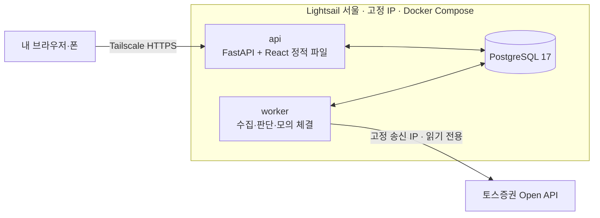

# Quant Lab

토스증권 공식 Open API의 미국 주식 일봉으로 규칙 기반 전략을 돌리고, **실제 주문 없이 내부 모의 체결(DRY RUN)** 로 신호·주문·잔고·판단 근거를 추적하는 개인용 퀀트 실험 도구입니다.

최종 목표는 퀀트 자동매매이고, 첫 완성 범위(MWP)는 "실거래 코드 경로가 아예 없는 상태에서 정기 모의 운영을 2주 동안 사람 개입 없이 돌리는 것"입니다.

| 문서 | 내용 |
| --- | --- |
| [docs/project.md](docs/project.md) | 설계의 단일 출처: 범위, 원칙, 아키텍처, 기술 스택, 인프라, 작업 방식 |
| [docs/roadmap.md](docs/roadmap.md) | 단계별 계획, 진행 상태, 백테스트·replay 결과 |
| [docs/tossApi.md](docs/tossApi.md) | 토스증권 Open API 조사·실측 결과 |

## 무엇을 하나

- **시세 수집** — 토스 일봉을 상장일부터 받아 PostgreSQL에 캐시하고, 누락·중복·비거래일·이상치를 검사합니다. 수정주가가 바뀌면 자동으로 전체를 다시 받습니다.
- **백테스트** — 전략 4종(골든크로스 50/200, Faber 200일선, Connors RSI(2), 터틀 돌파)을 매수 후 보유와 비교합니다. CLI와 화면 모두에서 실행·저장합니다.
- **정기 DRY RUN** — Worker가 미국 정규장 마감 2시간 뒤 완료된 일봉으로 판단하고, 다음 거래일 시가로 모의 체결합니다.
- **알림** — 경고·오류, 매매 신호, 모의 체결, Worker 재시작과 매일 평가 자산을 텔레그램으로 받습니다. Worker나 서버 자체가 멈추면 외부 heartbeat(Healthchecks.io)가 알립니다.
- **운영 화면** — 실행 상태 → 마지막 판단 이유 → 모의 잔고 순서로 보여주는 대시보드, 캔들 차트(신호·체결 마커), 백테스트, 로그. 시작·일시정지·중지·수동 실행.

## 설계에서 신경 쓴 것

| 문제 | 해결 |
| --- | --- |
| 백테스트 결과와 실제 운영이 어긋나는 문제 | 판단·체결 함수(`domain/trading.py`)를 백테스트와 Worker가 **같이** 씁니다. 과거 거래일마다 정기 평가를 재생하는 `replay`로 실제 QQQ 데이터에서 **체결까지 백테스트와 일치**하는 것을 확인했습니다 (689일 3건, 437일 17건). |
| 미래 데이터 참조 (look-ahead) | 전략은 판단일까지의 봉만 받습니다. 테스트가 "잘린 데이터와 전체 데이터의 판단이 겹치는 구간에서 같은지"를 검사합니다. |
| 진행 중인 봉으로 판단하는 문제 | 토스는 미국 정규장 **전부터** 당일 일봉을 데이마켓 체결로 채워 내려줍니다 (직접 호출해서 발견). 정규장 마감 + 2시간이 지난 봉만 완료로 보고, 저장 뒤 값이 바뀌면 재동기화로 감지합니다. |
| 중복 주문 | `bot + 종목 + 거래일 + 모드` 유일 제약, "봇당 대기 주문 1개" 부분 유일 인덱스, PostgreSQL advisory lock으로 Worker 1개만 실행. 같은 봉을 다시 평가하면 아무것도 하지 않습니다. |
| 토큰 경합 | 토스는 client당 유효 토큰이 1개라 새로 발급하면 이전 토큰이 무효가 됩니다. 토큰은 Worker 한 곳만 보유하고, API 컨테이너에는 토스 키가 아예 들어가지 않습니다. |
| 모를 때의 동작 | 데이터 지연·캘린더 불일치·토스 일시 장애는 판단 없이 `SKIPPED` 후 재시도, 허용 IP·인증 오류는 봇을 `ERROR`로 멈춥니다. 재시작하면 봇은 항상 `PAUSED`로 돌아와 사람이 확인합니다. |
| 돈과 시간 | 가격·금액은 `Decimal`/`numeric`(float 금지), DB 시각은 UTC, 장 판정은 `America/New_York`, 화면은 KST. |

## 아키텍처



- 공개 인바운드 포트가 없습니다. 화면과 SSH는 Tailscale로만 접근합니다.
- API와 Worker는 **DB를 통해서만** 대화합니다. 화면의 명령은 `commands` 테이블에 쌓이고 Worker가 15초 안에 처리합니다.
- `domain` 계층은 FastAPI·httpx·SQLAlchemy를 import하지 않습니다 (테스트로 강제).

```text
Worker 평가 1회
완료 봉 확인·검증 → 이전 대기 주문을 T+1 시가로 체결 → 전략 판단 → 모의 주문 → 잔고·다음 평가 시각 저장
(모두 한 트랜잭션, 실패하면 아무것도 바뀌지 않음)
```

## 백테스트 결과 예시 (QQQ, 수수료 0.1%, 슬리피지 5bp)

| 전략 | 2000~ CAGR / 최대 낙폭 | 2010~ CAGR / 최대 낙폭 |
| --- | --- | --- |
| 매수 후 보유 | 8.1% / -82.6% | 18.0% / -35.6% |
| **골든크로스 50/200** (운영 전략) | **10.5% / -36.3%** | 14.2% / -28.6% |
| Faber 200일선 | 7.3% / -55.5% | 11.5% / -25.6% |
| Connors RSI(2) | 1.7% / -16.2% | 1.1% / -16.0% |

추세 추종은 강세장에서 보유를 이기지 못하는 대신 낙폭을 줄입니다. 과최적화를 피하려고 파라미터 탐색은 하지 않았습니다. 자세한 비교는 [roadmap.md](docs/roadmap.md).

## 기술 스택

| 영역 | 사용 |
| --- | --- |
| Backend | Python 3.14, uv, FastAPI, Pydantic v2, SQLAlchemy 2, Alembic, psycopg 3, httpx, pandas, exchange_calendars |
| Frontend | React, TypeScript, Vite, TanStack Query, Lightweight Charts |
| Infra | Docker Compose, PostgreSQL 17, AWS Lightsail(Terraform), Tailscale |
| 품질 | pytest(핵심 불변식 위주), ruff, mypy strict, oxlint, GitHub Actions, `alembic check` |

## 로컬 실행

필요한 도구: [uv](https://docs.astral.sh/uv/), Python 3.14, Node.js LTS, Docker Desktop.

```bash
cp .env.example .env                      # 필요하면 값 채우기
docker compose up -d --wait db            # PostgreSQL 17
cd backend
uv sync
uv run alembic upgrade head
uv run uvicorn quant_lab.api.main:app --reload   # http://localhost:8000/api/health
uv run python -m quant_lab.worker                # 다른 터미널 (기본값: 토스 호출 없음)
cd ../frontend
npm install
npm run dev                                       # http://localhost:5173
```

## CLI

```bash
cd backend
uv run python -m quant_lab.cli sync-bars QQQ VOO                                # 토스 일봉 동기화 (처음 전체, 이후 증분)
uv run python -m quant_lab.cli backtest QQQ --params fast=50,slow=200 --save    # 백테스트
uv run python -m quant_lab.cli bot create qqq-sma QQQ --params fast=50,slow=200 # DRY RUN 봇
uv run python -m quant_lab.cli bot cmd <봇 ID> START                            # START·PAUSE·STOP·RUN_ONCE
uv run python -m quant_lab.cli replay QQQ --start 2024-01-02 --end 2026-09-30   # 정기 평가 재생 vs 백테스트
uv run python -m quant_lab.cli notify chat-id                                   # 텔레그램 채팅 ID 확인 (봇에게 먼저 메시지)
uv run python -m quant_lab.cli notify test                                      # 텔레그램 테스트 메시지
uv run scripts/toss_probe.py                                                    # 토스 API 읽기 전용 탐색
```

## 검사

```bash
cd backend
uv run ruff check . && uv run ruff format --check .
uv run python -m mypy          # Windows에서 mypy.exe가 막히면 이렇게 실행
uv run pytest                  # DB 테스트는 compose DB의 quant_lab_test 사용
cd ../frontend
npm run lint && npm run build
```

## 운영 배포

서울 리전 VM 1대에서 Docker Compose로 실행하고, 화면은 Tailscale로만 엽니다. 단계별 절차는 [project.md 6절](docs/project.md).

```bash
cd infra/lightsail && terraform apply   # 서버·고정 IP·자동 스냅샷 (AWS 자격 증명 필요)
sudo bash deploy/bootstrap.sh           # 새 서버에서 한 번
bash deploy/deploy.sh                   # 배포할 때마다 (main 기준)
```

## 프로젝트 구조

```text
backend/src/quant_lab/
  domain/        봉·전략·체결·백테스트 규칙 (외부 의존 없음)
  application/   일봉 동기화, DRY RUN 평가 1회, 백테스트, replay
  adapters/      토스 클라이언트, 거래소 달력
  persistence/   SQLAlchemy 모델·저장소
  api/           FastAPI
  worker/        Worker 루프 (advisory lock, 명령 처리, 예정 평가)
frontend/        React 운영 화면
deploy/          운영 compose, 서버 준비·배포·백업 스크립트
infra/lightsail/ Terraform
docs/            설계·로드맵·토스 API 조사
```

## 데이터와 범위에 대한 주의

- 토스증권 Open API 데이터는 본인 매매 목적으로만 쓸 수 있고 제3자 배포가 금지돼 있습니다. 이 저장소에는 시세 데이터를 넣지 않으며, 테스트는 합성 데이터로만 돌립니다.
- 모든 주문은 내부 모의 체결입니다. 실제 계좌 주문 기능은 별도 검증 단계 전까지 구현하지 않습니다.
- 투자 조언이 아니며, 백테스트 결과는 미래 수익을 보장하지 않습니다.
