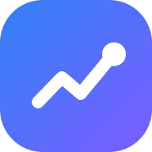
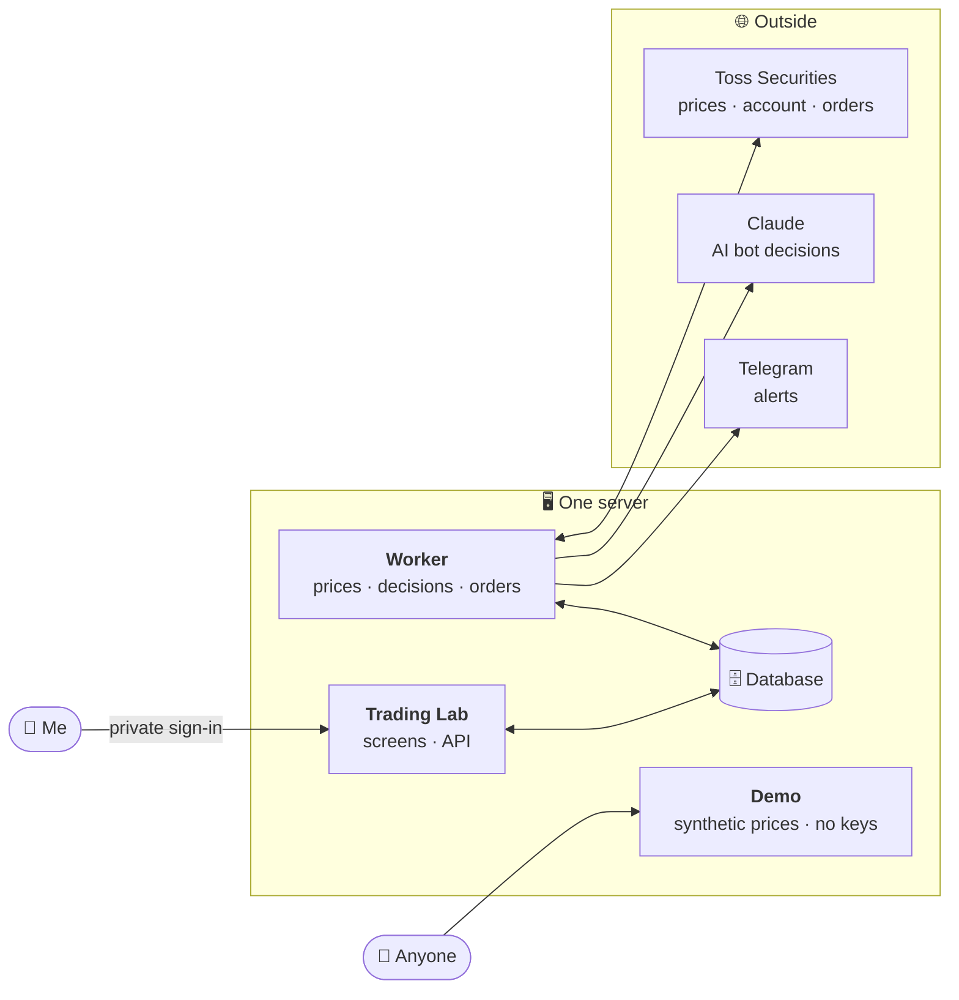
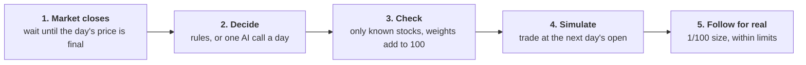

  

<h1 align="center">Trading Lab</h1>

A personal quant app where bots invest the way I do. Every decision is simulated first, then mirrored at 1/100 size in a real account if I choose.

<a href="https://demo.trading-lab.me"><b>Live demo →</b></a>

## What is Trading Lab?

Trading Lab runs small investing bots on US stock daily prices from the Toss Securities Open API. There are two kinds:

- **Copy-me bot.** A few questions turn my own investing habits into rules: how much I put in each month, whether I pause after a big rally, how far a drop has to go before I buy more.
- **AI bots.** Once a day after the US market closes, an AI (Claude) decides how to split money between a fixed watchlist of 10 stocks and ETFs and cash. The engine, not the AI, turns that into orders.

Every decision is first recorded as a simulated (dry-run) trade. If I turn it on, the same decision is also placed in my real brokerage account at 1/100 of the amount, to prove the bot behaves the same with real money.

It is a one-person app. It does not manage anyone else's money and there is no service behind it. The app itself is in Korean.

<table>
  <tr>
    <td align="center"> Home</td>
    <td align="center"> AI bot</td>
  </tr>
  <tr>
    <td align="center"> Copy me</td>
    <td align="center"> Try it</td>
  </tr>
</table>

Screenshots use the demo's synthetic prices, not real market data.

## Highlights

- **A bot that copies you.** Answer a few questions and get a bot that follows your own rules, not someone else's formula.
- **Parallel versions of you.** See how the last 10 years would have gone if you had changed one habit — for curiosity, not as a score.
- **AI bots that show their work.** Each day's call comes with a one-line decision, its reasons, target weights per stock and the news it read.
- **Two kinds of AI.** One reads the news. The other sees only price charts with names and dates hidden, so it cannot lean on what it remembers.
- **Real money, tiny amounts.** Real orders are 1/100 of the simulated ones, capped per order and per month, need approval above the limit, and can all be stopped with one switch.
- **Plain language.** Built for people new to investing: short explanations next to every term, light and dark themes, dollar or won view, and installable on a phone.

## What you can do

|                       |                                                                                          |
| --------------------- | ---------------------------------------------------------------------------------------- |
| **Copy me**           | Turn your habits into a bot and compare "invest like me" with "just buy every month".     |
| **Try it**            | Test the same rules on past prices, across up to 10 stocks.                              |
| **See what's next**   | How much each stock gets on the next payday, and how far prices are from buy or pause.   |
| **Watch AI bots**     | Today's call, the reasons and sources, and how it compares with the other bots.          |
| **Read the journal**  | Every decision a bot made, with what it did and why.                                     |
| **Follow for real**   | Mirror a bot's trades at 1/100 size in the real account.                                 |
| **Get alerts**        | Telegram messages for approvals, fills and problems.                                     |

## The bots

|                    | Copy-me bot                         | Market AI bot                                   | Candle AI bot                                        |
| ------------------ | ----------------------------------- | ----------------------------------------------- | ---------------------------------------------------- |
| **Decides with**   | My rules                            | News, rates and earnings found by web search    | Anonymized price charts only                         |
| **Asks**           | What if I had done it my way?       | Does knowing the market help pick better?       | Can AI beat my rules looking at the same prices?     |
| **Compared**       | Over the past 10 years              | From the day it starts, going forward           | From the day it starts, going forward                |

AI bots are never backtested on the past: the model already knows how the market turned out, so the result would look better than it is.

## How it fits together

The screens and the worker only talk through the database. Only the worker reaches the brokerage, the AI and Telegram, and the demo has its own database with no keys.

## A bot's day

If anything is unclear — late data, a failed AI call, an order with an unknown result — the bot does nothing that day and says why.

## Keeping it simple

One person, one server, one decision a day. No intraday trading, no scores or rankings, and the AI only ever chooses weights; buying, selling and limits stay with the engine.

## Disclaimer

This is a personal project, not investment advice and not a service. Toss Securities data may only be used for my own trading, so this repository contains no market data and the demo uses synthetic prices only. AI decisions can change from day to day for the same situation and can be wrong. Past results do not promise future returns.

## For developers

How it is built and run: [`docs/project.md`](docs/project.md) (design, operations, local setup), [`docs/roadmap.md`](docs/roadmap.md) (progress), [`docs/tossApi.md`](docs/tossApi.md) (brokerage API notes), [`AGENTS.md`](AGENTS.md) (working rules and checks).

## License

All rights reserved. See [LICENSE](LICENSE).
