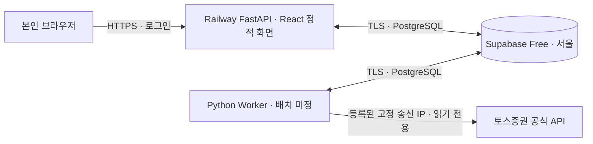

# Trading Lab 인프라

> **2026-10-01 MWP 배포 방향.** 웹·API는 Railway, 운영 DB는 Supabase Free PostgreSQL을 사용한다. 토스증권을 호출할 Worker의 배치는 **Railway Pro 직접 연결**과 **Railway Hobby + 소형 고정 IP 서버**를 연동 단계에서 비교해 확정한다. 아직 리소스나 애플리케이션 코드는 없고, **구현·배포는 사용자의 재개 요청 전까지 보류**한다. 기능 범위는 [프로젝트 문서](project.md)에 둔다.

## 시작 구성

| 구성 요소 | 선택 | 역할 |
| --- | --- | --- |
| 웹·API | Railway의 상시 FastAPI 서비스 1개 | 기존 React·TypeScript·Vite 빌드 결과와 REST API를 같은 서비스에서 제공한다. |
| Worker | API와 분리된 Python 실행 단위 1개 | 토스 시세 수집, 예약 평가, 백테스트와 내부 DRY RUN을 처리한다. Railway Pro 또는 고정 IP 서버 배치는 연동 단계에서 정한다. |
| 데이터베이스 | Supabase Free PostgreSQL, 서울 `ap-northeast-2` | 설정·명령·봉 캐시·실행 기록·모의 주문·포지션을 저장한다. API·Worker만 서버 측에서 접속한다. |
| 실행 지역 | Railway는 싱가포르 `asia-southeast1-eqsg3a`; 소형 서버를 선택하면 서울 후보 | [현재 Railway 배포 지역](https://docs.railway.com/deployments/regions)에 서울은 없다. Supabase 서울 DB와의 지역 간 연결·지연을 시험한다. |
| 외부 연결 | 토스 호출 프로세스의 고정 송신 IPv4 | [토스증권이 요구하는 허용 IP](https://developers.tossinvest.com/docs)에 실제 송신 IP를 등록한 뒤 호출을 검증한다. |

Railway Pro에서 Worker가 직접 토스를 호출할 때의 흐름이다. Hybrid 안에서는 **Worker 전체**를 고정 IP 서버로 옮기고, Railway에는 웹·API만 둔다. 두 안 모두 API와 Worker는 Supabase에서 명령·상태를 공유한다.

프론트엔드는 기존 **React·Vite** 설계를 유지한다. 인용된 대화의 Next.js·Vercel은 이 프로젝트에서 확정한 변경이 아니므로 도입하지 않는다. 서버에서 정적 파일을 함께 제공해 초기 운영 서비스를 두 개로 제한한다. Railway는 공개 도메인과 HTTPS를 제공하지만, 개인 대시보드의 접근 제어는 앱에서 구현·검증해야 한다. Worker는 공개 도메인을 만들지 않는다. Redis·RabbitMQ와 별도 시장 데이터·전략·AI Worker는 MWP에 넣지 않는다.

API와 Worker는 같은 Python 패키지를 각각 다른 시작 명령으로 실행한다. 두 프로세스가 Supabase의 명령·상태를 공유하며, DB 유일 제약과 트랜잭션으로 모의 주문 중복을 막는다. Worker가 죽거나 DB·토스 연결이 실패하면 신규 모의 주문을 중단하고 오류를 기록한다. 재시작 뒤 봇은 `PAUSED`로 복구한다. Railway에 상시 Worker를 둔다면 [Serverless 절전 모드](https://docs.railway.com/deployments/serverless)는 사용하지 않는다. 짧은 예약 작업으로 바꿀지는 봉 주기와 수동 실행 UX가 확정된 뒤 판단한다.

Supabase는 Railway 프로젝트 내부 DB가 아니다. API와 Worker는 공용 엔드포인트로 TLS 접속하며, IPv4 연결이 필요하면 [공유 세션 풀러](https://supabase.com/docs/guides/database/connecting-to-postgres)(포트 5432)를 쓴다. 연결 수를 작게 제한하고 실제 연결·Alembic 마이그레이션을 배포 전에 시험한다. 브라우저는 Supabase에 직접 접속하지 않고, Supabase Auth·Realtime도 사용하지 않는다.

## 토스 API 제약과 시세 수집 범위

- [토스 공식 가이드](https://developers.tossinvest.com/docs)에 따르면 REST·WebSocket 호출에는 OAuth 2.0 액세스 토큰이 필요하고, **등록되지 않은 송신 IP는 차단**된다. 시세 조회는 토큰으로 가능하지만 계좌·주문 API에는 계좌 식별 헤더가 추가로 필요하다. MWP에는 실제 계좌 주문을 넣지 않는다.
- [REST 캔들 API](https://developers.tossinvest.com/docs/market-data)는 1분봉·일봉을 제공한다. 현재 MWP는 **1종목의 완료된 봉을 사용한 정기 DRY RUN**이므로 이 경로를 먼저 검증한다. API 그룹별 호출 제한은 변경될 수 있으므로 응답 헤더와 `429`를 처리한다. 첫 종목의 실제 데이터 제공 여부·봉 시각은 호출해서 확인한다.
- [WebSocket](https://developers.tossinvest.com/docs/connection)은 실시간 체결·호가·주문 이벤트를 제공하며 허용 IP 검사를 handshake에도 적용한다. **계정당 동시 연결은 최대 2개**, 연결당 구독은 100건이다. 새 연결이 오래된 연결을 밀어낼 수 있고, 클라이언트 송신이 180초 없으면 연결이 종료된다. 실시간 단계에서는 단일 연결 담당자를 두고 60초 간격 PING, 재연결·재구독과 누락 데이터 복구를 처리한다. 실시간 tick을 완료 봉으로 간주하지 않는다.
- 여러 소비자가 실시간 시세를 필요로 할 때 고정 IP의 **Toss Gateway 1개가 WebSocket을 구독해 내부로 배포**하는 구조를 검토한다. Redis·메시지 큐는 필요성이 확인되면 추가한다. MWP에서는 REST로 받은 완료 봉과 실행 결과를 Supabase에 저장하며 원시 tick fan-out은 만들지 않는다.

## 토스 연동 시 배치·비용 결정

| 후보 | 월 기본 비용 | 토스 연결과 운영 부담 |
| --- | ---: | --- |
| Railway Pro에 API·Worker | [Pro $20/월](https://docs.railway.com/pricing/plans)부터 | Worker에 [고정 송신 IP](https://docs.railway.com/networking/static-outbound-ips)를 켜고 할당된 IP **모두**를 토스에 등록한다. 한 플랫폼에서 운영한다. |
| Railway Hobby API + 소형 고정 IP 서버 | [Hobby $5/월](https://docs.railway.com/pricing/plans) + [Lightsail 0.5 GiB $5/월 또는 1 GiB $7/월](https://aws.amazon.com/lightsail/pricing/) = **$10 또는 $12/월부터** | 고정 IP 서버에서 Worker 전체를 실행한다. Railway는 웹·API만 제공한다. 서버 관리와 두 환경 사이 장애 추적이 추가된다. |

각 Railway 플랜의 기본료에는 같은 금액의 리소스 사용액이 포함되며, 사용량이 이를 넘으면 초과분이 붙는다. [RAM $10/GB·월, CPU $20/vCPU·월, egress $0.05/GB](https://docs.railway.com/pricing) 기준으로 실제 사용량을 측정해야 한다. Lightsail 금액은 공인 IPv4 포함 Linux 번들 기준이며 인스턴스에 연결한 [static IP는 추가 요금이 없다](https://docs.aws.amazon.com/lightsail/latest/userguide/amazon-lightsail-frequently-asked-questions-faq-billing-and-account-management.html). 0.5 GiB에서 운영체제·Python Worker·백테스트가 동작할지는 측정 전까지 보장하지 않는다. Supabase Free는 월 $0이지만 무료 한도가 적용된다. 세금·환율·초과 사용량은 별도다.

Railway Pro의 고정 송신 IP는 서비스별로 설정하며 여러 IPv4에 트래픽을 분산한다. 토스 계정에서 **모든 IP를 허용 목록에 등록할 수 있는지**와 실제 송신 IP가 일치하는지 확인해야 한다. 서비스 지역을 바꾸면 IP도 바뀐다. Hobby + 소형 서버에서는 토스 토큰을 서버에만 두고, Worker가 정규화한 봉·모의 실행 결과를 Supabase에 기록해 API가 읽도록 한다. 서버에 공개 수신 포트·Redis·MQ를 둘 필요는 없다. API의 수동 실행 명령도 DB를 통해 Worker에 전달한다. 향후 실시간 소비자가 늘면 토스 연결 담당 Gateway와 전략 Worker를 분리할 수 있다. 실제 주문까지 지원한다면 주문 호출도 고정 IP 경로로 통과하도록 별도 설계·검증한다.

**결정 시점은 토스 연동 단계**다. 첫 봉 주기, 실제 메모리·CPU 사용량, 토스 허용 IP 등록 가능 여부, 두 환경 운영 부담을 비교해 Worker 배치를 확정한다. 그전에는 토스 어댑터와 전략 코드를 배치 위치와 분리해 설계한다.

Supabase Free의 [DB 500 MB와 월 egress 5 GB 한도](https://supabase.com/pricing), [초과 시 DB 읽기 전용 가능성](https://supabase.com/docs/guides/platform/database-size), [낮은 사용량에 따른 일시정지](https://supabase.com/docs/guides/platform/free-project-pausing)를 운영 제약으로 둔다. 봉 데이터는 필요한 범위만 보관한다. DB가 사용 불가하면 Worker는 신규 모의 주문을 하지 않는다. Railway 사용량 과금과 Supabase 한도는 각각 확인한다.

## 관리 범위

- 개발 PC에서는 PostgreSQL을 Compose로 띄울 수 있다. 운영 DB는 Supabase에 두며, 소형 서버를 선택해도 그 서버에 DB를 추가하지 않는다.
- Railway 구성은 재개 후 [Railway Infrastructure as Code](https://docs.railway.com/infrastructure-as-code)의 `.railway/railway.ts`로 관리한다. 기존 `railway.toml` 방식은 신규 서비스에 사용하지 않는다. 소형 서버를 선택하면 AWS 리소스는 Terraform으로 관리한다. Supabase 프로젝트·리전은 처음에는 콘솔에서 만들고 스키마는 Alembic으로 관리한다. 비밀값은 각 서비스의 비밀 설정에 두며 코드·Git·IaC에 넣지 않는다.
- 일상 운영은 Railway 배포·로그·메트릭과 Supabase 사용량을 확인하는 수준으로 시작한다. 정기 DB 덤프·복원 시험은 MWP의 필수 작업이 아니다. 파괴적인 스키마 변경 전에는 수동 백업과 되돌리기 방법을 정한다.
- 실제 주문은 별도 단계다. 배포 전에는 단일 사용자 인증, 데이터 연결, 토스 허용 IP, Railway 청구 상한과 Worker 재시작·오류 경로를 검증한다.

웹·API는 Railway로 정했지만 **토스 호출 Worker의 배치는 연동 단계에서 확정**한다. 사용자가 구현·배포 재개를 요청하면 비용·송신 IP·데이터 연결 가정을 먼저 확인하고 단계 0부터 진행한다.
