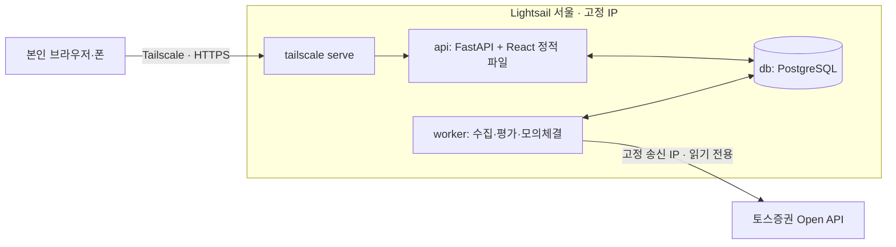

# Quant Lab 설계

> **이 문서가 설계의 단일 출처다.** 일정과 진행 상태는 [roadmap.md](roadmap.md), 토스 API 조사 결과는 [tossApi.md](tossApi.md)에 둔다.
> 결정이 바뀌면 그 변경을 담은 PR에서 이 문서도 함께 고친다. 최종 갱신: 2026-10-06.

## 1. 한 줄 정의

토스증권 공식 Open API의 미국 주식 시세로 규칙 기반 전략을 돌리고, **실제 주문 없이 내부 모의 체결(DRY RUN)**로 신호·주문·포지션·손익과 판단 이유를 추적하는 개인용 도구. 최종 목표는 퀀트 자동매매이며, 실거래는 DRY RUN이 검증된 뒤 별도 단계로 연다. **남에게 서비스하지 않고, 나를 대신해 투자하는 앱으로 만든다** (2026-10-03 결정, 이유는 12절).

### 제품의 중심: 나 카피 봇 (2026-10-02 결정)

**"내 투자 습관을 옮긴 봇이, 내가 실제로 투자하지 않은 달에도 내 방식대로 계속 투자했다면 어땠을지 보여준다."**

- **무엇이 다른가:** 비슷한 서비스는 남을 따라 하거나(카피 트레이딩: eToro·Tickeron), 규칙을 직접 설계하게 하거나(말로 전략 만들기: Composer by SoFi·Surmount), 정해진 금액을 기계적으로 산다(토스 주식 모으기, PayPay つみたてロボ). **"나"를 기준으로 만들고 "나"와 비교하는 서비스는 찾지 못했다** (2026-10-02 조사, 영어·한국어·일본어).
- **핵심 화면: 나 카피 봇 vs 매달 그냥 사기, 그리고 "평행세계의 나"** (2026-10-02 결정, 재미로 보는 비교). 같은 기간·같은 종목에서 **나 카피 봇**(내 규칙을 빠짐없이 지켰다면)과 **매달 그냥 사기**(기계적 적립)를 나란히 보여주고, 내 규칙을 조금씩 바꾼 **평행세계의 나**들을 함께 돌린다. 예: "고점에도 안 쉬는 나", "-20%까지 참았다가 몰아 사는 나", "더 일찍(-5%) 사는 나". 넣은 돈과 시점이 서로 달라도 비교할 수 있게 **넣은 시점을 반영한 연 수익률(XIRR)**로 맞춘다.
- **평행세계의 나 구현 (2026-10-03, `application/parallel.py`):** 내 규칙에서 **한 가지씩만** 바꾼 나들을 같은 일봉으로 그때그때 계산한다 (저장하지 않음, 일봉은 한 번만 읽음). 매달 그냥 사는 나(비교 기준), 고점에도 안 쉬는 나(또는 많이 오르면 쉬는 나), 떨어졌을 때만 사는 나(또는 매달 꾸준히 사는 나), -20%까지 참는 나, -5%에 바로 사는 나. 모두 같은 날 같은 돈을 넣는다 ("두 배로 넣은 나"는 결과가 뻔하고 수익률 비교만 어렵게 해서 뺐다, 2026-10-03). 순서는 결과와 상관없이 늘 같고, 지금 가치와 해마다 평균(XIRR, 1년 미만이면 넣은 돈 대비)만 보여준다. 다른 나를 고르면 나 만들기에서는 답을 그 규칙으로 바꾸고, 시험해 보기에서는 그 규칙으로 새 봇을 시작하며, 운영 중인 봇은 한 번 더 물은 뒤 다음 판단부터 그 규칙으로 바꾼다. 운영 중인 봇의 "나"는 첫 판단일부터 **지금 규칙**으로 다시 계산한 값이라 중간에 규칙을 바꿨다면 실제 기록과 다를 수 있다.
- **따라 하기: 미래는 "다음에 할 일"로** (2026-10-03, `application/plan.py`, `GET /api/bots/{id}/plan`). 과거는 평행세계의 나가 답하고, 미래는 나 카피 봇이 다음 입금일(휴장이면 다음 거래일)에 종목별로 살 금액·모아 둘 금액과 이유, "이 가격 아래면 몰아 사기(1년 최고가 - 하락장 기준) / 이 가격 위면 쉬기(200일 평균 + 고점 기준)"와 지금 가격까지의 거리, 모아 둔 돈이 어느 달 어느 종목 몫에서 왔는지를 홈에 보여준다. 다음 장에 체결될 예정 주문이 있으면 그것부터. 지금 가격이 그날까지 이어진다고 보고 실제 판단과 같은 규칙 함수(`decide_basket`)로 계산하며 규칙은 바꾸지 않는다. **사용자는 같은 날 같은 금액으로 실제 계좌(moomoo 등)에서 따라 하면 실제 투자가 된다** (실거래 연동 전에도). 비율 맞추기(리밸런싱)는 매수 타이밍이 핵심이라 봇 규칙에는 넣지 않고 평행세계의 "비율 맞추는 나"(새 돈을 덜 들고 있는 종목부터, 팔지 않음, `rebalance`)로만 둔다.
- **평가가 아니라 구경이다.** 점수·등수·"잘했다/못했다" 문장을 붙이지 않고 "이런 나였다면 지금 이만큼"만 보여준다. 마음에 드는 평행세계의 나가 있으면 그 규칙으로 바꿀 수 있다. "닮은 정도", "규칙을 지켰다면 얼마였나" 같은 성적표형 지표와 **실제 계좌와의 비교("실제 나")는 계획에서 뺐다** (2026-10-02, 사용자 결정: 압박을 주고, 실제 거래 증권사가 앱과 다른 경우가 흔하다. 사용자도 토스로 보고 일본 moomoo로 거래한다). 그래서 **증권사 연동 없이 질문만으로** 누구나 쓸 수 있다. 토스 계좌 조사(tossApi.md 9절)는 실거래 단계(마일스톤 3)를 위해 남긴다.
- **쉬운 질문으로 규칙을 만든다:** 전문 용어 대신 "월급날 얼마 넣나요? 많이 올랐을 땐 쉬나요? 얼마나 떨어지면 몰아 사나요?" 같은 질문에 답하면 정해진 규칙 틀(입금·고점·하락·매도)의 값이 채워진다. 이후 AI(Claude API)가 자유 대화로 묻게 할 수 있다 (N6, **선택으로 보류** 2026-10-03: 사람은 자기 투자 방식을 정확히 말로 설명하기 어려워 선택지로 고르게 하는 편이 더 정확하고 만족도도 높다. roadmap.md N6). **구현 (2026-10-03, "질문으로 나 만들기", `#me`):** 한 화면에 질문 하나씩 5개(평소 사는 종목·비율 → 한 달에 넣는 돈 → 넣는 날 → 많이 올랐을 때 → 많이 떨어졌을 때)를 고르면 `dip_saver` 값이 되고(`frontend/src/me.ts`), 쉬운 말 요약과 지난 10년 "나처럼 했다면 vs 매달 그냥 샀다면"(같은 돈·같은 날, 해마다 평균은 XIRR)을 보여준 뒤 버튼 하나로 모의 투자 봇을 만들어 시작한다. 매도는 묻지 않고 "팔지 않아요"로 둔다. 들어가는 곳: 봇이 없을 때 홈, 홈 봇 목록의 "나 만들기", 설정 제목 메뉴. **보완 (2026-10-03):** 첫 화면에서 "지금부터 당신의 투자 습관을 복사할게요"로 무엇을 하는지(1분, 정답 없음, 계좌 연결 안 함)와 끝에 무엇을 보여주는지 먼저 안내한다. "주로 어떻게 사나요?"(매달 꾸준히 / 떨어졌을 때만)를 묻고, 금액은 "투자에 쓰는 돈의 한 달 평균"으로 물어 매달 사지 않는 사람에게도 의미가 있게 한다 (넣는 돈과 사는 때를 나눈다). 떨어졌을 때만 사는 사람은 넣는 날·고점 질문을 건너뛴다 (질문 4개). 넣는 날은 "정해진 날 없어요"(말일 무렵으로 계산)를 고를 수 있다.
- **복사할 수 없는 투자 (2026-10-03 결정):** 그때그때 기분이나 뉴스를 보고 사고팔거나, 며칠·몇 주 단위로 자주 사고파는 투자는 규칙으로 옮길 수 없어 나 카피 봇의 대상이 아니다. "매달 얼마, 많이 오르면 쉬고, 떨어지면 몰아 사기"처럼 말로 정할 수 있는 습관만 따라 하고, 파는 습관은 아직 복사하지 않는다. 질문 첫 화면에 이 한계를 적어 둔다. 규칙 함수가 판단해야 백테스트와 DRY RUN이 같고(원칙 3) 재현된다(원칙 9)는 원칙을 지키기 위한 선택이다.
- **AI의 역할은 "질문 → 규칙 값"까지다** (규칙 봇. 마일스톤 4의 **AI 봇**만 AI가 종목 비중을 판단한다, 14절, 2026-10-06). AI는 사고팔 날을 정하지 않는다. AI가 낸 값은 정해진 규칙 틀(스키마)로 검증하고, 쉬운 말 요약과 10년 백테스트를 보여준 뒤 사람이 확정한다. 판단은 언제나 규칙 함수가 하므로 백테스트·DRY RUN 일치(원칙 3)와 재현성(원칙 9)이 그대로 유지된다. MWP의 "AI 전략 제외"와 충돌하지 않는다.
- **평행세계 화면이 재미있게 나오면 홈의 첫 화면으로 한다.** 지금의 봇별 홈은 "봇 하나 자세히 보기"로 내려간다. **구현 (2026-10-03):** 나 카피 봇(나처럼 모으기 봇)이 있으면 홈 첫 화면은 위에서부터 "나처럼 했을 때 vs 매달 그냥 샀다면"(넣은 돈 대비, 판정 문장 없음), 월간 정리 한 줄("9월에 나 카피 봇은 $675어치 샀어요. 떨어졌을 때만 사는 나는 사지 않고 모아 뒀어요." 이번 달에 아무도 안 샀으면 지난달), 평행세계의 나, 오늘의 판단, [자세히 보기]다. 자세히 보기(`#bot`, 홈 탭 안)는 예전 봇 화면(자산 그래프·들고 있는 주식·거래·가격 그래프·매매 시작/멈춤)이다. 나 카피 봇이 없으면 홈은 예전처럼 봇 화면이고, 봇 목록 아래에서 나 만들기를 권한다.
- 첫 단추로 "나처럼 모으기" 전략(정기 입금·고점 쉬기·하락장 몰아 사기·팔지 않기)과 "매달 그냥 사기" 비교를 만들었다 (7절). 실제 가격 10년 백테스트(월 $675)에서 QQQ +188.2% vs +188.3%, VOO +105.7% vs +107.5%로 거의 같았다. 라쿠텐증권의 S&P500 25년 검증(적립 + 하락 시 추가 매수, 2026-02)도 연 0.5~0.8%p 개선에 그쳤다. 즉 규칙 하나하나의 차이는 작고, 그래서 결과를 성적표가 아니라 **"이런 나였다면" 하고 가볍게 구경하는 재미**로 보여주는 편이 맞다. 작업 순서는 [roadmap.md](roadmap.md)의 "나 카피 봇" 트랙.

## 2. 첫 완성 범위 (MWP)

| 포함 | 제외 (MWP 이후) |
| --- | --- |
| 사용자 1명, 미국 상장 종목, USD, 소수점 수량(6자리, 금액 기준), 매수·매도 | 실제 계좌 주문, 공식 모의투자(토스에 없음) |
| **봇 하나가 여러 종목**(최대 10개, 모으기 전략만, 비율 합 100, 현금 공유, 2026-10-02~). 봇 여러 개를 홈 오른쪽 봇 목록에서 골라 하나씩 보기 (운영: `QQQ`, `TQQQ` 같은 전략 비교) | 봇 여러 개를 묶는 포트폴리오 위험 한도 |
| 규칙 전략 5개 중 선택(사고팔기 4개 + 매달 넣고 사 모으는 "나처럼 모으기"), 봉 주기 **1개**(일봉) | AI 전략. 전략 편집기는 계획에서 뺐다 (2026-10-02) |
| 백테스트와 정기 DRY RUN이 같은 전략 함수 사용 | 실시간 시세로 판단하기, WebSocket 시세 |
| **실시간 화면 표시**: Worker가 거래 시간 중 30초마다 현재가와 진행 중 일봉을 REST로 받아 "지금 가치"와 차트의 오늘 봉(흐리게)에 반영 (판단에는 안 씀) | |
| 홈·시험해 보기·설정 화면, 시작·일시정지·중지·수동 1회 실행, 앱 안의 기록(최근 활동). 텔레그램 알림은 만들었지만 기본으로 끈다 (2026-10-02) | |
| **레버리지 ETF**(QLD·TQQQ·SOXL) 백테스트·DRY RUN: 배수 표시, 주의 안내, 이상치 기준 완화 | 레버리지 전용 위험 한도 (보유 기간·손절 등) |
| 재시작 복구, 중복 모의 주문 방지, 데이터 이상 시 주문 차단 | |

관심 목록: `VOO`, `QQQ`, `QLD`, `TQQQ`, `SOXL`, `NVDA`, `GLD`, `MAGS`, `EWY`, `EWJ` (`WATCHLIST_SYMBOLS`). Worker가 하루 한 번 토스 `/stocks`로 레버리지 배수를 `instruments`에 저장하고, 배수가 1보다 크면 하루 변동 이상치 기준을 50%에서 90%로 넓힌다.

**MWP 완료 조건:** 서버에서 정기 DRY RUN이 돌고, 중복 주문 0건, 데이터 이상·API 실패 때 신규 주문 차단이 기록되며, 화면에서 현재 상태와 마지막 판단 이유를 바로 이해할 수 있다. 처음 정했던 "2주 무개입 운영"과 백업 복원 연습은 하지 않기로 했다 (2026-10-04, 사용자 결정: 운영하면서 고치고, 복원 절차는 필요할 때 만든다).

## 3. 반드시 지킬 원칙

이 프로젝트에서 틀리면 비용이 큰 것들이다. 코드 리뷰 기준으로도 쓴다.

1. **실거래 경로는 스위치 뒤에만 있다.** MWP에는 주문 어댑터가 없었다. 마일스톤 3 R2(2026-10-04~)부터 토스 주문 어댑터(`adapters/toss/trader.py`, `Trader` 규약)가 있지만, Worker는 `LIVE_TRADING=true`일 때만 만든다. 꺼져 있으면 실제 주문 코드가 동작할 길이 없다. 켜져 있어도 봇마다 "실제로 따라 사기"를 켜야 하고, 처음 3번은 사람이 승인해야 나가며, 모으기 봇은 사기만 하고 한도(주문 1건 $20, 한 달 $50)를, 사고팔기 봇(R3, 2026-10-06~)은 봇 현금 × 1/100으로 사고(한 건 $150) 이 봇이 실제로 산 수량만 판다. 한도를 넘으면 다시 묻는다. 모의 체결은 그대로 `adapters/sim`과 `domain/trading.py`가 맡는다.
2. **완료된 봉만 쓴다.** 진행 중인 봉으로 판단하지 않는다. 토스는 미국 날짜 D의 일봉을 정규장 전부터 데이마켓 체결로 채워 내려주므로, **D일 정규장 마감 + 여유 시간 전의 D일 봉은 버린다.** 백테스트도 같은 규칙을 따르며, 판단 시점 이후의 데이터를 참조하면 테스트가 실패해야 한다.
3. **판단과 체결을 분리한다.** T 봉으로 판단하고 T+1 봉 규칙으로 체결한다. 백테스트와 DRY RUN이 같은 규칙을 쓴다.
4. **판단 하나에 주문은 최대 하나다.** `bot_id + symbol + bar_ts + mode`에 DB 유일 제약을 건다. Worker가 실수로 두 개 떠도 중복 주문이 생기지 않는다.
5. **모르면 멈춘다.** 데이터 누락·지연, API 오류, 장 운영 판정 불일치, DB 오류가 있으면 신규 주문 없이 이유를 기록한다. 단, Worker 재시작은 "모르는 상태"가 아니다. 평가가 멱등이고 체결가가 봉 데이터로 정해지므로, 실행 중이던 봇은 재시작 뒤 그대로 이어서 돌고 밀린 평가를 바로 처리한다 (2026-10-02 변경, roadmap Phase 4 장애 기록).
6. **토스 토큰은 Worker 한 곳에서만 발급한다.** 토큰은 클라이언트당 1개만 유효해서, 두 곳에서 발급하면 서로를 무효화한다. API 서버는 토스를 호출하지 않는다.
7. **돈과 시간은 정확한 타입으로 다룬다.** 가격·금액은 `Decimal`(DB `numeric`)로 저장하고 float를 쓰지 않는다. DB 시각은 UTC로 저장하고, 장 판정은 `America/New_York`, 화면 표시는 KST로 한다.
8. **비밀값과 시세 데이터는 저장소에 넣지 않는다.** 토스 데이터는 제3자 배포가 금지돼 있다. 테스트 fixture는 합성 데이터로 만들고, 실제 응답은 로컬에서만 쓴다.
9. **재현할 수 있어야 한다.** 모든 실행·백테스트는 전략 버전, 파라미터, 데이터 범위, 비용 가정을 함께 저장한다. AI 봇(14절)은 판단마다 입력·출처·출력·모델·지침 버전을 기록하고, 기록된 판단으로 다시 돌리면 같은 결과가 나와야 한다 (AI를 다시 부르면 다를 수 있으므로 판단 자체가 재현의 원본이다).

## 4. 아키텍처

서울 리전 VM 한 대에서 Docker Compose로 DB·API·Worker를 실행한다. 공개 인바운드 포트는 없고, 화면과 SSH 접근은 모두 Tailscale로만 한다.



### 구성 요소

| 구성 요소 | 책임 | 하지 않는 일 |
| --- | --- | --- |
| **worker** | 토스 토큰 보유, 시세 수집, 장 운영 판정, 정기 평가, 위험 검사, 모의 체결, 백테스트 실행, heartbeat | HTTP 요청 처리 |
| **api** | 화면 제공, 조회 API, 명령 기록(시작·중지·수동 실행·백테스트 요청), 설정 저장 | 토스 호출, 긴 계산 |
| **db** | 모든 상태의 원본. 봉 캐시, 설정 버전, 명령 큐, 실행·판단·주문·체결·포지션·이벤트 | — |
| **frontend** | 상태 확인과 제어. API를 주기적으로 조회 (MWP는 polling) | 비즈니스 로직 |

API와 Worker는 같은 Python 패키지를 다른 진입점으로 실행한다. 둘은 **DB를 통해서만 대화한다.** API가 `commands` 테이블에 명령을 쓰면 Worker가 읽어 처리하고 결과를 기록한다. 큐 시스템(Redis·Celery 등)은 필요해질 때까지 두지 않는다.

### 코드 구조

```text
backend/
  src/quant_lab/
    domain/          # 순수 로직: 봉, 지표, 전략, 위험 규칙, 모의 체결 규칙 (외부 의존 없음)
      broker.py      # 증권사 연결 규약(Broker)과 증권사와 무관한 시세·계좌 형식, 오류 2종
      events.py      # 이벤트 종류·내용 형식·이유 코드 (엔진 → 알림·화면 규약)
    application/     # 유스케이스 (FastAPI를 모른다)
      dry_run.py     #   평가 1회 (엔진)
      bots.py        #   봇 관리: 만들기·설정·종목·이름·초기화·삭제·명령
      bot_status.py  #   봇 상태 계산: 종목별·실시간 평가, 마지막 판단, 자산 곡선
      queries.py     #   조회: 일봉(+진행 중 봉), 종목, 최근 활동, 기록
      research.py    #   계산해 보기: 백테스트, 평행세계, 따라 하기
      messages.py    #   알림·화면 공용 문장
      errors.py      #   서비스 오류 3종 (NotFound·Invalid·Conflict)
    adapters/toss/   # 토스 HTTP 클라이언트, 토큰 관리, 응답 → domain/broker 형식 변환
    adapters/sim/    # 모의 브로커
    persistence/     # SQLAlchemy 모델, 리포지토리
    api/             # FastAPI 진입점. routes/는 요청 해석 → 서비스 호출 → 응답 변환만 한다
    worker/          # Worker 진입점과 루프
  migrations/        # Alembic
  tests/
frontend/            # React + Vite
deploy/              # 운영용 compose, 서버 준비 스크립트, 백업 스크립트
infra/lightsail/     # Terraform: Lightsail 인스턴스·Static IP·방화벽·자동 스냅샷
compose.yaml         # 로컬 개발용 (PostgreSQL)
```

`domain`은 FastAPI, httpx, SQLAlchemy를 import하지 않는다. 토스 어댑터(`adapters/toss`)는 조립 지점(`worker/__main__.py`, `cli.py`)만 import하고, 엔진·저장소·API는 `domain/broker.py`의 규약과 형식만 안다. 두 규칙 모두 테스트(import 검사)로 강제한다. 그래서 증권사를 바꾸려면 `Broker` 규약을 지키는 어댑터 하나를 만들고 조립 지점만 바꾸면 된다. **이름과 개념도 나눈다 (2026-10-04, 사용자 결정):** 엔진·저장소·API·화면 코드의 표·함수·경로 이름에 증권사 이름(toss)을 쓰지 않는다 (`broker_account`, `/api/broker-account`). 증권사별 규칙(토스 멱등 키 10분, 금액 주문 접수 시간, 오류 코드, 계좌 헤더 등)은 어댑터 안에만 두고, 엔진에는 규약의 값(접수 시간대, 멱등 유효 시간, 증권사 무관 거절 이유 코드)으로만 넘긴다. 저장 데이터에 남는 것은 출처 코드(`source`)뿐이고, 사람이 읽는 증권사 이름은 프론트엔드 `source.ts`가 정한다. 증권사 이름이 남아도 되는 곳은 어댑터, 조립 지점(Worker 진입점·CLI·설정 `TOSS_*`), 문서뿐이다.

### Worker 평가 1회의 흐름

```text
명령 확인 → 장 운영 판정 → 완료 봉 수집·검증 → 이전 대기 주문 체결(T+1 규칙)
→ 전략 판단 → 위험 검사 → 모의 주문 생성 → 상태·다음 평가 시각 저장 → heartbeat
```

1. **Worker는 하나만 동작한다.** 시작할 때 PostgreSQL advisory lock을 잡고, 못 잡으면 잡을 때까지 기다린다. 토스 토큰도 이 프로세스만 보유한다.
2. 잠금을 얻으면 `RUNNING` 봇은 그대로 두고 "이어서 실행" 이벤트를 남긴다. `next_evaluation_at`이 지났으면 첫 tick에서 바로 평가한다. 놓친 거래일은 기존처럼 기록만 한다.
3. 15초마다 heartbeat → 미처리 명령 → `RUNNING`이면서 `next_evaluation_at`이 지난 봇 평가 순서로 돈다.
4. 평가 대상은 "정규장 마감 + 2시간이 지난 가장 최근 거래일"이다. 여러 종목 봇은 **모든 종목**의 그날 봉이 있고 판단 구간 검사를 통과해야 판단한다 (하나라도 아니면 전체를 미룬다: 현금을 함께 쓰므로 일부만 먼저 판단하면 백테스트와 순서가 달라진다). 토스 캘린더가 거래일이 아니라고 하거나, 그날 봉이 없거나, 판단 구간 봉에 누락·이상치가 있으면 판단 없이 `SKIPPED`를 남기고 15분 뒤 다시 시도한다.
5. 이전 대기 주문은 판단일 다음 거래일 시가로 체결한다. 체결·판단·주문·잔고 변경은 한 트랜잭션이다.
6. `bot_id + symbol + session_date + mode` 유일 제약과 "봇당 대기 주문 1개" 부분 유일 인덱스가 중복 모의 주문을 막는다. 같은 봉을 다시 평가하면 아무것도 하지 않는다.
7. 증권사 오류는 두 종류로만 본다. `BrokerAccessError`(허용 IP·인증, 토스 403·401 반복)와 예상하지 못한 오류는 봇을 `ERROR`로 바꾸고, 그 밖의 `BrokerError`(429·5xx·네트워크)는 `SKIPPED` 후 재시도한다. 어댑터가 httpx 오류까지 이 두 종류로 바꿔 넘긴다.
8. Worker가 멈춰 있던 동안의 거래일은 소급 판단하지 않고 `missed_sessions` 경고만 남긴다.
9. 봇 평가와 별도로 30분마다 관심 종목(`WATCHLIST_SYMBOLS`, 기본 10종목) 일봉이 최신 완료 거래일까지 있는지 보고, 뒤처진 종목만 증분 동기화한다 (백테스트 데이터 최신화). 실패는 경고만 남긴다.
10. 토스 모드에서는 하루 한 번 관심·봇 종목 정보(레버리지 배수)를, 미국 거래 시간(뉴욕 일 20:00~금 20:00, 데이마켓 포함) 중 30초마다 봇 종목 현재가와 진행 중 일봉(`/candles` 최신 1개)을 받아 저장한다. 원/달러 매매기준율(`Broker.exchange_rate`)은 거래 시간과 상관없이 한 시간마다 `exchange_rates`에 저장한다 (W1, 화면 원화 보기). 화면 표시용이라 실패해도 로그만 남긴다.
11. **실제 증권사 계좌 읽기 (실거래 R1, 2026-10-04~):** 조립 지점이 계좌 읽기를 켜면(운영: `TOSS_ACCOUNT_ENABLED=true`, 토스 모드에서만) 한 시간마다 `Broker.account_snapshot`으로 주문 가능 금액(달러·원)·보유·최근 30일 주문을 읽어 `broker_account`에 덮어쓴다. 계좌번호와 원본 응답은 저장하지 않고, 출처 코드(`source`)만 남겨 화면 이름("토스증권 계좌")은 프론트엔드가 정한다. 실패하면 마지막 값은 두고 종류(`access` 권한·허용 IP / `temporary` 일시 장애)와 시각만 적는다. 주문은 내지 않는다. **실제 계좌 대조 (2026-10-04~):** 읽을 때마다 종목별로 "계좌 보유 ≥ 봇이 실제로 사서 체결된 수량 합계(체결 10분 뒤부터)"인지 본다. 직접 산 주식이 섞일 수 있어 같은지가 아니라 적지 않은지만 본다(봇은 사기만 한다). 적으면 따라 사기 봇을 모두 다시 승인 단계로 돌리고, 맞을 때까지 매번 승인을 받으며, 결과가 바뀔 때만 `live_reconcile`로 알린다.
12. **실제로 따라 사기 (실거래 R2, 2026-10-04~, `application/live.py`):** 매 tick마다 (1) 따라 사기를 켠 봇(`bots.live_ratio`, 켠 뒤의 모의 매수만)의 새 모의 매수마다 실제 주문을 하나 만든다: 금액 = 모의 매수 예산 × 비율(센트 아래 버림), 낼 날 = 판단 다음 거래일. 레버리지 종목·비상 중지면 건너뛰고, $1 미만이면 버리지 않고 모아 두었다가(`reason=carried`) 같은 종목 다음 주문에 더해 $1이 넘으면 함께 산다(`carried_into`, 2026-10-04 사용자 결정), 연속 성공이 3번 미만이거나 한도를 넘으면 승인을 기다린다. (2) `Trader.order_window`가 열리고 5분 뒤 `SENDING`으로 먼저 적고(commit) `place_amount_buy`로 보낸다. 결과를 모르면 `Trader.idempotency_window` 안에서만 같은 키로 다시 보내고, 그 뒤에는 `find_orders`로 찾으며 못 찾으면 `UNKNOWN`. 창이 닫히면 놓친 주문은 넘긴다. **달러 부족:** 주문을 만들 때 마지막으로 읽은 달러 잔고와 그날 주문 합계를 비교해 모자라면 미리 알리고(`live_funds`), 보내기 직전 `Trader.available_cash`로 다시 확인해 모자라면 보내지 않고 넘긴다(`no_funds`, 다음 달에 더하지 않음). 돈 부족은 연속 성공을 지우지 않는다. (3) 보낸 주문은 1분마다 `get_order`로 체결을 확인한다. 체결이면 연속 성공 +1, 거절·취소·확인 불가면 0으로(다시 승인부터). 이벤트 `live_order`로 알림(승인 요청·체결·문제). 실패해도 모의 판단과 무관하다.

봇 상태(`STOPPED`, `RUNNING`, `PAUSED`, `ERROR`)는 Worker 프로세스의 생존과 별개다. 명령: `START`(→ RUNNING, 즉시 1회 평가), `PAUSE`(RUNNING → PAUSED), `STOP`, `RUN_ONCE`(상태는 그대로 두고 1회 평가). 화면에는 "멈추기(`PAUSE`) / 시작(`START`)"만 둔다. `STOP`과 `RUN_ONCE`는 일반 사용자에게 차이가 없거나(판단은 하루 한 번 자동) 헷갈려서 API·CLI에만 남긴다. 화면에서는 `PAUSED`와 `STOPPED`를 모두 "멈춤"으로 보여준다.

판단·체결 함수(`domain/trading.py`)는 백테스트와 Worker가 함께 쓴다. `replay` CLI로 과거 거래일마다 정기 평가를 재생해 백테스트와 체결이 같은지 확인한다.

### 핵심 데이터

| 테이블 | 내용 |
| --- | --- |
| `daily_bars` | `(symbol, session_date)` PK, 미국 거래일 기준. OHLCV(`numeric`, 정밀도 제한 없음, 수정주가), `source`, `fetched_at`. 1분봉은 필요해질 때 별도 테이블 |
| `bots` | 대표 종목(`symbol`, 첫 종목)과 종목·비율 목록(`symbols`, JSONB `[{symbol, weight}]`), 전략 이름·파라미터, 상태·사유, 초기 현금, 수수료·슬리피지, 위험 한도, `next_evaluation_at` |
| `bot_accounts` | 봇의 모의 현금·실현 손익·**넣은 돈**(`contributed`, 시작 금액 + 입금, 수익률의 기준)·모아 둔 돈(`reserve`, 모으기 전략이 고점 때 쌓아 두고 하락장에만 쓰는 현금) (실제 토스 계좌와 무관) |
| `bot_deposits` | 모으기 전략의 정기 입금. `(bot_id, month)` PK로 한 달 한 번 |
| `bot_positions` | 봇의 종목별 보유 수량(소수점 6자리)·평균 단가(수수료 포함). `(bot_id, symbol)` PK |
| `commands` | 화면 명령 큐 (`START`, `PAUSE`, `STOP`, `RUN_ONCE`), 처리 시각·결과 |
| `runs` | 평가 1회: 계기(정기·수동), 대상 거래일, `OK`·`SKIPPED`·`ERROR`, 사유 |
| `decisions` | 판단·사유·지표·차단 사유, **당시 전략·비용·위험 한도 스냅샷**. 유일 키 `bot_id + symbol + session_date + mode` |
| `sim_orders` | 모의 주문(판단당 최대 1개, 종목 `symbol`, **봇·종목당 대기 주문 1개**): `PENDING` → `FILLED`·`UNFILLED`, 체결일·수량·가격·수수료·실현 손익, 모으기 매수 예산(`budget`, 없으면 현금 전부) |
| `backtests` | 입력 조건(여러 종목이면 `symbols`에 종목·비율, 데이터 범위, 전략·파라미터, 비용, 위험 한도, 코드 버전)과 지표·체결·판단·자산 곡선 |
| `events` | 심각도별 기록 (텔레그램 알림·최근 활동의 원본). 종류(`EventKind`)와 종류별 `data` 형식, 판단을 미룬·멈춘 이유 코드는 `domain/events.py`가 정한다. 알림 문장은 `data`만 읽고 `message`(로그 원문)는 해석하지 않는다. 모든 종류가 문장으로 바뀌는지 테스트가 확인한다 |
| `instruments` | 종목명, 유형, 레버리지 배수 (토스 `/stocks`, 하루 한 번) |
| `quotes` | 종목별 최신 현재가 1행 (`price`, `quoted_at`). 화면 "지금 가치"용, 판단에는 안 씀 |
| `exchange_rates` | 통화 쌍(`base`·`quote`)마다 최신 환율 1행: 매매기준율(화면 환산), 살 때 환율(참고), 시각, 출처 코드. 판단·주문·저장 금액은 늘 달러이고 원화는 화면에서 바꿔 보기만 한다 (W1) |
| `live_orders` | 실제 주문 (실거래 R2). 모의 매수 1건에 최대 하나(`sim_order_id` 유일), 중복 방지 키(`key`, 판단 키에서 만듦) 유일. 상태 `WAITING_APPROVAL`→`APPROVED`→`SENDING`(보내기 전에 먼저 적음)→`SENT`→`FILLED`, 또는 `SKIPPED`·`REJECTED`·`CANCELED`·`UNKNOWN`. 이유 코드, 증권사 주문 번호, 출처 코드, 체결 수량·금액. 봇을 지우거나 다시 시작해도 남는다(연결만 비움) |
| `live_control` | 실거래 전체 상태 1행: 비상 중지, Worker에 주문 어댑터가 있는지(출처 코드, 꺼지면 NULL), 실제 계좌 대조 결과(`shortfall`: 보유가 봇이 산 수량보다 적은 종목, `checked_at`) |
| `notify_settings` | 텔레그램 알림 설정 1행: 켜기, 범위(`live` 실제 주문만 / `all`), Worker에 토큰이 있는지 |
| `broker_account` | 실제 증권사 계좌를 마지막으로 읽은 결과 1행 (실거래 R1): 출처 코드, 주문 가능 금액(달러·원), 보유·최근 주문(JSONB, 금액은 문자열), 읽은 시각, 마지막 실패 종류. 모의 봇 기록과 섞지 않는다 |
| `live_bars` | 종목별 진행 중 일봉 1행. API `/bars`가 완료 봉보다 새 날짜일 때만 `live: true`로 끝에 붙인다. `daily_bars`와 섞지 않는다 |
| `ai_judgments` | AI 판단 기록 (마일스톤 4, 14절). 봇·판단일마다 1행(유일), 지우지 않는다. 결과(`OK`·`FAILED`·`INVALID`·`OVER_BUDGET`), 넘긴 입력 요약, 목표 비중(현금은 `CASH`)·이유·시장 요약, 검색한 말·출처(주소·제목), 모델·지침 버전·출처 코드, 토큰·검색 횟수·비용, 실패 이유. 시험 판단(CLI)은 봇 없이 |
| `worker_heartbeat` | Worker 마지막 생존 시각, 버전 |

## 5. 기술 스택

| 영역 | 선택 | 이유 |
| --- | --- | --- |
| 언어·패키지 | Python 3.14, **uv** | 빠른 설치와 잠금 파일 (`backend/.python-version`) |
| API | FastAPI, Pydantic v2, pydantic-settings | 타입 기반 검증, 설정 분리 |
| DB 접근 | SQLAlchemy 2.0, Alembic, psycopg 3 | 마이그레이션 관리, `numeric` ↔ `Decimal` |
| HTTP | httpx (동기 클라이언트로 시작) | Worker는 단일 루프. 비동기는 필요할 때 |
| 데이터 처리 | pandas | 지표·백테스트 계산 |
| 시장 달력 | `exchange_calendars` (XNYS) + 토스 캘린더 | 토스는 3영업일만 제공 |
| 테스트·품질 | pytest, respx(HTTP 목, Phase 2), ruff, mypy(strict) | Windows에서는 `python -m mypy`로 실행 |
| DB | PostgreSQL 17 (로컬·운영 모두 컨테이너) | 같은 버전으로 개발·운영 |
| 프론트엔드 | React, TypeScript, Vite, oxlint, TanStack Query·Lightweight Charts(Phase 4) | polling·캐시, 금융 차트 |
| 실행 | Docker Compose | 로컬 → Lightsail → OCI/홈서버로 그대로 이동 |
| 접근 | **`https://app.trading-lab.me`** (Cloudflare Tunnel + Access, 본인 이메일만, 2026-10-03~). Tailscale(`tailscale serve`)은 관리용·예비 경로로 남긴다 (6절) | 공개 포트 0개, MWP에 로그인 구현 불필요 |
| CI | GitHub Actions (`.github/workflows/ci.yml`): ruff, mypy, pytest(+PostgreSQL 17 서비스), oxlint, tsc·vite build | PR과 `dev`·`main` push |

## 6. 인프라와 운영

### 운영 환경

| 항목 | 선택 |
| --- | --- |
| 서버 | AWS Lightsail **서울(ap-northeast-2), 2GB RAM / 2 vCPU**, Ubuntu 24.04 LTS |
| 비용 | 약 $12/월 (공인 IPv4 포함 번들. 생성 시 서울 리전 가격 확인). Tailscale·GitHub 비공개 저장소는 무료 |
| 고정 IP | Lightsail Static IP를 붙이고 그 IP를 토스 허용 IP에 등록 |
| 방화벽 | 처음엔 Lightsail 콘솔 브라우저 SSH(22번, 콘솔 대역만)만 허용. Tailscale SSH가 동작하면 인바운드 전부 차단 |
| 비밀값 | **저장소 안 `.secrets/`** (`.gitignore`·`.dockerignore`로 제외, 로컬·서버 같은 위치): `env`(DB 비밀번호·`DATABASE_URL`, 부트스트랩이 생성)와 `worker.env`(토스 키·`TOSS_ACCOUNT_ENABLED`·텔레그램·`HEARTBEAT_PING_URL`, **worker 컨테이너에만** 주입). 둘 다 권한 600. 개발용 실행은 루트 `.env`를 쓴다. **토스 키 만료 2027-09-28** (발급 2026-09-28, 1년). 만료 전 WTS에서 재발급하고 `worker.env` 교체 |
| 서버 생성 | Terraform(`infra/lightsail`). 콘솔에서 손으로 만들지 않는다 |
| 배포 (MWP) | 서버에서 `bash deploy/deploy.sh`: `main` pull → 이미지 빌드(프론트 포함 단일 이미지) → `compose up -d`. 데모도 같은 이미지라 이때 함께 바뀐다(따로 배포하지 않음). `index.html`은 `no-cache`, 해시 붙은 `assets/`는 오래 캐시해 배포 뒤 바로 새 화면이 보인다. 저장소는 읽기 전용 deploy key로 받음. Compose 프로젝트 이름은 `quant-lab-prod` |
| 마이그레이션 | `migrate` 일회성 서비스가 성공해야 api·worker가 시작 (`depends_on: service_completed_successfully`) |
| 백업 | `deploy/backup.sh`를 cron이 매일 03:00 UTC(12:00 KST, 평가 시각과 겹치지 않음)에 실행, `pg_dump` 7일 보관 + Lightsail 자동 스냅샷. 파괴적 마이그레이션 전에는 수동 덤프 |
| 모니터링 | 화면의 heartbeat·마지막 실행 표시, `docker compose logs`, 앱의 기록(최근 활동·전체 기록 서랍). **텔레그램 알림은 2026-10-02부터 기본으로 끈다** (`TELEGRAM_ENABLED=false`): 실거래가 없는 모의 투자와 "나 카피 봇" 방향에는 즉시 알림이 필요 없고, 소식은 앱에서 본다. 코드는 남겨 두어 `TELEGRAM_ENABLED=true`로 다시 켤 수 있다(실거래 단계에서 다시 검토). 켜면 Worker가 `events` 테이블을 따라가며 경고·오류, 매수·매도 신호, 모의 체결, 설정 변경, Worker 재시작 후 이어서 실행을 보내고, 매주 마지막 거래일 판단 뒤에는 **주간 리포트**(이번 주 자산 변화(입금 제외), 그냥 보유 대비, 거래 횟수)를 보낸다. **아무것도 하지 않는 날의 일일 점검과 월급 입금은 앱 기록에만 남긴다** (2026-10-02: 봇마다 매일 오던 알림이 거래·문제 알림을 묻어서). 한 번에 생긴 소식(예: 아침 07:00 봇 여러 개의 체결·점검·주간 리포트)은 한 통으로 묶어 보낸다(3,800자 넘으면 나눔). 봇 삭제·처음부터 다시 시작도 알린다. 알림 실패는 판단에 영향이 없다. **외부 heartbeat**: `HEARTBEAT_PING_URL`(Healthchecks.io 등)에 5분마다 신호를 보내 Worker·PC·서버가 멈추면 외부 서비스가 알린다 |

**Healthchecks 알림을 한국어로** (선택, 사용자가 Healthchecks 화면에서 설정): 기본 HealthchecksBot 메시지는 영어라, Integrations → Webhook으로 우리 텔레그램 봇이 직접 보내게 할 수 있다. 대가로 텔레그램 봇 토큰을 Healthchecks에 저장하게 된다 (이 봇은 내 채팅에 메시지만 보낼 수 있어 유출 영향은 작다). 설정 후 HealthchecksBot 연동은 지운다.

| 항목 | 값 |
| --- | --- |
| URL (down·up 공통) | `https://api.telegram.org/bot<봇 토큰>/sendMessage`, 방식 `POST` |
| 헤더 | `Content-Type: application/json` |
| down 본문 | `{"chat_id": "<채팅 ID>", "text": "⚠️ Quant Lab 프로그램이 응답하지 않아요
20분 넘게 신호가 없어요. PC나 서버가 꺼졌는지 확인해 주세요."}` |
| up 본문 | `{"chat_id": "<채팅 ID>", "text": "✅ Quant Lab 프로그램이 다시 응답해요"}` |

배포 자동화(GitHub Actions에서 Tailscale로 SSH 배포)는 수동 배포가 번거로워지면 도입한다. 서버 리소스는 처음부터 Terraform으로 관리한다.

**서버 준비 절차** (Terraform과 스크립트로 재현한다):

| 단계 | 누가 | 작업 |
| --- | --- | --- |
| 1. AWS 자격 증명 | 사용자 | IAM 사용자(Lightsail 권한만)의 액세스 키를 만들고 개발 PC에서 `aws configure`로 입력 (키는 Claude·저장소에 넘기지 않음) |
| 2. 서버 생성 | 사용자 실행 | `cd infra/lightsail && terraform init && terraform plan && terraform apply` → 인스턴스(서울 2GB, Ubuntu 24.04), Static IP, 자동 스냅샷, 방화벽(브라우저 SSH만). 출력된 `static_ip`를 메모 |
| 3. 토스 허용 IP | 사용자 | WTS > 설정 > Open API > 허용 IP에 `static_ip` 추가 |
| 4. Tailscale 먼저 | 사용자 | Lightsail 콘솔의 브라우저 SSH에서 `curl -fsSL https://tailscale.com/install.sh \| sh && sudo tailscale up --ssh --hostname quant-lab` → 링크로 로그인. 개발 PC에도 Tailscale 설치·로그인 |
| 5. 원격 작업 | Claude (개발 PC → `tailscale ssh ubuntu@quant-lab`) | deploy key 생성 → `gh repo deploy-key add`(읽기 전용) → `git clone` → `sudo bash deploy/bootstrap.sh` → `sudo tailscale serve --bg 8000` |
| 6. 토스 키·알림 | 사용자 | `.secrets/worker.env`에 토스 키, 텔레그램 토큰·채팅 ID, `HEARTBEAT_PING_URL` 입력 (`tailscale ssh` 또는 브라우저 SSH, 키는 대화에 붙이지 않음) |
| 7. Tailscale 접근 제한 | 사용자 | 필요하면 Tailscale ACL에서 서버 접근을 본인 기기로만 제한 (개인 tailnet이면 기본값으로 충분) |
| 8. 배포·봇 시작 | 서버 | 로컬에서 토스를 호출하는 프로세스를 모두 멈춘 뒤 `bash deploy/deploy.sh` → `docker compose -f deploy/compose.prod.yaml exec api python -m quant_lab.cli bot create qqq-sma QQQ --params fast=50,slow=200` → 화면에서 시작 |

브라우저 SSH용 22번 포트(Lightsail 콘솔 대역만)는 Tailscale SSH가 동작하면 `aws_lightsail_instance_public_ports`에서 지워 인바운드를 모두 닫는다. Terraform 상태 파일(`*.tfstate`)은 개발 PC에만 두고 Git에 넣지 않는다.

### 도메인과 바깥 접속 (마일스톤 2 끝, 2026-10-02 결정)

Tailscale 앱 없이 폰·다른 PC에서 주소만으로 들어오기 위해 **도메인 + Cloudflare Tunnel + Cloudflare Access(이메일 인증)**로 화면 접속을 옮긴다. 여전히 **본인만** 쓰는 구성이다 (토스 데이터는 제3자에게 보여줄 수 없다, tossApi.md 1절). 누구나 쓰는 서비스는 하지 않는다 (12절).

| 항목 | 계획 |
| --- | --- |
| 도메인 | Cloudflare Registrar 또는 다른 등록 업체에서 구매하고 DNS를 Cloudflare에 둔다. 비용은 연 $10~15 정도 (구매 시 확인) |
| Tunnel | `cloudflared` 컨테이너를 운영 Compose에 추가해 서버에서 Cloudflare로 **밖으로만** 연결한다. 공개 인바운드 포트는 계속 0개, api는 지금처럼 127.0.0.1(컨테이너 네트워크)만 듣는다. Tunnel 토큰은 `.secrets/cloudflared.env` |
| Access | 앱 앞에 Access 정책을 두고 **본인 이메일 한 개만** 허용 (이메일로 받은 일회용 코드로 로그인). 화면에 로그인을 따로 만들지 않는다. 세션 유지 기간은 길게(예: 1개월) 잡아 PWA로 열 때 자주 묻지 않게 한다. 무료 플랜 범위(사용자 수 한도)는 착수 시 확인 |
| SSH | 서버 관리용 SSH는 Tailscale을 그대로 쓴다. 화면 접속만 옮긴 뒤 Tailscale을 완전히 뺄지는 그때 정한다 |
| API 이중 확인 | Access가 막지만 정책 실수로 열리는 일에 대비해, api가 **Cloudflare를 거쳐 온 요청(`cf-ray` 헤더)**은 Access 토큰(`Cf-Access-Jwt-Assertion` 헤더 또는 `CF_Authorization` 쿠키, RS256)을 팀 공개 키와 AUD 태그로 확인하고 없으면 403 (`api/access.py`). Tailscale로 온 요청은 그대로 둔다. `.secrets/env`에 `CF_ACCESS_TEAM`·`CF_ACCESS_AUD`가 있을 때만 켜진다. **Access 로그인은 되는데 화면에 `{"detail":"로그인이 필요해요"}`가 나오면** `CF_ACCESS_AUD`가 지금 Access 앱의 AUD 태그와 다른 것이다 (2026-10-04에 겪음: 로그인 페이지 주소의 `kid` 값이 AUD). `.secrets/env`를 고치고 `api`만 다시 띄운다 |
| PWA | Access 뒤에서는 매니페스트 요청에도 로그인 쿠키가 필요하므로 `<link rel="manifest" crossorigin="use-credentials">` |
| 확인 | Access 로그인 없이 도메인으로 열면 화면·API 모두 막히는지, 서버 공인 IP로 직접 들어오는 경로가 없는지 |

**연결 완료 (2026-10-03):** 주소 `https://app.trading-lab.me`, Zero Trust 팀 `nameless-fire-1e28` (팀 이름은 고유해야 해서 자동 이름을 그대로 쓴다), Access 앱 `app`(정책 `Quant Lab`: 본인 이메일 하나, 세션 1개월, 로그인은 일회용 코드), 터널 `quant-lab`(Public hostname → `http://api:8000`). 확인한 것: 로그인 없이 `/`·`/api/*`·매니페스트 모두 Access 로그인으로 넘어감(앱 ID가 `CF_ACCESS_AUD`와 같음), Cloudflare를 거친 것처럼 꾸민 요청은 토큰 없거나 가짜면 api가 403, api는 `127.0.0.1:8000`에만 열림(공개 포트 0개), 폰(Tailscale 끔)·노트북에서 로그인 후 정상, Tailscale 주소도 그대로 동작.

**Tailscale은 이제 필요할 때만:** 도메인 접속은 Tailscale과 상관없이 인터넷으로 된다 (폰에서 Tailscale을 꺼 둬도 된다. 확인할 때 끈 것은 Tailscale 없이도 열리는지 보려고). 서버 PC의 Tailscale은 관리용·예비 경로로 켜 둔다. **나중에 Lightsail 같은 서버로 옮기면** Cloudflare One 앱(기기 전체 트래픽을 보내는 회사용 클라이언트)보다 **Access 브라우저 SSH**(같은 터널, 같은 이메일 정책)로 관리 접속까지 옮겨 Tailscale을 뺄 수 있다. 그때 정한다.

**연결 순서 (2026-10-03 준비 완료, 계정·결제 단계는 사용자가 한다):**

| 단계 | 누가 | 할 일 |
| --- | --- | --- |
| 1. 도메인 | 사용자 | Cloudflare 계정을 만들고 도메인을 산다 (Cloudflare Registrar면 DNS가 바로 Cloudflare에 있다). 다른 곳에서 샀다면 네임서버를 Cloudflare로 바꾼다 |
| 2. Zero Trust | 사용자 | Cloudflare 대시보드 → Zero Trust에서 팀 이름을 정한다 (무료 플랜, 결제 수단 등록이 필요할 수 있다). 팀 이름이 `CF_ACCESS_TEAM` |
| 3. Tunnel | 사용자 | Networks → Tunnels → 새 터널(Cloudflared) → 설치 화면의 토큰을 `.secrets/cloudflared.env`에 `TUNNEL_TOKEN=...`로 저장 (대화에 붙이지 않는다). Public Hostname: 고른 주소(예: `lab.<도메인>`) → 서비스 `HTTP` `api:8000` |
| 4. Access | 사용자 | Access → Applications → Self-hosted, 같은 주소. 정책: Allow, Emails = 본인 이메일 하나. 로그인 방법은 One-time PIN, 세션 1개월. 애플리케이션의 AUD 태그를 `CF_ACCESS_AUD`로 `.secrets/env`에 (팀 이름도 함께) |
| 5. 배포·확인 | Claude | `bash deploy/deploy.sh`(토큰 파일이 있으면 tunnel이 켜짐) → 로그인 없이 막히는지, 로그인 후 화면·API·PWA 설치가 되는지, API가 Access 토큰 없는 Cloudflare 요청을 403으로 막는지 확인 |

### 로컬 운영 리허설 (서버 생성 전, 2026-10-01~)

Lightsail도 VM 한 대에 같은 Compose를 올리는 구조라, 서버가 준비되기 전까지 **개발 PC에서 운영 구성 그대로** 돌린다. 운영 이력(판단·모의 체결)을 미리 쌓고, 서버로 옮길 때 백업·복원 절차를 함께 검증한다.

| 항목 | 내용 |
| --- | --- |
| 비밀값 | 저장소 안 `.secrets/env`, `.secrets/worker.env` (서버와 같은 위치·형식, Git 제외) |
| 실행 | `docker compose -f deploy/compose.prod.yaml up -d --build` (Compose 이름 `quant-lab-prod`, 개발용 DB와 분리) |
| 접속 | `tailscale serve --bg 8000` → `https://<PC 이름>.<tailnet>.ts.net` (tailnet 안에서만) |
| 토스 | 개발 PC 공인 IP가 허용 목록에 있어야 한다. 이 Worker가 토큰을 가지므로, 동작 중에는 개발용 CLI(`sync-bars`, `toss_probe`)로 토스를 호출하지 않는다 |
| 한계 | PC가 꺼지거나 절전에 들어가면 평가가 빠진다 (`missed_sessions` 경고). 가정용 IP가 바뀌면 토스 403 → 봇 `ERROR` |
| 서버로 이전 | 로컬 Worker 정지 → `pg_dump` → 서버에서 `pg_restore` → 서버 Worker 시작 → 로컬 스택 `down`. Worker를 두 곳에서 동시에 돌리지 않는다 |

### 로컬 개발

개발 PC에서는 `compose.yaml`로 PostgreSQL만 띄우고 API·Worker·프론트엔드는 각각 직접 실행한다. **토스 client는 계정당 1개만 발급된다 (2026-10-01 확인).** 같은 client로 토큰을 발급하면 다른 쪽 토큰이 무효화되므로, 서버 Worker가 동작한 뒤로는 로컬에서 토스를 호출하지 않는다. 로컬 개발은 저장된 봉(서버 DB 덤프)이나 합성 데이터로 한다. Worker는 기본값 `WORKER_MARKET_SOURCE=stored`로 토스를 호출하지 않고, 운영 서버만 `toss`로 둔다. 로컬 호출이 꼭 필요하면 서버 Worker를 멈추고 호출한 뒤 다시 시작한다. 허용 IP는 여러 개 등록할 수 있어 개발 PC IP와 서버 IP를 함께 둔다.

```bash
docker compose up -d db
uv run alembic upgrade head
uv run uvicorn quant_lab.api.main:app --reload
uv run python -m quant_lab.worker
npm --prefix frontend run dev
```

(구현 후 사용할 명령이다. 현재 코드는 없다.)

### 이전 계획 (Lightsail → OCI / 홈서버)

- 서버에 의존하는 것은 Compose 파일, env 파일, DB 덤프뿐이므로 새 서버에서 `pg_restore` 후 같은 Compose를 실행하면 된다.
- **송신 IP가 바뀐다.** 허용 IP는 여러 개 등록할 수 있으므로 새 IP를 먼저 추가하고, 구 서버 Worker를 멈춘 뒤 새 Worker를 시작하고, 마지막에 구 IP를 지운다. Worker를 두 곳에서 동시에 돌리지 않는다 (토큰 경합).
- **홈서버는 가정용 회선 IP가 바뀔 수 있다.** 이때는 토스 호출만 고정 IP를 가진 소형 VPS를 거쳐 나가게 한다 (WireGuard 또는 Tailscale exit node). Lightsail을 가장 작은 플랜으로 줄여 송신 게이트웨이로 남기는 것이 가장 간단한 후보다.

## 7. 전략·백테스트 규칙

| 항목 | 값 |
| --- | --- |
| 봉 주기 | **일봉 (결정).** 미국장은 한국 밤 시간이라 사람이 지켜보기 어렵고, 하루 한 번 평가라 실패 지점이 적다. 토스 일봉은 상장일부터 제공된다 |
| 평가 시각 | 정규장 마감(서머타임 KST 05:00, 표준시 06:00, 조기 폐장 반영) **+ 2시간** 이후. 저장 뒤 값이 바뀌면 동기화가 `resync`로 감지한다 |
| 체결 규칙 | T일 종가로 판단 → **T+1일 시가로 체결** (보통 전략은 전량, 모으기 전략은 정한 예산만큼). DRY RUN도 T+1 시가가 확정된 뒤 같은 가격으로 체결을 기록 |
| 비용 | **토스증권 공식 요율**: 위탁수수료 0.1% ($0.01 미만 절사), 매도 시 SEC Fee max(매도대금×0.00206%, $0.01) 추가. 슬리피지 5bp(매수는 올리고 매도는 내림). 환전 수수료는 USD 기준 DRY RUN이라 제외. 실행 기록에 함께 저장 |
| 전략 | 잘 알려진 단일 종목 전략 4개: `sma_cross`(골든크로스 50/200, 기본값), `trend_filter`(Faber 200일선), `rsi2`(Connors RSI(2) 눌림목), `donchian`(터틀 채널 돌파). 수량은 체결 시점 현금으로 **금액 기준·소수점 6자리** 계산(토스 금액 주문과 같음, 최소 주문 $1, $10 이하 수수료 무료), 위험 한도(종목 최대 보유 금액, 1회 최대 주문 금액) 적용 |
| 모으기 전략 (`dip_saver`, "나처럼 모으기", 2026-10-02) | 사용자의 실제 투자 습관을 옮긴 전략. **매달 `day`일(기본 25일, 휴장이면 그 뒤 첫 판단일) `deposit`달러(기본 $1,350)를 넣고 팔지 않는다.** 종목은 최대 10개를 비율대로 한 계좌로 다룬다 (예: VOO 50·QQQ 50). 판단일마다: 종가가 최근 252일 종가 최고보다 `dip`%(10) 이상 낮으면 **모아 둔 현금까지 모두** 사고, 200일 평균보다 `hot`%(10) 이상 높으면 사지 않고 현금으로 모으고 (`hot=0`이면 고점에도 쉬지 않는다), 그 밖에는 입금일에 **그달 입금액만큼** 산다 (`regular=0`, "떨어졌을 때만 사기"이면 평소에도 사지 않고 모아 두다가 하락장에만 산다. 2026-10-03). 여러 종목이면 입금일에 고점인 종목의 몫은 모아 둔 돈이 되고, 평소인 종목들은 모아 둔 돈을 뺀 현금을 비율대로 나눠 사며, 하락장인 종목들은 남은 현금을 모아 둔 돈까지 비율대로 나눠 산다 (`decide_basket`) (지난달까지 남은 잔돈 포함. 첫 판단일에는 시작 금액을 그달 입금으로 본다). 쉬는 날 들어온 돈은 `bot_accounts.reserve`(모아 둔 돈)로 따로 두고 하락장에만 쓴다. 모의 체결이 소수점(금액 기준)이라 주가($700대)가 월 입금액보다 비싸도 입금액만큼 그대로 산다. 전략은 `Signal.spend`(`DEPOSIT`·`ALL`·`NONE`)로 쓸 돈만 알려 주고, `decide`가 예산(`budget`)을 정해 주문에 남기며, 이미 들고 있어도 더 산다. 입금은 `DepositPlan` 한 규칙을 백테스트와 DRY RUN이 같이 쓰고, DRY RUN은 `bot_deposits`(봇·월 PK)로 한 달 한 번을 보장한다. 실제 가격(2016-10~2026-09, 월 $675) 백테스트에서 QQQ +188.2% vs 매달 그냥 사기 +188.3%, VOO +105.7% vs +107.5%로 거의 같았다 (평균 현금 비중 2~4%, 소수점 체결 기준). **규칙 고르기 (2026-10-02):** 매달 넣는 돈(프리셋)과 따로 "고점에 쉬기"(+10·+15·+20%·안 쉼)와 "하락장 기준"(-10·-15·-20%)을 고른다 (`StrategyInfo.choices`, 프리셋을 바꿔도 유지). 하락장에서 쓰는 돈은 "모아 둔 돈 전부" 하나만 둔다: "절반"은 한 번의 하락장에 한 번만 쓰도록 하락장 단위 상태가 더 필요하고, Worker가 멈춘 날이 있으면 백테스트와 어긋나기 쉽다. 매도는 계속 안 함. **상장 1년 미만 종목 (2026-10-03):** 이력 전체가 warmup(252일)보다 짧은 종목은 한 달(`min_bars` 21거래일) 이력부터 있는 만큼의 최고가·평균으로 판단하고, 판단 이유도 "상장 뒤 최고가"·"상장 뒤 N일 평균"으로 쓴다. 이력이 warmup보다 긴 종목은 예전처럼 warmup을 채운 날부터 판단하므로 기존 백테스트 결과는 그대로다 (실제 가격으로 재확인). 실제 가격(2016-10~, 월 $1,350, QQQ 50·VOO 50) 12가지 조합이 모두 +145~149%로 매달 그냥 사기(+147.9%)와 ±2%p 안이었다 |
| 백테스트 데이터 | 토스 일봉 `adjusted=true`, 상장일부터 (QQQ 1999-03-10~, 닷컴·2008·2020·2022 하락장 포함) |
| 비교 기준·지표 | 같은 기간 매수 후 보유 (입금이 있으면 같은 돈을 넣자마자 다음 날 시가에 사는 "매달 그냥 사기"). 총 수익률(넣은 돈 대비), 연평균(입금이 있으면 넣은 시점을 반영한 XIRR, 없으면 CAGR), 최대 낙폭·연 변동성·샤프 지수(무위험 0)·연도별 수익률(입금 효과를 뺀 시간가중 수익률), 보유 비중, 승률 |
| 위험 한도 | 종목별 최대 보유 금액·1회 주문 금액 구현. 일봉 1종목은 거래일당 판단 1회라 하루 주문 수는 구조적으로 1건 이하. 하루 손실 한도·주문 간 최소 간격은 다종목·장중 전략 도입 때 추가 |

## 8. 화면

**원칙: 주식을 잘 모르는 사람도 쓸 수 있게 한다 (토스 스타일).** 전문 용어 대신 쉬운 말을 쓰고, 꼭 필요한 용어는 ⓘ와 도움말(용어 설명)로 풀어 준다. 파라미터는 직접 입력하지 않고 선택지로 고른다. 판단 이유·알림·활동 문장은 `application/messages.py` 한곳에서 만들어 텔레그램과 화면이 같은 말을 쓴다. 디자인은 Robinhood식 구성(큰 숫자 하나와 자산 그래프가 먼저)에 Vercel·Raycast식 톤을 따른다: 회색 단계와 가는 선으로 구획을 나누고, 카드는 요약 패널과 봇 목록에만 쓰며, 상태는 칩 대신 색 점과 글자로, 주 버튼은 검정(어두운 테마는 흰색) 하나에 나머지 동작은 ⋯ 메뉴로 둔다. 글꼴은 숫자·영문 Geist, 한글 Pretendard다. 밝은 테마와 어두운 테마를 둘 다 지원한다. 기본은 시스템 설정을 따르고 헤더의 밝기 메뉴로 바꾸며, 고른 값은 브라우저에만 저장한다. 색은 `index.css` 토큰에서만 가져오고 차트도 같은 토큰을 읽어 테마가 바뀌면 다시 그린다. 로고는 글자색 사각형 위의 상승선 마크 + "Quant Lab" 워드마크이고, "모의 투자" 안내는 자산 그래프 아래 한 줄과 도움말에서 한다. 가격·손익 색은 국내 관례대로 **오르면 빨강, 내리면 파랑**(매수 빨강, 매도 파랑)이고, 상태 색(정상 초록, 오류 빨강)과는 토큰을 나눠 쓴다(`--rise`/`--fall` vs `--ok`/`--bad`). PWA 매니페스트와 아이콘이 있어 폰에서 "홈 화면에 추가"하면 주소창 없이 앱처럼 열린다 (서비스 워커·오프라인 캐시는 없음: 항상 최신 데이터를 본다). 봇 화면은 1개씩 본다. 홈 오른쪽(폰에서는 맨 위) 봇 목록(상태·최근 3개월 자산 미니 그래프·수익률)에서 고르고, 고른 봇은 브라우저에 기억한다. 홈 첫 화면의 자산 그래프는 `GET /api/bots/{id}/equity`가 첫 판단일부터 체결 기록을 장 마감 가격에 다시 적용해 만든 하루 단위 값이며, 마우스를 올리면 큰 숫자가 그날 값으로 바뀐다. 최근 활동은 첫 화면에서 빼고 거래 내역의 "전체 기록 보기" 서랍으로 옮겼다 (2026-10-02). 가격 차트는 확정 봉이 바뀔 때만 다시 그리고 오늘 진행 중 봉은 제자리에서 갱신해 확대·이동 상태를 유지한다.

| 화면 | 내용 |
| --- | --- |
| 홈 | 지금 모의 자산(큰 숫자, 기간 손익은 그사이 넣은 돈을 뺀 값)과 자산 그래프(1주~전체, 3개월이 안 된 봇은 전체가 기본, 회색 선은 같은 돈으로 그냥 보유, 점선 계단은 넣은 돈, 산 날·판 날 점), 제어(멈추기 또는 시작 + 설정), 자산 그래프 아래 비교 줄(이 봇·그냥 보유·넣은 돈과 한 줄 평가), 요약 패널(다음 판단·마지막 판단·평가 손익·확정 손익, 모으기 봇은 확정 손익 대신 넣은 돈), 오늘의 판단(쉬운 말 이유), 들고 있는 주식, 가격 차트(3개월~3년, 평균선·산 날·판 날), 거래 내역(최근 5건, 전체 기록 서랍), 전략 소개, 오른쪽 봇 목록 오른쪽 봇 목록 아래 **실제 계좌 카드**(달러·원화 주문 가능 금액·이번 달 실제로 산 금액·승인 기다림 수, 누르면 숫자 자리를 같은 높이의 회색 둥근 막대로 가리고(눈 아이콘에 사선) 이 브라우저에 기억, 2026-10-04). 실제로 따라 사기를 켜면 맨 위에 "실제로 살까요?" 승인 카드 |
| 시험해 보기 | 홈과 같은 2단 구성. 왼쪽 위에 시험 양식(전략 카드·종목·기간), 그 아래 결과: "$10,000로 시작했다면" 최종 금액 큰 숫자와 수익, 그냥 보유와 비교한 한 줄 평가, 전략 vs 그냥 보유 자산 곡선(비율 눈금), 쉬운 이름의 지표 요약 패널(연평균 수익률, 가장 크게 떨어진 폭, 가격 출렁임, 위험 대비 수익 점수, 투자 중이던 기간), 해마다 결과(차이 %p), 거래 내역(접어 둠). 양식의 선택은 지금 보이는 결과에 맞춰진다. 오른쪽(폰에서는 맨 아래)에 지난 시험 목록. **"이 전략으로 모의 투자 시작"**을 누르면 종목·전략이 채워진 새 봇 양식으로 간다 |
| 설정 | **맨 위 "계좌와 알림"(봇과 무관, 2026-10-04):** 실제 증권사 계좌(잔액·보유·최근 주문), 텔레그램 알림(끄기·실제 주문만·모의 투자 소식까지, 테스트), 실제 주문 모두 멈추기. 그 아래 봇 설정: 홈에서 고른 봇 하나를 보여준다. Vercel식 섹션 구성: 제목 "봇 이름 설정 ▾" 메뉴로 봇 전환·"+ 새 봇 만들기", 왼쪽 섹션 설명·오른쪽 입력, 저장 버튼 하나, 맨 아래 빨간 테두리의 되돌릴 수 없는 동작(처음부터 다시 시작·봇 삭제). 전략 카드, 반응 속도(프리셋), 체결 가격 가정(보수적/보통/이상적), 최대 투자 금액. 수수료는 토스 요율 고정. **돌아가는 중에도 바꿀 수 있고 다음 판단부터 적용**된다 (API와 Worker 평가가 같은 봇 행을 잠가 순서가 정해진다). 주식을 들고 있는데 전략을 바꾸면 "다음 판단에서 팔 수 있다"고 안내. 이름 바꾸기, 바꾼 기록, 봇 관리(처음부터 다시 시작: 잔고·판단·거래 기록 초기화, 봇 삭제). 새 봇은 이름을 종목·전략으로 자동 제안하고, 기본으로 만들자마자 시작해 홈에서 보여준다 |

전략 별명: 느긋한 추세 타기(`sma_cross`), 200일선 지킴이(`trend_filter`), 급락 줍줍(`rsi2`), 신고가 올라타기(`donchian`), 나처럼 투자(`dip_saver`). 이모지 대신 규칙 그림(`StrategyGlyph`)을 쓴다. 로그 화면은 두지 않는다 (원시 기록은 API `/api/events`로만).

## 9. 결정 현황

| 항목 | 상태 | 메모 |
| --- | --- | --- |
| 첫 종목 | **결정: `QQQ`** (2026-10-01) | 이력이 가장 길고(1999~) 하락장 표본이 많다. VOO는 두 번째 후보 |
| 첫 전략과 파라미터 | **결정: `sma_cross` 50/200** (2026-10-01, 사용자 확인) | 백테스트 비교는 [roadmap.md](roadmap.md) Phase 2 결과 참고 |
| 봉 주기 | **결정: 일봉** (2026-10-01) | 정규장 마감 + 2시간 뒤 평가 |
| 초기 모의 현금 | **결정: $10,000** | |
| 수수료·슬리피지 | **결정: 0.1% + 매도 SEC Fee · 5bp** | 2026-10-02 계좌 수수료 조회 API와 토스증권 공지(2025-12-01 표준 요율 0.1%)로 확인 |
| 제품의 중심 아이디어 | **결정: 나 카피 봇** (2026-10-02, 사용자 확인) | 1절. 나 카피 봇 vs 매달 그냥 사기와 평행세계의 나를 핵심 화면으로 (2026-10-02 수정). 재미있게 나오면 홈 첫 화면 |
| 텔레그램 알림 | **결정: 화면 설정에서 켜고 고른다** (2026-10-04, 사용자 결정. 2026-10-02~10-04는 기본으로 끔) | 설정 맨 위 "계좌와 알림"에서 끄기 / 실제 주문만(승인 요청·체결·실제 주문 문제·봇 멈춤) / 모의 투자 소식까지, 테스트 메시지 보내기. 값은 `notify_settings` 1행에 두고 Worker의 알림이 매 주기 읽는다. 봇 토큰·채팅 ID는 비밀값이라 `.secrets/worker.env`에만 두고 Worker가 있는지만 적는다(`available`). `TELEGRAM_ENABLED`는 처음 시작 값으로만 쓴다. Worker 정지 감시(Healthchecks)는 유지 |
| AI 사용 범위 | **결정: 규칙 봇은 질문 → 규칙 값까지, AI 봇만 비중 판단** (2026-10-02, 2026-10-06 AI 봇 추가) | 규칙 봇에서 AI는 매매 판단을 하지 않는다. AI 봇은 정해 준 종목과 현금 사이 비중만 정하고 주문·체결·한도는 엔진이 한다 (14절) |
| 실제 계좌 비교 ("실제 나") | **결정: 계획에서 뺀다** (2026-10-02, 사용자 결정) | 성적표처럼 압박을 주고, 실제 거래 증권사가 앱과 다른 경우가 흔하다. 대신 평행세계의 나(1절). 토스 계좌 조사 결과(tossApi.md 9절)는 실거래 단계용으로 남긴다 |
| 나 카피 봇의 종목 수 | **결정: 최대 10개** (2026-10-02) | 평소 가장 많이 사는 종목부터 고르게 하고, 10개보다 적게(보통 2~5개) 고르도록 안내한다. 수십 개 종목을 사고파는 사용자는 대상이 아니다 |
| 여러 종목 봇 | **결정·구현: 봇 하나 = 계좌 하나, 최대 10개 종목** (2026-10-02) | 모으기 전략만. 종목별 비율(합 100), 현금 공유. **만든 뒤 종목·비율 바꾸기** (2026-10-03, 설정 → 종목과 비율, `PUT /api/bots/{id}/symbols`): 다음 판단부터 적용하고 바꾼 기록은 `config_change` 이벤트로 남긴다. 모으기 전략에서 뺀 종목을 들고 있으면(또는 주문 예정이면) `symbols`에 **비율 0**으로 남겨 시세·평가에는 쓰고 더 사지 않는다 (팔지 않음). 팔고 사는 전략은 들고 있는 종목을 뺄 수 없다 (팔 기회를 잃으므로). 바꾼 뒤에는 그 봇의 DRY RUN이 처음 조건의 백테스트와 달라진다. 한 종목 봇은 지금과 같게 동작 (재생 = 백테스트 일치 테스트) |
| 모의 체결 수량 | **결정·구현: 금액 기준·소수점 6자리** (2026-10-02) | 월 금액이 주가보다 적어도 그대로 산다. 토스 금액 주문(소수점 매수)과 같은 방식. 지금까지는 정수 주식 |
| 실거래 범위 (마일스톤 3) | **결정: 나 카피 봇의 1/100 축소판을 토스 계좌에서 따라 산다** (2026-10-04, 사용자 결정. 2026-10-03 계획을 줄임) | 실제 큰돈 투자(목표 매달 10만엔 ≈ 100만원)는 일본 moomoo에서 하고 이 앱과 잇지 않는다. 나 카피 봇(모의)은 그 목표 금액으로 돌리고, 토스 계좌는 모의 주문 금액 × 1/100(한 달 약 1만원)을 같은 날·같은 종목에 금액 주문으로 산다. 사기만, 처음 3번은 승인 뒤 자동, 한도 주문 1건 $20·한 달 $50, 서버는 개발 PC 그대로. 원칙 1("실거래 코드 경로가 없다")은 MWP 범위의 원칙이고, R2에서 안전장치(실거래 스위치·비상 중지·한도·중복 방지·대조)와 함께 주문 경로를 연다. R1(실제 계좌 읽기)은 주문 경로가 없다. 단계는 roadmap.md "실거래 트랙" |
| 실거래 넓히기 (R3) | **결정: 비율은 1/100만, 레버리지는 QLD·TQQQ만, 파는 전략은 실거래, 고정 IP 서버는 별도 인프라 트랙** (2026-10-06, 사용자 결정) | 1/10 버튼은 누르면 지원하지 않는 이유를 보여준다. 사고팔기 봇: 모의로 살 때 봇 현금 × 1/100을 금액 주문으로(한 건 $150 넘으면 승인), 모의로 팔 때 이 봇이 실제로 산 수량을 모두 소수점 수량 시장가로 판다(`Trader.place_quantity_sell`). 켜기 전 모의 보유를 파는 신호는 넘긴다. 손실 범위는 봇 시작 금액의 1/100(약 $100) 안이다 |
| AI 퀀트봇 (마일스톤 4) | **결정: 매일 판단, 나 카피 봇과 같은 매달 입금, 지표 + 웹 검색, Claude Sonnet 5.5** (2026-10-06, 사용자 결정) | AI가 시장을 조사해 정해 준 종목 안에서 비중을 정하는 봇. 과거 백테스트 없이 앞으로의 모의 운영으로 나 카피 봇·매달 그냥 사기와 비교한다. 설계는 14절, 단계는 roadmap "AI 퀀트봇" |
| 데모와 운영을 같은 기계에 | **결정: 실거래 뒤에도 분리하지 않는다** (2026-10-03, 사용자 결정) | 데모에는 키가 없고, 네트워크·DB·비밀값을 나눴다 (11-1절) |
| 이름 | **결정: 기능은 "나 카피 봇", 전략은 "나처럼 투자", 질문은 "나 카피하기"** (2026-10-03, 사용자 결정) | 봇 기본 이름은 나처럼 투자면 "나 카피 봇"("도플갱어 봇"도 검토했지만 "나 카피 봇"이 더 직관적이라 골랐다), 그 밖은 "QQQ 봇"처럼 종목 이름 (겹치면 뒤에 2, 3). 전략 이모지는 아마추어 느낌이 나서 뺐고, 대신 카드마다 **규칙 그림**(언제 사고파는지: 빨간 점 사는 때, 파란 점 파는 때, 점선 기준선, 나처럼 투자는 매달 칸·쉬는 달 빈 칸·하락장 큰 막대)을 넣는다 (`StrategyGlyph`, 2026-10-03) |
| 홈·시험해 보기 배치 (N8) | **결정: 나 카피 봇이 늘 첫 자리** (2026-10-03) | 홈 첫 화면은 나 카피 봇(없으면 세 단계 소개와 [나 카피하기], 그 아래 "나 카피 봇을 만들면 홈이 이렇게 바뀌어요" 예시 화면을 흐리게 보여 빈 서비스처럼 보이지 않게), 봇 목록은 "나 카피 봇"과 "다른 봇"으로 나눈다 ("전략"은 너무 전문적으로 들려 뺐다). 시험해 보기는 "나처럼 투자"가 큰 주력 카드, 유명 전략 4개는 "유명 전략 참고" 작은 목록. 나 카피 봇 설정은 전략 고르기 대신 "내 규칙" 요약과 [질문 다시 하기](같은 봇의 규칙·종목을 바꿈). 자세히 보기에서 나 카피 봇은 판정 문장 없이 "매달 그냥 사기"와 비교. 아무 봇도 고르지 않았으면 나 카피 봇을 고른 것으로 본다 |
| 바깥 접속 | **결정·완료: 도메인 + Cloudflare Tunnel·Access** (2026-10-02 결정, 2026-10-03 연결, `app.trading-lab.me`) | 본인 이메일만 허용. 공개 포트 0개 유지. 6절 |
| 누구나 쓰는 서비스 | **결정: 하지 않는다** (2026-10-03, 사용자 결정) | 나를 대신해 투자하는 앱으로 간다. 남에게 쓸 수 있는 시세 계약이 최소 월 $250 수준이라 개인 프로젝트로는 어렵다. 이유는 12절 |
| 백테스트 엔진 | **제안: 자체 엔진 유지** (2026-10-01, 사용자 확인 대기) | QuantConnect LEAN(Docker)은 검토 후 보류. 판단·체결 함수를 백테스트와 DRY RUN이 공유하는 구조(replay 일치 검증)를 지키기 위해서다. 장중·다종목·복잡한 주문으로 넓힐 때 연구용 교차 검증 도구로 다시 검토 |

## 10. 작업 방식

- **브랜치:** `dev`에서 `feat/`, `fix/`, `docs/`, `chore/` 접두어 작업 브랜치를 만들고 PR로 `dev`에 합친다 (squash). 검증된 묶음은 `dev → main` PR로 올린다 (merge commit). `main`은 항상 배포 가능한 상태다.
- **PR:** 한국어로 쓰고 변경 내용, 검증 방법과 결과, 제한 사항을 적는다. CI가 있으면 통과해야 한다.
- **Merge 권한 (2026-10-01):** Claude가 작업 브랜치 → `dev`, `dev → main` 모두 merge할 수 있다. 단 **큰 문제가 있으면 merge하지 않고 사용자에게 묻는다.** 큰 문제의 예: CI 실패, 설계 원칙(3절) 위반이나 변경, 실거래 경로 추가, 비밀값·시세 데이터 노출 위험, 비용이 드는 리소스 생성, 되돌리기 어려운 DB 변경.
- **문서:** 매 작업 전에 이 문서와 [roadmap.md](roadmap.md)의 현재 단계를 확인한다. 설계가 바뀌면 같은 PR에서 문서를 고친다. 단계가 끝나면 roadmap의 상태를 갱신한다.
- **커밋에 넣지 않는 것:** API 키, 토큰, 계좌 정보, 실제 토스 응답 데이터, `docs/references/` 이미지. 가짜 키도 넣지 않고 `.env.example`에는 변수 이름만 둔다.
- **공급자 기능:** 공식 문서와 실제 호출로 확인하기 전에는 사실로 적지 않는다.

## 11. 알려진 한계 (2026-10-02 기준)

MWP는 "실거래 경로 없이 정기 모의 운영을 사람 손 없이 돌린다"까지다. 아래는 알고 남겨 둔 한계이며, 모의 결과를 실제 수익으로 읽으면 안 되는 이유이기도 하다.

**모의 체결·비용**

| 한계 | 영향 | 대응·계획 |
| --- | --- | --- |
| 체결은 "다음 거래일 시가 + 슬리피지 가정"으로 계산한다. 호가·유동성·부분 체결이 없다 | 장 시작 직후 급변이나 얇은 호가에서 실제보다 유리하게 나올 수 있다 | 슬리피지 선택지(보수적 0.1%)로 민감도만 본다 |
| 모의 체결은 토스 금액 주문처럼 소수점(6자리)으로 산다 (2026-10-02~). 최소 주문 $1, 체결금액 $10 이하는 수수료 무료 | 실제 토스에서 금액 주문은 시장가·정규장 종료 1시간 전까지만 된다. 모의 체결(다음 날 시가)은 그 안이지만, 소수점 매수가 안 되는 종목은 실제와 다를 수 있다 | 실거래 단계에서 종목별 소수점 가능 여부를 확인한다 |
| 환전 수수료·환율, 양도소득세(연 250만 원 초과분 22%), 배당 세금은 넣지 않는다 | 원화 기준 실제 수익은 더 낮다 | USD 기준 비교용으로만 본다. 화면의 원화 보기(roadmap W1)는 오늘 환율로 바꾼 값이라 환차익은 들어가지 않는다 |
| 배당을 모의 잔고에 넣지 않는다. 토스 수정주가(`adjusted=true`)가 배당까지 반영하는지는 확인하지 못했다 | 배당이 있는 종목은 모의 수익이 조금 낮게, 백테스트 "그냥 보유"는 배당 반영 여부에 따라 다르게 나온다 | 필요해지면 배당 이력 API를 조사한다 |
| **보유 중 액면분할·병합이 생기면 잔고 수량·평균 단가를 맞추지 않는다.** 일봉은 수정주가로 자동 재동기화(`resync`)되지만 이미 체결된 주문과 잔고는 예전 기준이다 | 분할 뒤 평가 손익이 크게 틀어진다 (예: 2:1 분할이면 반토막 손실처럼 보임). 재동기화는 알림 없이 내부 기록만 남는다 | 분할이 생기면 수동으로 확인한다. 자주 생기면 분할 비율로 잔고를 보정하는 기능을 만든다 |
| 봇마다 따로 $10,000을 가진 독립 계좌다 | 두 봇을 합친 위험(같은 나스닥 노출)은 보지 않는다 | 포트폴리오 위험 한도는 MWP 이후 |

**판단·전략**

| 한계 | 영향 | 대응·계획 |
| --- | --- | --- |
| 하루 한 번, 정규장 마감 2시간 뒤에만 판단한다 (서머타임 중 한국 07:00쯤, 11월~3월 표준시에는 08:00쯤) | 장중 급락에 대응하지 못한다. 손절·익절 주문이 없다 | 설계상 선택. 실시간 판단은 WebSocket과 함께 다시 검토 |
| Worker가 멈춘 동안의 거래일은 소급 판단하지 않는다 (`missed_sessions` 알림만) | 멈춘 사이 신호가 바뀌었다면 놓친다. 대기 주문은 원래 날짜 시가로 체결된다 | 서버 이전으로 멈춤 자체를 줄인다 |
| 레버리지 ETF 전용 위험 한도가 없다 | 3배 상품도 1배와 같은 규칙으로 전액 투자한다. 변동성 손실·큰 낙폭에 그대로 노출 | 화면 안내만. 보유 기간·손절 한도는 MWP 이후 |
| 전략은 대중적인 규칙 4개를 기본 파라미터로만 쓴다. 파라미터 탐색은 일부러 하지 않았다 | 과최적화는 피했지만 종목에 맞춘 조정도 없다. 백테스트 결과는 미래를 보장하지 않는다 | — |

**데이터**

| 한계 | 영향 | 대응·계획 |
| --- | --- | --- |
| 토스 미국 시세는 일부 거래소 기준이고 NBBO가 아니다 | 거래량은 참고용, 고가·저가가 다른 사이트와 조금 다를 수 있다 | 공식 종가 기준 일봉만 판단에 쓴다 |
| 상장폐지 종목의 과거 시세를 받을 수 없다 | 백테스트에 생존 편향이 있다 (관심 10종목에는 영향 작음) | — |
| 토스 client당 유효 토큰 1개 | Worker가 도는 동안 개발 PC에서 토스를 부르면 Worker 토큰이 무효가 된다 (Worker가 한 번 재발급해 복구) | 토스 호출은 Worker만 한다 |
| 실시간 가격은 REST 30초 주기, 봇 종목만 | 화면은 최대 40초쯤 늦다. 토스 앱처럼 틱마다 바뀌지 않는다. 휴장일에도 같은 값을 다시 받는다 | 판단과 무관한 표시용. WebSocket은 필요해질 때 |
| 오늘 진행 중 봉은 정규장 전(데이마켓·프리마켓) 거래부터 채워진다 | 정규장 전에는 공식 일봉과 시가·고가·저가가 다르다 | 흐리게 표시하고 확정 전이라고 안내 |

**운영**

| 한계 | 영향 | 대응·계획 |
| --- | --- | --- |
| 지금은 개발 PC에서 리허설 중이다 | Windows 업데이트 재부팅·로그인 전 Docker 미기동으로 멈출 수 있다 (2026-10-02 실제로 약 5시간 정지). 가정용 IP가 바뀌면 토스 403 | 업데이트 일시 중지·Docker 자동 시작으로 버티고, Lightsail 이전으로 해결 |
| 서버·Worker·DB가 각각 1개다 (이중화 없음) | 서버 장애 시 그동안의 판단이 빠진다 | Healthchecks로 감지. 모의 운영에는 충분하다고 판단 |
| 백업은 서버 cron에서만 돌고, 복원은 아직 해 보지 않았다. 로컬 리허설 중에는 백업이 없다 | 리허설 기간 DB를 잃으면 모의 기록이 사라진다 | 서버 이전 후 복원 연습 (Phase 5) |
| 텔레그램 알림을 기본으로 껐다 (2026-10-02). Worker·PC가 멈추는 것은 외부 heartbeat(Healthchecks, 기본 영어)만 알린다 | 판단 실패·데이터 문제는 앱을 열어야 보인다 | 실거래 단계(마일스톤 3)에서 알림을 다시 검토. 한국어 webhook 설정 방법은 6절 |
| 화면에 로그인이 없다 | 앱 자체에는 로그인이 없다 | 도메인은 Cloudflare Access(본인 이메일 일회용 코드)가 앞에서 막고 API도 Access 토큰을 다시 확인한다. Tailscale 경로는 tailnet 기기만 (6절) |
| 실거래 경로가 없다 | 모의 결과와 실제 체결의 차이는 아직 검증하지 못했다 | 실거래는 별도 게이트 (roadmap) |

## 11-1. 포트폴리오 데모 (2026-10-03 결정, 마일스톤 3 앞)

누구나 볼 수 있는 데모를 **운영과 따로** 띄운다. 토스 시세와 그것으로 계산한 결과는 남에게 보여줄 수 없으므로 데모는 **합성 예시 시세**만 쓴다. 같은 코드에 설정만 다르게(데모 모드) 띄우고, 토스·주문 키는 아예 넣지 않는다. 지금(실거래 전)은 개발 PC에서 운영과 나란히 별도 Compose로 띄우고 같은 Tunnel에 `demo.trading-lab.me`를 더한다. **실거래를 시작해도 데모는 같은 기계에 둔다** (2026-10-03, 사용자 결정. 처음 계획은 다른 기계로 옮기는 것이었다). 대신 데모에는 토스·주문 키를 넣지 않고, 데모 DB·비밀값을 나누고, 데모는 `quant-lab-edge` 네트워크로만 터널과 이어져 운영 DB·Worker에 닿지 않으며, 바꾸기 요청은 막는다. 실거래 키는 운영 Worker에만 둔다. 단계는 roadmap.md "포트폴리오 데모 트랙".

**구성 (D3, 2026-10-03):** `deploy/compose.demo.yaml`(이름 `quant-lab-demo`): `demo-db`(데모 전용 PostgreSQL), `demo-migrate`, `demo-seeder`(6시간마다 `seed-demo`: 예시 시세를 오늘까지 늘리고 예시 봇을 이어서 평가), `demo-api`(`DEMO_MODE=true`, 바꾸기 요청은 403). Worker·토스 키·Access 설정은 없다. 비밀값은 `.secrets/demo.env`(데모 DB 전용 비밀번호)뿐이고, 이 파일이 있으면 `deploy.sh`가 운영 다음에 데모도 띄운다. 바깥 접속은 운영의 `cloudflared`가 `demo.trading-lab.me` → `http://demo-api:8000`으로 잇는다. 둘은 `quant-lab-edge` 네트워크만 함께 쓰고 운영 DB·Worker는 그 네트워크에 없어 데모에서 닿지 않는다. Cloudflare 대시보드에서 터널에 Public hostname `demo`를 더하고 **Access 앱은 만들지 않는다** (누구나 본다. Access 앱은 `app.trading-lab.me`만 덮는다).

## 12. 서비스화하지 않는 이유 (2026-10-03 결정)

"나 카피 봇"은 여러 사람이 쓰는 서비스에도 어울리지만, **나를 대신해 투자하는 개인용 앱으로 확정한다.** 남에게 열려면 아래를 모두 풀어야 하는데, 첫 번째만으로도 개인 프로젝트 규모를 넘는다. 2026-10-02~03 웹 조사 기준이며 법률 자문은 받지 않았다.

| 걸림돌 | 내용 |
| --- | --- |
| **시세 데이터** | 토스 시세는 본인 매매 목적 한정, 비상업이어도 제3자 배포 금지 (tossApi.md 1절). 차트를 빼도 안 된다: 판단 정보("1년 최고가보다 8% 낮아요")도 토스 데이터로 계산한 결과라 남을 위한 계산에 쓰는 것 자체가 범위 밖이다. 무료 API(yfinance·Tiingo·Alpaca·Massive 등)는 대부분 개인·비상업·재배포 금지. 앱에 표시 가능한 계약은 **Tiingo 표시 재배포 월 $250(스타트업)**, EODHD B2B 월 $399부터다. TradingView 위젯은 공개 사이트에 무료로 넣을 수 있지만(로고 유지) 그림만 보여 줘서 숫자를 꺼내 계산할 수 없다 |
| **투자 자문 규제** | 사람마다 다른 매매 추천은 투자자문업(알고리즘 추천은 로보어드바이저 테스트베드까지)이다. "봇은 사용자를 복사할 뿐 추천하지 않는다, 결과는 지난 일로만 보여준다"면 도구로 볼 여지가 있지만, 봇이 종목·비율을 알아서 정하거나 매매 알림을 보내면 선을 넘는다 |
| **실거래 대행** | 남의 계좌로 자동 매매하면 투자일임업 등 인가 대상일 가능성이 크다. 증권사 파트너 API(예: Alpaca Broker API)와 인가가 필요하다 |
| **일본에서 낸다면** | 규제는 조금 유리하다: 투자 조언업(投資助言・代理業) 등록은 보수를 받는 조언이 대상이라 무료 도구나 누구나 살 수 있는 분석 소프트웨어는 등록 대상에서 빠진다는 해석이 일반적이다 (유료 회원제로 판단 정보를 주면 등록 필요, 남의 계좌 자동 매매는 투자운용업). 데이터는 똑같이 막힌다: 미국 주식은 같은 업체 계약, 일본 주식의 J-Quants(무료~월 ¥1,650)는 개인 사적 이용 한정이라 남에게 앱을 제공하려면 J-Quants Pro 계약이 필요하다 |
| **사용자 1명 구조** | 로그인·사용자 테이블 없음, Worker·토큰 1개. 로그인, 사용자별 데이터 분리, 개인정보처리방침이 필요하다 |

다시 검토한다면 출발점은 시세 업체에 "원시 가격은 보여주지 않고 파생 판단 정보만 표시, 차트는 TradingView" 구성으로 견적을 묻는 것이다. 코드 쪽은 `adapters/toss` 옆에 시세 어댑터를 하나 추가하면 되고, 사용자마다 Worker를 상시로 돌릴 필요도 없어 생각보다 작다.

## 13. 공개 데모 원칙 (2026-10-03, 11-1절에서 진행 중)

포트폴리오로 외부에 보여줄 때 막히는 것은 실거래 여부가 아니라 **토스 시세를 남에게 보여주는 것**이다 (페이퍼 거래만 공개해도 화면이 토스 시세면 제3자 배포). 그래서 운영과 데모를 나눈다.

| | 운영 | 공개 데모 |
| --- | --- | --- |
| 시세 | 토스 | 합성 데이터, 또는 화면 표시가 허용되는 소스 (12절) |
| 거래 | 모의 + (마일스톤 3 이후) 실거래 | **모의만.** 실제 계좌 연결·실거래 경로는 꺼 둔다 |
| 접속 | Cloudflare Access, 본인만 (6절) | 누구나. 봇 여러 개가 미리 돌고 있는 상태로 보여준다 |

- **같은 이미지를 데모 모드로 하나 더 띄운다.** 별도 DB에 데모 시세를 채우고 Worker는 토스를 부르지 않는다 (`WORKER_MARKET_SOURCE=stored`와 같은 방식). 화면에는 "데모 데이터" 안내를 둔다. 데모에서는 봇 시작·멈춤·삭제를 막거나 주기적으로 초기화한다.
- **야후 차트 페이지를 따로 만들지 않는다.** yfinance는 비공식이라 공개 화면에 쓰기 어렵다. 실제 시장 차트가 꼭 필요하면 공식 임베드 위젯(TradingView 등, 이용 조건은 착수 시 확인)을 쓰고, 봇 계산은 데모 시세로 한다.
- **코드·설계 문서·운영 기록은 그대로 공개할 수 있다.** 저장소를 공개하기 전에 Git 이력에 비밀값이 없는지 점검한다. 실거래 구현은 실제 계좌 화면 대신 멱등성·비상 중지·소액 한도를 검증하는 테스트로 보여준다.
- **README 캡처는 데모 화면으로 다시 찍는다.** 지금 캡처의 차트도 토스 시세다.
- 실제 수익률은 공개하지 않는다. "이 봇을 따라 하라"로 읽히면 투자 권유처럼 보일 수 있다.

## 14. AI 봇 (마일스톤 4, 2026-10-06 결정)

**AI가 시장을 조사해 매일 판단하고, 내가 정해 준 종목 안에서만 사고파는 봇.** 규칙 봇(나 카피 봇·사고팔기 봇)은 그대로 두고 전략 하나(`ai_judge`)로 더한다. 단계는 roadmap.md "AI 퀀트봇".

**나누는 선: AI는 비중만, 나머지는 엔진**

| AI가 정하는 것 | 엔진이 정하는 것 (지금 규칙 그대로) |
| --- | --- |
| 고른 종목(최대 10개)과 현금 사이의 **목표 비중**(합 100%), 종목마다 쉬운 말 이유 한두 문장, 오늘의 시장 요약, 참고한 출처 | 목표 비중과 지금 비중의 차이 → 팔 수량·살 금액 (같은 순수 함수를 DRY RUN과 재생이 함께 씀), 작은 차이는 무시해 매일 조금씩 사고파는 것을 막음, 체결(판단 다음 거래일 시가, 팔기 먼저·사기 나중), 수수료·슬리피지, 위험 한도, 중복 방지, 매달 입금 |

AI가 고르지 않은 종목을 말하거나 비중 합이 맞지 않으면 형식 오류로 보고 판단하지 않는다 (원칙 5). 판단하지 않은 날은 지금 보유를 그대로 둔다.

**흐름 (A2, 2026-10-06):** 종목은 관심 목록 10종목(봇 비율은 쓰지 않아 똑같이 나눠 둔다). 평가가 체결·입금까지 한 뒤 그날 판단이 없으면 모두 되돌리고, 봇 행을 잠그지 않은 채 AI를 불러 판단을 기록한 다음 처음부터 다시 평가한다. 그래서 AI는 그날 체결·입금이 반영된 상태와 지난 판단을 보고, 같은 날을 다시 평가해도 AI를 다시 부르지 않는다. `trading.rebalance`가 판단일 종가로 목표 금액과 지금 금액의 차이를 구해, 자산의 2%보다 작으면 그대로 두고, 크면 팔 금액·살 금액으로 주문을 만든다 (목표 0이면 남김없이 팔기, 판 돈이 들어올 것까지 어림해 살 금액을 맞춤). 주문은 팔기 먼저 만들어 체결도 팔기 먼저다. 백테스트(`run_backtest(judgments=…)`)는 기록된 판단으로만 다시 돌리고, 판단 없이 부르면 거절한다. 판단을 받지 못한 날은 알림(`ai_judgment`)을 보낸다 (비용 상한은 그달 처음 한 번만). AI 봇은 아직 실제로 따라 사기를 켤 수 없다.

**입력 (토스 시세는 요약만):** 엔진이 판단일 종가 기준으로 종목마다 지금 가격, 200일 평균 대비, 1년 최고가 대비, 최근 1·3·12개월 수익률, 최근 변동성을 계산해 넘기고, 봇의 현금·보유·지금 비중·이번 달 입금도 함께 넘긴다. 원본 일봉은 보내지 않는다 (토스 시세는 본인 매매 목적 한정, tossApi.md 1절. AI에게 보내는 것은 내 매매 판단을 위한 처리로 본다). 뉴스·금리·실적 같은 시장 자료는 AI가 웹 검색으로 직접 찾는다 (한 번에 최대 검색 횟수를 둔다).

**판단 기록 (`ai_judgments`, 재현의 원본):** 봇·판단일마다 1행 (유일 키). 넘긴 입력 요약, 모델 ID, 지침(프롬프트) 버전, AI가 낸 목표 비중·이유·시장 요약, 검색한 출처(주소·제목·검색어, 기사 본문은 저장하지 않음), 토큰·검색 횟수·비용(달러), 결과(`OK`·`FAILED`·`INVALID`·`OVER_BUDGET`)와 실패 이유. 지우지 않는다. 기록된 판단을 순서대로 다시 적용하는 재생이 DRY RUN과 같은 결과를 내야 한다 (원칙 3·9의 AI 봇 판).

**화면 (A3, 2026-10-06):** 봇 자세히 보기에서 오늘의 AI 판단(시장 요약, 종목마다 지금 → 목표 비중과 이유, 내일 낼 모의 주문, 검색어·기사 링크, 이번 달 비용), AI 봇 vs 나 카피 봇, 판단 기록을 보여준다. 비교의 AI 봇 값은 기록된 판단 재생이라 모의 기록과 같다. 나 카피 봇 규칙은 지금 규칙으로 다시 계산하고 입금은 AI 봇과 같게 맞춘다. AI 봇은 비율을 쓰지 않으므로 화면에 종목 비율을 보이지 않는다.

**과거 백테스트를 하지 않는 이유:** 모델은 학습한 시점까지 시장이 어떻게 흘러갔는지 알고 있어, 과거 날짜로 판단을 시키면 미래를 아는 상태로 판단하게 된다. 그래서 AI 봇은 **시작한 날부터 앞으로만** 비교한다: 같은 날·같은 금액을 넣는 나 카피 봇과 매달 그냥 사기를 나란히 두고, 넣은 시점 반영 연 수익률(XIRR)과 지금 가치를 보여준다. 점수·판정은 붙이지 않는다 (1절).

**경계와 비용**

- 엔진은 `domain/advisor.py` 규약(입력 요약 → 판단)만 알고, Claude API 호출·웹 검색·구조화 출력·모델 이름은 `adapters/claude` 안에만 둔다 (증권사와 같은 방식, 4절). 엔진·저장소·API·화면 이름에는 공급자 이름을 쓰지 않는다 (`ai_judgments`, 출처 코드만).
- 호출은 Worker만 한다. 키는 `.secrets/worker.env`의 `ANTHROPIC_API_KEY`(worker 컨테이너에만). 키가 없으면 AI 봇은 판단하지 않고 이유를 남긴다. 데모에는 키를 넣지 않는다 (데모 AI 봇은 예시 판단).
- 모델 Claude Sonnet 5.5, 하루 한 번. 판단마다 비용을 적고, **한 달 비용 상한**(기본 $15)을 넘으면 그달 남은 날은 판단하지 않고 알린다. 요금은 입력 100만 토큰 $2·출력 $10, 웹 검색 1,000번 $10 (2026-10-06 기준).
- 실패(네트워크·한도·거절·형식 오류)는 그날 판단 없음으로 끝난다. 봇을 `ERROR`로 바꾸지 않고, 다음 판단일에 다시 부른다. 같은 판단일을 다시 부르지는 않는다 (매번 비용이 들고 결과가 달라질 수 있어서).
- **실제 돈은 모의 비교를 본 뒤 사용자가 정한다.** 따라 한다면 마일스톤 3의 안전장치(실거래 스위치·1/100·한도·대조·비상 중지)를 그대로 쓰고 처음에는 매번 승인한다.

## 참고 자료

- [토스증권 Open API](https://developers.tossinvest.com/) — 조사 요약은 [tossApi.md](tossApi.md)
- [한국투자증권 Open API 예제](https://github.com/koreainvestment/open-trading-api) — 미국 주식 거래 흐름 참고용. 토스 형식에 그대로 대입하지 않는다
- [tossinvest-cli](https://github.com/JungHoonGhae/tossinvest-cli) — API 탐색 참고. 실행 의존성으로 쓰지 않는다
- [Lightweight Charts](https://tradingview.github.io/lightweight-charts/), [exchange_calendars](https://github.com/gerrymanoim/exchange_calendars), [Tailscale serve](https://tailscale.com/kb/1312/serve)
