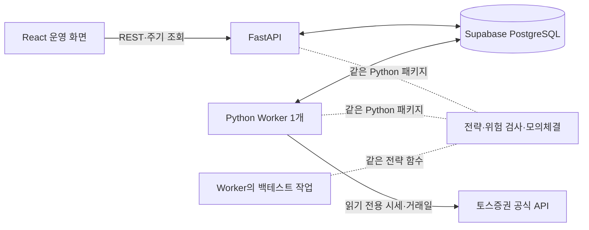

# Trading Lab 프로젝트

> 2026-10-01 기준 설계. 개인용 미국 주식 전략 실험·모의 자동매매 도구다. 웹·API는 Railway, 운영 DB는 Supabase Free로 정하고 [토스 호출 Worker의 배치](infrastructure.md)는 연동 단계에서 확정한다. **구현과 배포는 사용자의 재개 요청 전까지 보류**한다. 아직 애플리케이션 코드와 운영 리소스는 없다.

## 1. 목표와 첫 완성 범위

토스증권 **공식 Open API의 미국 주식 시세**를 받아 전략을 평가하고, 신호·모의 주문·체결·포지션·손익과 판단 이유를 한 화면에서 추적한다. 첫 완성 목표(MWP)는 실제 계좌에 주문하지 않는 **내부 DRY RUN**이다. 토스 API의 종목·봉·거래일 지원 여부는 구현 중 공식 문서와 실제 조회로 검증한다.

```text
시장 데이터 → 완료 봉·지표 → 전략 판단 → 위험 검사
            → 내부 모의 주문·체결 → 현금·포지션 → 화면·실행 기록
```

- 사용자 1명, 미국 상장 종목, USD, 정수 수량, 매수·매도만 다룬다. 회원가입·소셜 기능·뉴스·종목 랭킹·선물·옵션·암호화폐는 범위 밖이다.
- 관심 목록 **후보**는 `VOO`, `QQQ`, `QLD`, `TQQQ`, `SOXL`, `NVDA`, `GLD`, `MAGS`, `EWY`, `EWJ`다. 첫 자동 실행은 `VOO` 또는 `QQQ` 중 **1종목**이며, 데이터 지원 여부가 확인되면 목록을 확정한다. 레버리지 ETF는 별도 위험 한도 검증 전까지 조회·백테스트만 한다.
- 하나의 봉 주기와 규칙 전략 1개를 백테스트와 정기 DRY RUN에 공통으로 사용한다. 첫 전략은 이동평균 교차 또는 Donchian 돌파 등을 후보로 두고 아직 고르지 않았다.
- 첫 주문 모델은 내부 모의 시장가·전량 체결이다. 체결 시점·가격, 수수료·슬리피지·기업행동 가정을 실행 기록에 남기며 실거래 성과로 표시하지 않는다.
- MWP 완료 조건: 관심 목록 데이터 조회, 1종목 전략·백테스트·정기 실행, 중복 모의 주문 방지, 재시작 시 상태 복구, 모의 현금·포지션·손익, 화면의 상태 제어·판단 근거·오류 표시다. 데이터가 지연되거나 API가 실패하면 신규 모의 주문을 멈춘다.

## 2. 사용자 화면과 기능

첫 화면은 **A형 운영 대시보드**다. `정상 실행 여부 → 마지막 판단 이유 → 모의 포지션과 최근 기록` 순서로 읽히게 한다. 데스크톱을 기준으로 만들고, 모바일에서는 상태 확인과 중지 조작을 우선한다.

| 화면 | MWP에서 할 일 |
| --- | --- |
| 대시보드 | `DRY RUN`·봇 상태, 마지막/다음 실행, 데이터 갱신 시각, 모의 잔고·손익·포지션, 마지막 판단 이유, 시작·일시정지·중지·수동 1회 실행 |
| 종목·차트 | 관심 종목, 캔들·거래량, 신호·모의 체결 마커, 데이터 출처·봉 시각·지연 여부 |
| 전략·설정 | 첫 전략의 종목·파라미터·주문 크기·위험 한도, 저장된 초안과 실행 중 버전 구분 |
| 백테스트 | 종목·기간·전략 버전·초기 자금·비용 가정 선택, 자산 곡선·수익률·최대 낙폭·거래 목록·매수 보유 비교 |
| 주문·포지션 | 모의 주문·체결 상태, 현금·평균 단가·실현/미실현 손익, 거절 이유 |
| 로그 | 실행 ID·시각·종목·심각도별 판단·위험 검사·주문·오류 추적 |

화면은 모의 잔고를 실제 토스 계좌와 명확히 구분한다. 시장 데이터에는 공급자, 시장 시각, 수신 시각, 시간대와 지연 여부를 붙인다. 누락·지연·장 마감·주문 한도 초과 시 신규 모의 주문을 막고 이유를 보여준다. 백테스트와 정기 실행은 **완료된 봉**만 사용하며, 백테스트의 체결은 미리 정한 다음 봉 규칙을 따른다. 동일 조건을 다시 실행할 수 있도록 데이터 범위·전략 버전·비용 가정을 저장한다.

실행·판단 기록은 `run_id`, 전략 버전, 사용한 봉 시각, 신호와 사유, 위험 검사, 주문·체결 결과를 연결한다. 위험 설정은 종목별 보유 금액, 1회 주문 금액, 하루 주문 수·손실 한도, 주문 간 대기 시간을 포함한다. 인증 정보는 브라우저·응답·일반 로그에 노출하지 않는다.

알림 채널, 2~3종목 자동 실행, 레버리지 상품의 추가 위험 한도, 노드형 전략 워크플로 편집기, 실제 계좌 주문은 **MWP 이후**다. 워크플로는 시세·지표·조건·위험 검사·주문·알림의 제한된 노드부터 검토한다. 실거래는 공식 주문 조건, 계좌·주문 상태 대조, 중복 방지와 비상 중지를 검증한 별도 단계로 둔다. 공식 모의투자 환경도 제공 여부가 확인될 때만 계획에 넣는다.

## 3. 애플리케이션 구조



- **프론트엔드:** React·TypeScript·Vite와 Lightweight Charts. 빌드한 정적 파일을 Railway의 FastAPI 서비스에서 제공하고, 처음에는 REST 주기 조회로 상태를 갱신한다.
- **API:** Railway의 FastAPI 서비스가 조회·설정·시작/중지 명령을 처리한다. 개인 화면의 인증을 포함하며 긴 전략 작업은 요청 처리 프로세스에서 실행하지 않는다.
- **Worker:** API와 분리된 Python 실행 단위 하나가 데이터 수집·예약 평가·백테스트·위험 검사·모의체결·복구를 맡는다. 토스 호출 경로는 고정 송신 IP를 사용하며, Railway Pro 직접 연결과 Railway Hobby + 소형 서버를 연동 단계에서 비교한다. 백테스트가 예약 평가를 지연시키면 전용 프로세스로 분리한다.
- **DB:** 운영 환경은 서울 리전 Supabase Free PostgreSQL이다. 봉 캐시, 설정 버전, 명령, 실행·신호·모의 주문·체결·포지션·이벤트와 Worker heartbeat를 저장한다. 500 MB 무료 한도에 맞춰 봉 보존 범위를 제한한다. 초기에는 Redis·Celery·Kafka를 두지 않는다.
- **토스 어댑터:** 공식 API의 인증·시세·거래일 응답을 내부 데이터 형식으로 바꾼다. 첫 실행은 REST의 완료된 1분봉 또는 일봉을 검증해 사용하며, WebSocket 실시간 체결·호가·주문 이벤트는 MWP의 필수 경로로 두지 않는다. 실제 주문 어댑터는 구현하지 않는다. 키·토큰은 토스 호출 프로세스의 비밀 설정에만 둔다.

목표 코드 구조는 `backend/src/trading_lab/`의 `api`, `worker`, `domain`, `application`, `adapters/toss`, `adapters/sim`, `persistence`, 그리고 `backend/migrations`, `backend/tests`, `frontend`, 로컬 DB용 `compose.yaml`이다. `domain`은 FastAPI·HTTP 클라이언트·DB 모델을 직접 가져오지 않는다. API와 Worker는 같은 패키지를 다른 진입점으로 실행한다.

### Worker의 한 번의 평가

1. 시작 시 DB의 설정·미처리 명령·마지막 실행·모의 포지션을 읽고 heartbeat를 갱신한다. 재시작 후 자동 실행은 `PAUSED`로 두고 사용자가 확인한 뒤 재개한다.
2. 단일 루프가 명령과 `next_evaluation_at`을 확인한다. 미국 장·휴장은 거래일 데이터로 계산하고 DB 시각은 UTC로 저장한다.
3. 토스 데이터를 받아 완료 봉의 누락·중복·지연을 검사한다. 부적합하면 주문 없이 이유를 기록한다.
4. 공통 전략 함수로 신호·근거를 만들고 위험 한도를 통과할 때만 내부 모의 주문을 만든다. 평가와 다음 봉 체결은 분리한다.
5. `bot_id + symbol + bar_timestamp + mode`를 판단 고유 키로, `strategy_version`을 실행 근거로 기록한다. DB 유일 제약과 트랜잭션으로 모의 주문 중복을 막는다.
6. 결과·현금·포지션·다음 평가 시각을 저장한다. 오류 시 신규 주문을 멈추고 `ERROR`를 기록한다. Worker가 죽으면 heartbeat 단절을 화면에 표시한다.

Worker 프로세스의 생존과 봇의 `STOPPED`/`RUNNING`/`PAUSED`/`ERROR` 상태는 다르다. UI의 제어는 API가 DB에 명령을 기록하고 Worker가 반영한다. 운영 규모는 Worker 1개이며, 실수로 둘이 떠도 DB 제약으로 내부 모의 주문 중복을 막는다. 실제 외부 주문의 중복 방지는 이후 별도 설계가 필요하다.

### 개발 실행 방식

웹·API의 운영 장소는 [Railway 싱가포르 리전](infrastructure.md), PostgreSQL은 Supabase Free 서울 리전이다. 토스 호출 Worker는 Railway Pro 또는 소형 고정 IP 서버 중 연동 단계에서 선택한다. 개발 PC에서는 PostgreSQL을 Compose로 띄우고 API·Worker·프론트엔드를 각 터미널에서 실행하는 방식을 후보로 둔다. 아래는 **구현 후 로컬 개발 목표 명령**이며 지금 실행 가능한 명령이 아니다.

```powershell
docker compose up -d db
uv run uvicorn trading_lab.api.main:app --reload
uv run python -m trading_lab.worker
npm run dev
```

로컬 Compose 실행 시 `db` healthcheck와 일회성 Alembic 마이그레이션이 성공한 뒤 API·Worker를 시작한다. 운영에서는 Supabase 연결과 마이그레이션 성공을 확인한 뒤 API·Worker를 시작한다. Worker 복제 수는 1개다. 평소 봇 중지는 UI 명령을 사용하고, 실행 플랫폼의 Worker 중지는 프로세스 긴급 중단에 사용한다. PC가 꺼지면 그곳의 로컬 Worker도 멈춘다.

## 4. 구현 순서와 현재 상태

**현재는 문서 정리만 진행하며 구현은 보류**한다. 사용자가 재개를 요청하면 [인프라](infrastructure.md)의 두 Worker 배치 후보와 토스 허용 IP·Supabase 연결 조건을 확인하고 단계 0부터 진행한다. 봉 주기와 토스 연동 검증 결과로 배치를 확정한다.

| 단계 | 작업 | 완료 기준 |
| --- | --- | --- |
| 0. 기반 | 프로젝트 구조·로컬 DB·CI·비밀값 규칙, 첫 종목·전략·봉·체결 가정 | 새 환경의 설치·기본 검사 재현, 결정값 문서화 |
| 1. 시세 | 토스 공식 인증·읽기 전용 클라이언트, 관심 목록·캔들·거래일, 오류·호출 제한 | 후보 종목 지원 여부와 봉 출처·시각·갱신 시각 확인 |
| 2. 전략·백테스트 | 공통 전략, 모의체결·현금·포지션, 결과 저장 | 동일 조건 재실행 결과 일치, 미래 데이터 참조 없음, 거래별 근거 확인 |
| 3. Worker | 수동·정기 DRY RUN, 위험 검사, 중복 방지·재시작 복구 | 1종목에서 중복 주문 없음, 데이터·API·한도 오류 시 신규 주문 차단 |
| 4. API·화면 | 상태·차트·판단 이유·모의 포지션·로그·제어 | 화면에서 현재 상태와 마지막 판단을 이해하고 중지 가능 |
| 5. 운영 검증 | 실패 경로·시장 시간·재시작, 선택한 인프라의 배포·복구 | 정기 실행과 중단·데이터 보존 절차 재현, 한계 문서화 |

아직 정할 값은 첫 종목(`VOO`/`QQQ`), 전략 파라미터, 봉 주기·평가 시각, 초기 모의 현금, 체결 시점·가격·비용 가정이다. 실거래 기능은 모든 MWP 단계에서 꺼둔다.

## 5. 작업·브랜치 원칙

- 매 작업 전에 이 문서와 [인프라](infrastructure.md)를 읽고 현재 단계·완료 기준을 확인한다. 기능·운영 결정이 바뀌면 같은 변경에서 문서를 갱신한다.
- `dev`에서 작업 브랜치를 만들고 한국어 PR·적절한 라벨·검증 결과·제한 사항을 기록해 `dev`에 병합한다. 설계 논의 중에는 문서 변경을 하나의 PR에 모으고 설계가 정리되면 병합한다. 검증된 단계만 별도 `dev → main` PR로 올린다.
- API 키·토큰·계좌 정보·원본 `docs/references/` 이미지는 Git에 넣지 않는다. 인증 정보가 없어도 가짜 키를 저장소에 넣지 않는다.
- 각 단계의 결과는 API 또는 간단한 화면으로 확인한다. 공급자 기능은 공식 근거와 실제 조회 없이 확정 사실로 적지 않는다.

## 참고 자료

- [토스증권 Open API](https://developers.tossinvest.com/): 채택한 공급자의 공식 문서.
- [한국투자증권 Open API 예제](https://github.com/koreainvestment/open-trading-api): 미국 주식 거래 흐름의 참고 자료. 토스 요청 형식에 그대로 대입하지 않는다.
- [tossinvest-cli](https://github.com/JungHoonGhae/tossinvest-cli): API 탐색과 수동 검증 참고. Python 봇의 실행 의존성으로 사용하지 않는다.
- [FastAPI Background Tasks](https://fastapi.tiangolo.com/tutorial/background-tasks/), [Docker Compose 시작 순서](https://docs.docker.com/compose/how-tos/startup-order/), [PostgreSQL 유일 제약](https://www.postgresql.org/docs/current/indexes-unique/): 프로세스·시작 순서·중복 방지 참고.
- [Lightweight Charts](https://tradingview.github.io/lightweight-charts/), [React Flow](https://reactflow.dev/index): 차트와 MWP 이후 워크플로 편집기 참고.

`docs/references/`의 다섯 원본 이미지는 로컬 UI 참고용이며 Git과 발표 자료에 넣지 않는다. 상태·차트·포지션·파라미터·알림·로그 배치만 참고하고 원본 화면은 복제하지 않는다.
