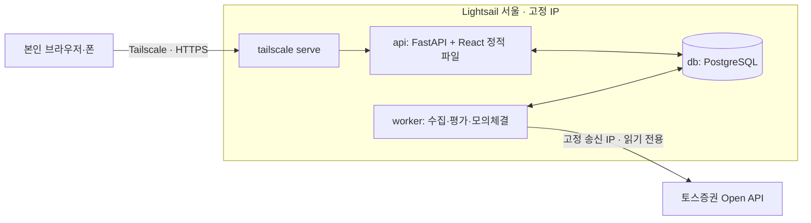

# Quant Lab 설계

> **이 문서가 설계의 단일 출처다.** 일정과 진행 상태는 [roadmap.md](roadmap.md), 토스 API 조사 결과는 [tossApi.md](tossApi.md)에 둔다.
> 결정이 바뀌면 그 변경을 담은 PR에서 이 문서도 함께 고친다. 최종 갱신: 2026-10-02.

## 1. 한 줄 정의

토스증권 공식 Open API의 미국 주식 시세로 규칙 기반 전략을 돌리고, **실제 주문 없이 내부 모의 체결(DRY RUN)**로 신호·주문·포지션·손익과 판단 이유를 추적하는 개인용 도구. 최종 목표는 퀀트 자동매매이며, 실거래는 DRY RUN이 검증된 뒤 별도 단계로 연다.

## 2. 첫 완성 범위 (MWP)

| 포함 | 제외 (MWP 이후) |
| --- | --- |
| 사용자 1명, 미국 상장 종목, USD, 정수 수량, 매수·매도 | 실제 계좌 주문, 공식 모의투자(토스에 없음) |
| 봇 여러 개를 홈 오른쪽 봇 목록에서 골라 하나씩 보기 (운영: `QQQ`, `TQQQ` 같은 전략 비교) | 봇 여러 개를 묶는 포트폴리오 위험 한도 |
| 규칙 전략 5개 중 선택(사고팔기 4개 + 매달 넣고 사 모으는 "나처럼 모으기"), 봉 주기 **1개**(일봉) | AI 전략. 전략 편집기는 계획에서 뺐다 (2026-10-02) |
| 백테스트와 정기 DRY RUN이 같은 전략 함수 사용 | 실시간 시세로 판단하기, WebSocket 시세 |
| **실시간 화면 표시**: Worker가 거래 시간 중 30초마다 현재가와 진행 중 일봉을 REST로 받아 "지금 가치"와 차트의 오늘 봉(흐리게)에 반영 (판단에는 안 씀) | |
| 홈·시험해 보기·설정 화면, 시작·일시정지·중지·수동 1회 실행, 텔레그램 알림 | |
| **레버리지 ETF**(QLD·TQQQ·SOXL) 백테스트·DRY RUN: 배수 표시, 주의 안내, 이상치 기준 완화 | 레버리지 전용 위험 한도 (보유 기간·손절 등) |
| 재시작 복구, 중복 모의 주문 방지, 데이터 이상 시 주문 차단 | |

관심 목록: `VOO`, `QQQ`, `QLD`, `TQQQ`, `SOXL`, `NVDA`, `GLD`, `MAGS`, `EWY`, `EWJ` (`WATCHLIST_SYMBOLS`). Worker가 하루 한 번 토스 `/stocks`로 레버리지 배수를 `instruments`에 저장하고, 배수가 1보다 크면 하루 변동 이상치 기준을 50%에서 90%로 넓힌다.

**MWP 완료 조건:** 서버에서 정기 DRY RUN이 **2주 동안 사람 개입 없이** 돌고, 그동안 중복 주문 0건, 데이터 이상·API 실패 때 신규 주문 차단이 기록되며, 화면에서 현재 상태와 마지막 판단 이유를 바로 이해할 수 있다.

## 3. 반드시 지킬 원칙

이 프로젝트에서 틀리면 비용이 큰 것들이다. 코드 리뷰 기준으로도 쓴다.

1. **실거래 코드 경로가 없다.** MWP에는 토스 주문 어댑터를 만들지 않는다. 모의 체결은 `adapters/sim`만 담당한다.
2. **완료된 봉만 쓴다.** 진행 중인 봉으로 판단하지 않는다. 토스는 미국 날짜 D의 일봉을 정규장 전부터 데이마켓 체결로 채워 내려주므로, **D일 정규장 마감 + 여유 시간 전의 D일 봉은 버린다.** 백테스트도 같은 규칙을 따르며, 판단 시점 이후의 데이터를 참조하면 테스트가 실패해야 한다.
3. **판단과 체결을 분리한다.** T 봉으로 판단하고 T+1 봉 규칙으로 체결한다. 백테스트와 DRY RUN이 같은 규칙을 쓴다.
4. **판단 하나에 주문은 최대 하나다.** `bot_id + symbol + bar_ts + mode`에 DB 유일 제약을 건다. Worker가 실수로 두 개 떠도 중복 주문이 생기지 않는다.
5. **모르면 멈춘다.** 데이터 누락·지연, API 오류, 장 운영 판정 불일치, DB 오류가 있으면 신규 주문 없이 이유를 기록한다. 단, Worker 재시작은 "모르는 상태"가 아니다. 평가가 멱등이고 체결가가 봉 데이터로 정해지므로, 실행 중이던 봇은 재시작 뒤 그대로 이어서 돌고 밀린 평가를 바로 처리한다 (2026-10-02 변경, roadmap Phase 4 장애 기록).
6. **토스 토큰은 Worker 한 곳에서만 발급한다.** 토큰은 클라이언트당 1개만 유효해서, 두 곳에서 발급하면 서로를 무효화한다. API 서버는 토스를 호출하지 않는다.
7. **돈과 시간은 정확한 타입으로 다룬다.** 가격·금액은 `Decimal`(DB `numeric`)로 저장하고 float를 쓰지 않는다. DB 시각은 UTC로 저장하고, 장 판정은 `America/New_York`, 화면 표시는 KST로 한다.
8. **비밀값과 시세 데이터는 저장소에 넣지 않는다.** 토스 데이터는 제3자 배포가 금지돼 있다. 테스트 fixture는 합성 데이터로 만들고, 실제 응답은 로컬에서만 쓴다.
9. **재현할 수 있어야 한다.** 모든 실행·백테스트는 전략 버전, 파라미터, 데이터 범위, 비용 가정을 함께 저장한다.

## 4. 아키텍처

서울 리전 VM 한 대에서 Docker Compose로 DB·API·Worker를 실행한다. 공개 인바운드 포트는 없고, 화면과 SSH 접근은 모두 Tailscale로만 한다.



### 구성 요소

| 구성 요소 | 책임 | 하지 않는 일 |
| --- | --- | --- |
| **worker** | 토스 토큰 보유, 시세 수집, 장 운영 판정, 정기 평가, 위험 검사, 모의 체결, 백테스트 실행, heartbeat | HTTP 요청 처리 |
| **api** | 화면 제공, 조회 API, 명령 기록(시작·중지·수동 실행·백테스트 요청), 설정 저장 | 토스 호출, 긴 계산 |
| **db** | 모든 상태의 원본. 봉 캐시, 설정 버전, 명령 큐, 실행·판단·주문·체결·포지션·이벤트 | — |
| **frontend** | 상태 확인과 제어. API를 주기적으로 조회 (MWP는 polling) | 비즈니스 로직 |

API와 Worker는 같은 Python 패키지를 다른 진입점으로 실행한다. 둘은 **DB를 통해서만 대화한다.** API가 `commands` 테이블에 명령을 쓰면 Worker가 읽어 처리하고 결과를 기록한다. 큐 시스템(Redis·Celery 등)은 필요해질 때까지 두지 않는다.

### 코드 구조

```text
backend/
  src/quant_lab/
    domain/          # 순수 로직: 봉, 지표, 전략, 위험 규칙, 모의 체결 규칙 (외부 의존 없음)
    application/     # 유스케이스: 평가 1회, 백테스트, 명령 처리
    adapters/toss/   # 토스 HTTP 클라이언트, 토큰 관리, 응답 → 도메인 변환
    adapters/sim/    # 모의 브로커
    persistence/     # SQLAlchemy 모델, 리포지토리
    api/             # FastAPI 진입점
    worker/          # Worker 진입점과 루프
  migrations/        # Alembic
  tests/
frontend/            # React + Vite
deploy/              # 운영용 compose, 서버 준비 스크립트, 백업 스크립트
infra/lightsail/     # Terraform: Lightsail 인스턴스·Static IP·방화벽·자동 스냅샷
compose.yaml         # 로컬 개발용 (PostgreSQL)
```

`domain`은 FastAPI, httpx, SQLAlchemy를 import하지 않는다. 이 규칙은 테스트(import 검사)로 강제한다.

### Worker 평가 1회의 흐름

```text
명령 확인 → 장 운영 판정 → 완료 봉 수집·검증 → 이전 대기 주문 체결(T+1 규칙)
→ 전략 판단 → 위험 검사 → 모의 주문 생성 → 상태·다음 평가 시각 저장 → heartbeat
```

1. **Worker는 하나만 동작한다.** 시작할 때 PostgreSQL advisory lock을 잡고, 못 잡으면 잡을 때까지 기다린다. 토스 토큰도 이 프로세스만 보유한다.
2. 잠금을 얻으면 `RUNNING` 봇은 그대로 두고 "이어서 실행" 이벤트를 남긴다. `next_evaluation_at`이 지났으면 첫 tick에서 바로 평가한다. 놓친 거래일은 기존처럼 기록만 한다.
3. 15초마다 heartbeat → 미처리 명령 → `RUNNING`이면서 `next_evaluation_at`이 지난 봇 평가 순서로 돈다.
4. 평가 대상은 "정규장 마감 + 2시간이 지난 가장 최근 거래일"이다. 토스 캘린더가 거래일이 아니라고 하거나, 그날 봉이 없거나, 판단 구간 봉에 누락·이상치가 있으면 판단 없이 `SKIPPED`를 남기고 15분 뒤 다시 시도한다.
5. 이전 대기 주문은 판단일 다음 거래일 시가로 체결한다. 체결·판단·주문·잔고 변경은 한 트랜잭션이다.
6. `bot_id + symbol + session_date + mode` 유일 제약과 "봇당 대기 주문 1개" 부분 유일 인덱스가 중복 모의 주문을 막는다. 같은 봉을 다시 평가하면 아무것도 하지 않는다.
7. 허용 IP·인증 오류(토스 403·401 반복)와 예상하지 못한 오류는 봇을 `ERROR`로 바꾼다. 토스 일시 장애(429·5xx·네트워크)는 `SKIPPED` 후 재시도한다.
8. Worker가 멈춰 있던 동안의 거래일은 소급 판단하지 않고 `missed_sessions` 경고만 남긴다.
9. 봇 평가와 별도로 30분마다 관심 종목(`WATCHLIST_SYMBOLS`, 기본 10종목) 일봉이 최신 완료 거래일까지 있는지 보고, 뒤처진 종목만 증분 동기화한다 (백테스트 데이터 최신화). 실패는 경고만 남긴다.
10. 토스 모드에서는 하루 한 번 관심·봇 종목 정보(레버리지 배수)를, 미국 거래 시간(뉴욕 일 20:00~금 20:00, 데이마켓 포함) 중 30초마다 봇 종목 현재가와 진행 중 일봉(`/candles` 최신 1개)을 받아 저장한다. 화면 표시용이라 실패해도 로그만 남긴다.

봇 상태(`STOPPED`, `RUNNING`, `PAUSED`, `ERROR`)는 Worker 프로세스의 생존과 별개다. 명령: `START`(→ RUNNING, 즉시 1회 평가), `PAUSE`(RUNNING → PAUSED), `STOP`, `RUN_ONCE`(상태는 그대로 두고 1회 평가). 화면에는 "멈추기(`PAUSE`) / 시작(`START`)"만 둔다. `STOP`과 `RUN_ONCE`는 일반 사용자에게 차이가 없거나(판단은 하루 한 번 자동) 헷갈려서 API·CLI에만 남긴다. 화면에서는 `PAUSED`와 `STOPPED`를 모두 "멈춤"으로 보여준다.

판단·체결 함수(`domain/trading.py`)는 백테스트와 Worker가 함께 쓴다. `replay` CLI로 과거 거래일마다 정기 평가를 재생해 백테스트와 체결이 같은지 확인한다.

### 핵심 데이터

| 테이블 | 내용 |
| --- | --- |
| `daily_bars` | `(symbol, session_date)` PK, 미국 거래일 기준. OHLCV(`numeric`, 정밀도 제한 없음, 수정주가), `source`, `fetched_at`. 1분봉은 필요해질 때 별도 테이블 |
| `bots` | 종목, 전략 이름·파라미터, 상태·사유, 초기 현금, 수수료·슬리피지, 위험 한도, `next_evaluation_at` |
| `bot_accounts` | 봇의 모의 현금·보유 수량·평균 단가·실현 손익·**넣은 돈**(`contributed`, 시작 금액 + 입금, 수익률의 기준) (실제 토스 계좌와 무관) |
| `bot_deposits` | 모으기 전략의 정기 입금. `(bot_id, month)` PK로 한 달 한 번 |
| `commands` | 화면 명령 큐 (`START`, `PAUSE`, `STOP`, `RUN_ONCE`), 처리 시각·결과 |
| `runs` | 평가 1회: 계기(정기·수동), 대상 거래일, `OK`·`SKIPPED`·`ERROR`, 사유 |
| `decisions` | 판단·사유·지표·차단 사유, **당시 전략·비용·위험 한도 스냅샷**. 유일 키 `bot_id + symbol + session_date + mode` |
| `sim_orders` | 모의 주문(판단당 최대 1개): `PENDING` → `FILLED`·`UNFILLED`, 체결일·수량·가격·수수료·실현 손익, 모으기 매수 예산(`budget`, 없으면 현금 전부) |
| `backtests` | 입력 조건(데이터 범위, 전략·파라미터, 비용, 위험 한도, 코드 버전)과 지표·체결·판단·자산 곡선 |
| `events` | 심각도별 기록 (텔레그램 알림·최근 활동의 원본) |
| `instruments` | 종목명, 유형, 레버리지 배수 (토스 `/stocks`, 하루 한 번) |
| `quotes` | 종목별 최신 현재가 1행 (`price`, `quoted_at`). 화면 "지금 가치"용, 판단에는 안 씀 |
| `live_bars` | 종목별 진행 중 일봉 1행. API `/bars`가 완료 봉보다 새 날짜일 때만 `live: true`로 끝에 붙인다. `daily_bars`와 섞지 않는다 |
| `worker_heartbeat` | Worker 마지막 생존 시각, 버전 |

## 5. 기술 스택

| 영역 | 선택 | 이유 |
| --- | --- | --- |
| 언어·패키지 | Python 3.14, **uv** | 빠른 설치와 잠금 파일 (`backend/.python-version`) |
| API | FastAPI, Pydantic v2, pydantic-settings | 타입 기반 검증, 설정 분리 |
| DB 접근 | SQLAlchemy 2.0, Alembic, psycopg 3 | 마이그레이션 관리, `numeric` ↔ `Decimal` |
| HTTP | httpx (동기 클라이언트로 시작) | Worker는 단일 루프. 비동기는 필요할 때 |
| 데이터 처리 | pandas | 지표·백테스트 계산 |
| 시장 달력 | `exchange_calendars` (XNYS) + 토스 캘린더 | 토스는 3영업일만 제공 |
| 테스트·품질 | pytest, respx(HTTP 목, Phase 2), ruff, mypy(strict) | Windows에서는 `python -m mypy`로 실행 |
| DB | PostgreSQL 17 (로컬·운영 모두 컨테이너) | 같은 버전으로 개발·운영 |
| 프론트엔드 | React, TypeScript, Vite, oxlint, TanStack Query·Lightweight Charts(Phase 4) | polling·캐시, 금융 차트 |
| 실행 | Docker Compose | 로컬 → Lightsail → OCI/홈서버로 그대로 이동 |
| 접근 | Tailscale (`tailscale serve`로 HTTPS) | 공개 포트 0개, MWP에 로그인 구현 불필요 |
| CI | GitHub Actions (`.github/workflows/ci.yml`): ruff, mypy, pytest(+PostgreSQL 17 서비스), oxlint, tsc·vite build | PR과 `dev`·`main` push |

## 6. 인프라와 운영

### 운영 환경

| 항목 | 선택 |
| --- | --- |
| 서버 | AWS Lightsail **서울(ap-northeast-2), 2GB RAM / 2 vCPU**, Ubuntu 24.04 LTS |
| 비용 | 약 $12/월 (공인 IPv4 포함 번들. 생성 시 서울 리전 가격 확인). Tailscale·GitHub 비공개 저장소는 무료 |
| 고정 IP | Lightsail Static IP를 붙이고 그 IP를 토스 허용 IP에 등록 |
| 방화벽 | 처음엔 Lightsail 콘솔 브라우저 SSH(22번, 콘솔 대역만)만 허용. Tailscale SSH가 동작하면 인바운드 전부 차단 |
| 비밀값 | **저장소 안 `.secrets/`** (`.gitignore`·`.dockerignore`로 제외, 로컬·서버 같은 위치): `env`(DB 비밀번호·`DATABASE_URL`, 부트스트랩이 생성)와 `worker.env`(토스 키·텔레그램·`HEARTBEAT_PING_URL`, **worker 컨테이너에만** 주입). 둘 다 권한 600. 개발용 실행은 루트 `.env`를 쓴다. **토스 키 만료 2027-09-28** (발급 2026-09-28, 1년). 만료 전 WTS에서 재발급하고 `worker.env` 교체 |
| 서버 생성 | Terraform(`infra/lightsail`). 콘솔에서 손으로 만들지 않는다 |
| 배포 (MWP) | 서버에서 `bash deploy/deploy.sh`: `main` pull → 이미지 빌드(프론트 포함 단일 이미지) → `compose up -d`. 저장소는 읽기 전용 deploy key로 받음. Compose 프로젝트 이름은 `quant-lab-prod` |
| 마이그레이션 | `migrate` 일회성 서비스가 성공해야 api·worker가 시작 (`depends_on: service_completed_successfully`) |
| 백업 | `deploy/backup.sh`를 cron이 매일 03:00 UTC(12:00 KST, 평가 시각과 겹치지 않음)에 실행, `pg_dump` 7일 보관 + Lightsail 자동 스냅샷. 파괴적 마이그레이션 전에는 수동 덤프 |
| 모니터링 | 화면의 heartbeat·마지막 실행 표시, `docker compose logs`, **텔레그램 알림**: Worker가 `events` 테이블을 따라가며 경고·오류, 매수·매도 신호, 모의 체결, 설정 변경, Worker 재시작 후 이어서 실행을 보내고, 매주 마지막 거래일 판단 뒤에는 **주간 리포트**(이번 주 자산 변화(입금 제외), 그냥 보유 대비, 거래 횟수)를 보낸다. **아무것도 하지 않는 날의 일일 점검과 월급 입금은 앱 기록에만 남긴다** (2026-10-02: 봇마다 매일 오던 알림이 거래·문제 알림을 묻어서). 한 번에 생긴 소식(예: 아침 07:00 봇 여러 개의 체결·점검·주간 리포트)은 한 통으로 묶어 보낸다(3,800자 넘으면 나눔). 봇 삭제·처음부터 다시 시작도 알린다. 알림 실패는 판단에 영향이 없다. **외부 heartbeat**: `HEARTBEAT_PING_URL`(Healthchecks.io 등)에 5분마다 신호를 보내 Worker·PC·서버가 멈추면 외부 서비스가 알린다 |

**Healthchecks 알림을 한국어로** (선택, 사용자가 Healthchecks 화면에서 설정): 기본 HealthchecksBot 메시지는 영어라, Integrations → Webhook으로 우리 텔레그램 봇이 직접 보내게 할 수 있다. 대가로 텔레그램 봇 토큰을 Healthchecks에 저장하게 된다 (이 봇은 내 채팅에 메시지만 보낼 수 있어 유출 영향은 작다). 설정 후 HealthchecksBot 연동은 지운다.

| 항목 | 값 |
| --- | --- |
| URL (down·up 공통) | `https://api.telegram.org/bot<봇 토큰>/sendMessage`, 방식 `POST` |
| 헤더 | `Content-Type: application/json` |
| down 본문 | `{"chat_id": "<채팅 ID>", "text": "⚠️ Quant Lab 프로그램이 응답하지 않아요
20분 넘게 신호가 없어요. PC나 서버가 꺼졌는지 확인해 주세요."}` |
| up 본문 | `{"chat_id": "<채팅 ID>", "text": "✅ Quant Lab 프로그램이 다시 응답해요"}` |

배포 자동화(GitHub Actions에서 Tailscale로 SSH 배포)는 수동 배포가 번거로워지면 도입한다. 서버 리소스는 처음부터 Terraform으로 관리한다.

**서버 준비 절차** (Terraform과 스크립트로 재현한다):

| 단계 | 누가 | 작업 |
| --- | --- | --- |
| 1. AWS 자격 증명 | 사용자 | IAM 사용자(Lightsail 권한만)의 액세스 키를 만들고 개발 PC에서 `aws configure`로 입력 (키는 Claude·저장소에 넘기지 않음) |
| 2. 서버 생성 | 사용자 실행 | `cd infra/lightsail && terraform init && terraform plan && terraform apply` → 인스턴스(서울 2GB, Ubuntu 24.04), Static IP, 자동 스냅샷, 방화벽(브라우저 SSH만). 출력된 `static_ip`를 메모 |
| 3. 토스 허용 IP | 사용자 | WTS > 설정 > Open API > 허용 IP에 `static_ip` 추가 |
| 4. Tailscale 먼저 | 사용자 | Lightsail 콘솔의 브라우저 SSH에서 `curl -fsSL https://tailscale.com/install.sh \| sh && sudo tailscale up --ssh --hostname quant-lab` → 링크로 로그인. 개발 PC에도 Tailscale 설치·로그인 |
| 5. 원격 작업 | Claude (개발 PC → `tailscale ssh ubuntu@quant-lab`) | deploy key 생성 → `gh repo deploy-key add`(읽기 전용) → `git clone` → `sudo bash deploy/bootstrap.sh` → `sudo tailscale serve --bg 8000` |
| 6. 토스 키·알림 | 사용자 | `.secrets/worker.env`에 토스 키, 텔레그램 토큰·채팅 ID, `HEARTBEAT_PING_URL` 입력 (`tailscale ssh` 또는 브라우저 SSH, 키는 대화에 붙이지 않음) |
| 7. Tailscale 접근 제한 | 사용자 | 필요하면 Tailscale ACL에서 서버 접근을 본인 기기로만 제한 (개인 tailnet이면 기본값으로 충분) |
| 8. 배포·봇 시작 | 서버 | 로컬에서 토스를 호출하는 프로세스를 모두 멈춘 뒤 `bash deploy/deploy.sh` → `docker compose -f deploy/compose.prod.yaml exec api python -m quant_lab.cli bot create qqq-sma QQQ --params fast=50,slow=200` → 화면에서 시작 |

브라우저 SSH용 22번 포트(Lightsail 콘솔 대역만)는 Tailscale SSH가 동작하면 `aws_lightsail_instance_public_ports`에서 지워 인바운드를 모두 닫는다. Terraform 상태 파일(`*.tfstate`)은 개발 PC에만 두고 Git에 넣지 않는다.

### 로컬 운영 리허설 (서버 생성 전, 2026-10-01~)

Lightsail도 VM 한 대에 같은 Compose를 올리는 구조라, 서버가 준비되기 전까지 **개발 PC에서 운영 구성 그대로** 돌린다. 운영 이력(판단·모의 체결)을 미리 쌓고, 서버로 옮길 때 백업·복원 절차를 함께 검증한다.

| 항목 | 내용 |
| --- | --- |
| 비밀값 | 저장소 안 `.secrets/env`, `.secrets/worker.env` (서버와 같은 위치·형식, Git 제외) |
| 실행 | `docker compose -f deploy/compose.prod.yaml up -d --build` (Compose 이름 `quant-lab-prod`, 개발용 DB와 분리) |
| 접속 | `tailscale serve --bg 8000` → `https://<PC 이름>.<tailnet>.ts.net` (tailnet 안에서만) |
| 토스 | 개발 PC 공인 IP가 허용 목록에 있어야 한다. 이 Worker가 토큰을 가지므로, 동작 중에는 개발용 CLI(`sync-bars`, `toss_probe`)로 토스를 호출하지 않는다 |
| 한계 | PC가 꺼지거나 절전에 들어가면 평가가 빠진다 (`missed_sessions` 경고). 가정용 IP가 바뀌면 토스 403 → 봇 `ERROR` |
| 서버로 이전 | 로컬 Worker 정지 → `pg_dump` → 서버에서 `pg_restore` → 서버 Worker 시작 → 로컬 스택 `down`. Worker를 두 곳에서 동시에 돌리지 않는다 |

### 로컬 개발

개발 PC에서는 `compose.yaml`로 PostgreSQL만 띄우고 API·Worker·프론트엔드는 각각 직접 실행한다. **토스 client는 계정당 1개만 발급된다 (2026-10-01 확인).** 같은 client로 토큰을 발급하면 다른 쪽 토큰이 무효화되므로, 서버 Worker가 동작한 뒤로는 로컬에서 토스를 호출하지 않는다. 로컬 개발은 저장된 봉(서버 DB 덤프)이나 합성 데이터로 한다. Worker는 기본값 `WORKER_MARKET_SOURCE=stored`로 토스를 호출하지 않고, 운영 서버만 `toss`로 둔다. 로컬 호출이 꼭 필요하면 서버 Worker를 멈추고 호출한 뒤 다시 시작한다. 허용 IP는 여러 개 등록할 수 있어 개발 PC IP와 서버 IP를 함께 둔다.

```bash
docker compose up -d db
uv run alembic upgrade head
uv run uvicorn quant_lab.api.main:app --reload
uv run python -m quant_lab.worker
npm --prefix frontend run dev
```

(구현 후 사용할 명령이다. 현재 코드는 없다.)

### 이전 계획 (Lightsail → OCI / 홈서버)

- 서버에 의존하는 것은 Compose 파일, env 파일, DB 덤프뿐이므로 새 서버에서 `pg_restore` 후 같은 Compose를 실행하면 된다.
- **송신 IP가 바뀐다.** 허용 IP는 여러 개 등록할 수 있으므로 새 IP를 먼저 추가하고, 구 서버 Worker를 멈춘 뒤 새 Worker를 시작하고, 마지막에 구 IP를 지운다. Worker를 두 곳에서 동시에 돌리지 않는다 (토큰 경합).
- **홈서버는 가정용 회선 IP가 바뀔 수 있다.** 이때는 토스 호출만 고정 IP를 가진 소형 VPS를 거쳐 나가게 한다 (WireGuard 또는 Tailscale exit node). Lightsail을 가장 작은 플랜으로 줄여 송신 게이트웨이로 남기는 것이 가장 간단한 후보다.

## 7. 전략·백테스트 규칙

| 항목 | 값 |
| --- | --- |
| 봉 주기 | **일봉 (결정).** 미국장은 한국 밤 시간이라 사람이 지켜보기 어렵고, 하루 한 번 평가라 실패 지점이 적다. 토스 일봉은 상장일부터 제공된다 |
| 평가 시각 | 정규장 마감(서머타임 KST 05:00, 표준시 06:00, 조기 폐장 반영) **+ 2시간** 이후. 저장 뒤 값이 바뀌면 동기화가 `resync`로 감지한다 |
| 체결 규칙 | T일 종가로 판단 → **T+1일 시가로 체결** (보통 전략은 전량, 모으기 전략은 정한 예산만큼). DRY RUN도 T+1 시가가 확정된 뒤 같은 가격으로 체결을 기록 |
| 비용 | **토스증권 공식 요율**: 위탁수수료 0.1% ($0.01 미만 절사), 매도 시 SEC Fee max(매도대금×0.00206%, $0.01) 추가. 슬리피지 5bp(매수는 올리고 매도는 내림). 환전 수수료는 USD 기준 DRY RUN이라 제외. 실행 기록에 함께 저장 |
| 전략 | 잘 알려진 단일 종목 전략 4개: `sma_cross`(골든크로스 50/200, 기본값), `trend_filter`(Faber 200일선), `rsi2`(Connors RSI(2) 눌림목), `donchian`(터틀 채널 돌파). 수량은 체결 시점 현금으로 정수 계산, 위험 한도(종목 최대 보유 금액, 1회 최대 주문 금액) 적용 |
| 모으기 전략 (`dip_saver`, "나처럼 모으기", 2026-10-02) | 사용자의 실제 투자 습관을 옮긴 전략. **매달 `day`일(기본 25일, 휴장이면 그 뒤 첫 판단일) `deposit`달러(기본 $675 = 월 $1,350을 VOO·QQQ 두 봇에 반씩)를 넣고 팔지 않는다.** 판단일마다: 종가가 최근 252일 종가 최고보다 `dip`%(10) 이상 낮으면 **모아 둔 현금까지 모두** 사고, 200일 평균보다 `hot`%(10) 이상 높으면 사지 않고 현금으로 모으고, 그 밖에는 입금일에 **그달 입금액만큼** 산다. 정수 주식이라 남는 잔돈은 하락장 때 쓰인다. 전략은 `Signal.spend`(`DEPOSIT`·`ALL`·`NONE`)로 쓸 돈만 알려 주고, `decide`가 예산(`budget`)을 정해 주문에 남기며, 이미 들고 있어도 더 산다. 입금은 `DepositPlan` 한 규칙을 백테스트와 DRY RUN이 같이 쓰고, DRY RUN은 `bot_deposits`(봇·월 PK)로 한 달 한 번을 보장한다. 실제 가격(2016-10~2026-09, 월 $675) 백테스트에서 QQQ +186.1% vs 매달 그냥 사기 +187.1%, VOO +104.8% vs +106.9%로 거의 같았다 (평균 현금 비중 5~8%) |
| 백테스트 데이터 | 토스 일봉 `adjusted=true`, 상장일부터 (QQQ 1999-03-10~, 닷컴·2008·2020·2022 하락장 포함) |
| 비교 기준·지표 | 같은 기간 매수 후 보유 (입금이 있으면 같은 돈을 넣자마자 다음 날 시가에 사는 "매달 그냥 사기"). 총 수익률(넣은 돈 대비), 연평균(입금이 있으면 넣은 시점을 반영한 XIRR, 없으면 CAGR), 최대 낙폭·연 변동성·샤프 지수(무위험 0)·연도별 수익률(입금 효과를 뺀 시간가중 수익률), 보유 비중, 승률 |
| 위험 한도 | 종목별 최대 보유 금액·1회 주문 금액 구현. 일봉 1종목은 거래일당 판단 1회라 하루 주문 수는 구조적으로 1건 이하. 하루 손실 한도·주문 간 최소 간격은 다종목·장중 전략 도입 때 추가 |

## 8. 화면

**원칙: 주식을 잘 모르는 사람도 쓸 수 있게 한다 (토스 스타일).** 전문 용어 대신 쉬운 말을 쓰고, 꼭 필요한 용어는 ⓘ와 도움말(용어 설명)로 풀어 준다. 파라미터는 직접 입력하지 않고 선택지로 고른다. 판단 이유·알림·활동 문장은 `application/messages.py` 한곳에서 만들어 텔레그램과 화면이 같은 말을 쓴다. 디자인은 Robinhood식 구성(큰 숫자 하나와 자산 그래프가 먼저)에 Vercel·Raycast식 톤을 따른다: 회색 단계와 가는 선으로 구획을 나누고, 카드는 요약 패널과 봇 목록에만 쓰며, 상태는 칩 대신 색 점과 글자로, 주 버튼은 검정(어두운 테마는 흰색) 하나에 나머지 동작은 ⋯ 메뉴로 둔다. 글꼴은 숫자·영문 Geist, 한글 Pretendard다. 밝은 테마와 어두운 테마를 둘 다 지원한다. 기본은 시스템 설정을 따르고 헤더의 밝기 메뉴로 바꾸며, 고른 값은 브라우저에만 저장한다. 색은 `index.css` 토큰에서만 가져오고 차트도 같은 토큰을 읽어 테마가 바뀌면 다시 그린다. 로고는 글자색 사각형 위의 상승선 마크 + "Quant Lab" 워드마크이고, "모의 투자" 안내는 자산 그래프 아래 한 줄과 도움말에서 한다. 가격·손익 색은 국내 관례대로 **오르면 빨강, 내리면 파랑**(매수 빨강, 매도 파랑)이고, 상태 색(정상 초록, 오류 빨강)과는 토큰을 나눠 쓴다(`--rise`/`--fall` vs `--ok`/`--bad`). PWA 매니페스트와 아이콘이 있어 폰에서 "홈 화면에 추가"하면 주소창 없이 앱처럼 열린다 (서비스 워커·오프라인 캐시는 없음: 항상 최신 데이터를 본다). 봇 화면은 1개씩 본다. 홈 오른쪽(폰에서는 맨 위) 봇 목록(상태·최근 3개월 자산 미니 그래프·수익률)에서 고르고, 고른 봇은 브라우저에 기억한다. 홈 첫 화면의 자산 그래프는 `GET /api/bots/{id}/equity`가 첫 판단일부터 체결 기록을 장 마감 가격에 다시 적용해 만든 하루 단위 값이며, 마우스를 올리면 큰 숫자가 그날 값으로 바뀐다. 최근 활동은 첫 화면에서 빼고 거래 내역의 "전체 기록 보기" 서랍으로 옮겼다 (2026-10-02). 가격 차트는 확정 봉이 바뀔 때만 다시 그리고 오늘 진행 중 봉은 제자리에서 갱신해 확대·이동 상태를 유지한다.

| 화면 | 내용 |
| --- | --- |
| 홈 | 지금 모의 자산(큰 숫자, 기간 손익은 그사이 넣은 돈을 뺀 값)과 자산 그래프(1주~전체, 3개월이 안 된 봇은 전체가 기본, 회색 선은 같은 돈으로 그냥 보유, 점선 계단은 넣은 돈, 산 날·판 날 점), 제어(멈추기 또는 시작 + 설정), 자산 그래프 아래 비교 줄(이 봇·그냥 보유·넣은 돈과 한 줄 평가), 요약 패널(다음 판단·마지막 판단·평가 손익·확정 손익, 모으기 봇은 확정 손익 대신 넣은 돈), 오늘의 판단(쉬운 말 이유), 들고 있는 주식, 가격 차트(3개월~3년, 평균선·산 날·판 날), 거래 내역(최근 5건, 전체 기록 서랍), 전략 소개, 오른쪽 봇 목록 |
| 시험해 보기 | 홈과 같은 2단 구성. 왼쪽 위에 시험 양식(전략 카드·종목·기간), 그 아래 결과: "$10,000로 시작했다면" 최종 금액 큰 숫자와 수익, 그냥 보유와 비교한 한 줄 평가, 전략 vs 그냥 보유 자산 곡선(비율 눈금), 쉬운 이름의 지표 요약 패널(연평균 수익률, 가장 크게 떨어진 폭, 가격 출렁임, 위험 대비 수익 점수, 투자 중이던 기간), 해마다 결과(차이 %p), 거래 내역(접어 둠). 양식의 선택은 지금 보이는 결과에 맞춰진다. 오른쪽(폰에서는 맨 아래)에 지난 시험 목록. **"이 전략으로 모의 투자 시작"**을 누르면 종목·전략이 채워진 새 봇 양식으로 간다 |
| 설정 | 홈에서 고른 봇 하나를 보여준다. Vercel식 섹션 구성: 제목 "봇 이름 설정 ▾" 메뉴로 봇 전환·"+ 새 봇 만들기", 왼쪽 섹션 설명·오른쪽 입력, 저장 버튼 하나, 맨 아래 빨간 테두리의 되돌릴 수 없는 동작(처음부터 다시 시작·봇 삭제). 전략 카드, 반응 속도(프리셋), 체결 가격 가정(보수적/보통/이상적), 최대 투자 금액. 수수료는 토스 요율 고정. **돌아가는 중에도 바꿀 수 있고 다음 판단부터 적용**된다 (API와 Worker 평가가 같은 봇 행을 잠가 순서가 정해진다). 주식을 들고 있는데 전략을 바꾸면 "다음 판단에서 팔 수 있다"고 안내. 이름 바꾸기, 바꾼 기록, 봇 관리(처음부터 다시 시작: 잔고·판단·거래 기록 초기화, 봇 삭제). 새 봇은 이름을 종목·전략으로 자동 제안하고, 기본으로 만들자마자 시작해 홈에서 보여준다 |

전략 별명: 🐢 느긋한 추세 타기(`sma_cross`), 🛡️ 200일선 지킴이(`trend_filter`), 🎯 급락 줍줍(`rsi2`), 🚀 신고가 올라타기(`donchian`). 로그 화면은 두지 않는다 (원시 기록은 API `/api/events`로만).

## 9. 결정 현황

| 항목 | 상태 | 메모 |
| --- | --- | --- |
| 첫 종목 | **결정: `QQQ`** (2026-10-01) | 이력이 가장 길고(1999~) 하락장 표본이 많다. VOO는 두 번째 후보 |
| 첫 전략과 파라미터 | **결정: `sma_cross` 50/200** (2026-10-01, 사용자 확인) | 백테스트 비교는 [roadmap.md](roadmap.md) Phase 2 결과 참고 |
| 봉 주기 | **결정: 일봉** (2026-10-01) | 정규장 마감 + 2시간 뒤 평가 |
| 초기 모의 현금 | **결정: $10,000** | |
| 수수료·슬리피지 | **결정: 0.1% + 매도 SEC Fee · 5bp** | 2026-10-02 계좌 수수료 조회 API와 토스증권 공지(2025-12-01 표준 요율 0.1%)로 확인 |
| 백테스트 엔진 | **제안: 자체 엔진 유지** (2026-10-01, 사용자 확인 대기) | QuantConnect LEAN(Docker)은 검토 후 보류. 판단·체결 함수를 백테스트와 DRY RUN이 공유하는 구조(replay 일치 검증)를 지키기 위해서다. 장중·다종목·복잡한 주문으로 넓힐 때 연구용 교차 검증 도구로 다시 검토 |

## 10. 작업 방식

- **브랜치:** `dev`에서 `feat/`, `fix/`, `docs/`, `chore/` 접두어 작업 브랜치를 만들고 PR로 `dev`에 합친다 (squash). 검증된 묶음은 `dev → main` PR로 올린다 (merge commit). `main`은 항상 배포 가능한 상태다.
- **PR:** 한국어로 쓰고 변경 내용, 검증 방법과 결과, 제한 사항을 적는다. CI가 있으면 통과해야 한다.
- **Merge 권한 (2026-10-01):** Claude가 작업 브랜치 → `dev`, `dev → main` 모두 merge할 수 있다. 단 **큰 문제가 있으면 merge하지 않고 사용자에게 묻는다.** 큰 문제의 예: CI 실패, 설계 원칙(3절) 위반이나 변경, 실거래 경로 추가, 비밀값·시세 데이터 노출 위험, 비용이 드는 리소스 생성, 되돌리기 어려운 DB 변경.
- **문서:** 매 작업 전에 이 문서와 [roadmap.md](roadmap.md)의 현재 단계를 확인한다. 설계가 바뀌면 같은 PR에서 문서를 고친다. 단계가 끝나면 roadmap의 상태를 갱신한다.
- **커밋에 넣지 않는 것:** API 키, 토큰, 계좌 정보, 실제 토스 응답 데이터, `docs/references/` 이미지. 가짜 키도 넣지 않고 `.env.example`에는 변수 이름만 둔다.
- **공급자 기능:** 공식 문서와 실제 호출로 확인하기 전에는 사실로 적지 않는다.

## 11. 알려진 한계 (2026-10-02 기준)

MWP는 "실거래 경로 없이 정기 모의 운영을 사람 손 없이 돌린다"까지다. 아래는 알고 남겨 둔 한계이며, 모의 결과를 실제 수익으로 읽으면 안 되는 이유이기도 하다.

**모의 체결·비용**

| 한계 | 영향 | 대응·계획 |
| --- | --- | --- |
| 체결은 "다음 거래일 시가 + 슬리피지 가정"으로 계산한다. 호가·유동성·부분 체결이 없다 | 장 시작 직후 급변이나 얇은 호가에서 실제보다 유리하게 나올 수 있다 | 슬리피지 선택지(보수적 0.1%)로 민감도만 본다 |
| 정수 주식만 산다. 토스의 소수점 주문은 쓰지 않는다 | 남는 현금이 생긴다 (예: QQQ 13주, 현금 $332). 비싼 종목일수록 투자 비율이 낮아진다 | 실거래 단계에서 소수점 주문 여부를 정한다 |
| 환전 수수료·환율, 양도소득세(연 250만 원 초과분 22%), 배당 세금은 넣지 않는다 | 원화 기준 실제 수익은 더 낮다 | USD 기준 비교용으로만 본다 |
| 배당을 모의 잔고에 넣지 않는다. 토스 수정주가(`adjusted=true`)가 배당까지 반영하는지는 확인하지 못했다 | 배당이 있는 종목은 모의 수익이 조금 낮게, 백테스트 "그냥 보유"는 배당 반영 여부에 따라 다르게 나온다 | 필요해지면 배당 이력 API를 조사한다 |
| **보유 중 액면분할·병합이 생기면 잔고 수량·평균 단가를 맞추지 않는다.** 일봉은 수정주가로 자동 재동기화(`resync`)되지만 이미 체결된 주문과 잔고는 예전 기준이다 | 분할 뒤 평가 손익이 크게 틀어진다 (예: 2:1 분할이면 반토막 손실처럼 보임). 재동기화는 알림 없이 내부 기록만 남는다 | 분할이 생기면 수동으로 확인한다. 자주 생기면 분할 비율로 잔고를 보정하는 기능을 만든다 |
| 봇마다 따로 $10,000을 가진 독립 계좌다 | 두 봇을 합친 위험(같은 나스닥 노출)은 보지 않는다 | 포트폴리오 위험 한도는 MWP 이후 |

**판단·전략**

| 한계 | 영향 | 대응·계획 |
| --- | --- | --- |
| 하루 한 번, 정규장 마감 2시간 뒤에만 판단한다 (서머타임 중 한국 07:00쯤, 11월~3월 표준시에는 08:00쯤) | 장중 급락에 대응하지 못한다. 손절·익절 주문이 없다 | 설계상 선택. 실시간 판단은 WebSocket과 함께 다시 검토 |
| Worker가 멈춘 동안의 거래일은 소급 판단하지 않는다 (`missed_sessions` 알림만) | 멈춘 사이 신호가 바뀌었다면 놓친다. 대기 주문은 원래 날짜 시가로 체결된다 | 서버 이전으로 멈춤 자체를 줄인다 |
| 레버리지 ETF 전용 위험 한도가 없다 | 3배 상품도 1배와 같은 규칙으로 전액 투자한다. 변동성 손실·큰 낙폭에 그대로 노출 | 화면 안내만. 보유 기간·손절 한도는 MWP 이후 |
| 전략은 대중적인 규칙 4개를 기본 파라미터로만 쓴다. 파라미터 탐색은 일부러 하지 않았다 | 과최적화는 피했지만 종목에 맞춘 조정도 없다. 백테스트 결과는 미래를 보장하지 않는다 | — |

**데이터**

| 한계 | 영향 | 대응·계획 |
| --- | --- | --- |
| 토스 미국 시세는 일부 거래소 기준이고 NBBO가 아니다 | 거래량은 참고용, 고가·저가가 다른 사이트와 조금 다를 수 있다 | 공식 종가 기준 일봉만 판단에 쓴다 |
| 상장폐지 종목의 과거 시세를 받을 수 없다 | 백테스트에 생존 편향이 있다 (관심 10종목에는 영향 작음) | — |
| 토스 client당 유효 토큰 1개 | Worker가 도는 동안 개발 PC에서 토스를 부르면 Worker 토큰이 무효가 된다 (Worker가 한 번 재발급해 복구) | 토스 호출은 Worker만 한다 |
| 실시간 가격은 REST 30초 주기, 봇 종목만 | 화면은 최대 40초쯤 늦다. 토스 앱처럼 틱마다 바뀌지 않는다. 휴장일에도 같은 값을 다시 받는다 | 판단과 무관한 표시용. WebSocket은 필요해질 때 |
| 오늘 진행 중 봉은 정규장 전(데이마켓·프리마켓) 거래부터 채워진다 | 정규장 전에는 공식 일봉과 시가·고가·저가가 다르다 | 흐리게 표시하고 확정 전이라고 안내 |

**운영**

| 한계 | 영향 | 대응·계획 |
| --- | --- | --- |
| 지금은 개발 PC에서 리허설 중이다 | Windows 업데이트 재부팅·로그인 전 Docker 미기동으로 멈출 수 있다 (2026-10-02 실제로 약 5시간 정지). 가정용 IP가 바뀌면 토스 403 | 업데이트 일시 중지·Docker 자동 시작으로 버티고, Lightsail 이전으로 해결 |
| 서버·Worker·DB가 각각 1개다 (이중화 없음) | 서버 장애 시 그동안의 판단이 빠진다 | Healthchecks로 감지. 모의 운영에는 충분하다고 판단 |
| 백업은 서버 cron에서만 돌고, 복원은 아직 해 보지 않았다. 로컬 리허설 중에는 백업이 없다 | 리허설 기간 DB를 잃으면 모의 기록이 사라진다 | 서버 이전 후 복원 연습 (Phase 5) |
| 알림 채널이 텔레그램 하나다. Healthchecks 알림은 기본 영어 | 텔레그램이 막히면 알림이 쌓였다가 다음에 보내진다 | 한국어 webhook 설정 방법은 6절 |
| 화면에 로그인이 없다 | tailnet에 들어온 기기면 누구나 봇을 시작·중지할 수 있다 | 공개 포트 없이 Tailscale로만 연다 |
| 실거래 경로가 없다 | 모의 결과와 실제 체결의 차이는 아직 검증하지 못했다 | 실거래는 별도 게이트 (roadmap) |

## 참고 자료

- [토스증권 Open API](https://developers.tossinvest.com/) — 조사 요약은 [tossApi.md](tossApi.md)
- [한국투자증권 Open API 예제](https://github.com/koreainvestment/open-trading-api) — 미국 주식 거래 흐름 참고용. 토스 형식에 그대로 대입하지 않는다
- [tossinvest-cli](https://github.com/JungHoonGhae/tossinvest-cli) — API 탐색 참고. 실행 의존성으로 쓰지 않는다
- [Lightweight Charts](https://tradingview.github.io/lightweight-charts/), [exchange_calendars](https://github.com/gerrymanoim/exchange_calendars), [Tailscale serve](https://tailscale.com/kb/1312/serve)
