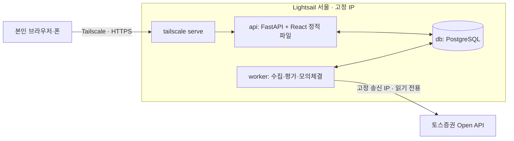

# Quant Lab 설계

> **이 문서가 설계의 단일 출처다.** 일정과 진행 상태는 [roadmap.md](roadmap.md), 토스 API 조사 결과는 [tossApi.md](tossApi.md)에 둔다.
> 결정이 바뀌면 그 변경을 담은 PR에서 이 문서도 함께 고친다. 최종 갱신: 2026-10-01.

## 1. 한 줄 정의

토스증권 공식 Open API의 미국 주식 시세로 규칙 기반 전략을 돌리고, **실제 주문 없이 내부 모의 체결(DRY RUN)**로 신호·주문·포지션·손익과 판단 이유를 추적하는 개인용 도구. 최종 목표는 퀀트 자동매매이며, 실거래는 DRY RUN이 검증된 뒤 별도 단계로 연다.

## 2. 첫 완성 범위 (MWP)

| 포함 | 제외 (MWP 이후) |
| --- | --- |
| 사용자 1명, 미국 상장 종목, USD, 정수 수량, 매수·매도 | 실제 계좌 주문, 공식 모의투자(토스에 없음) |
| 자동 실행 **1종목** (`QQQ`) | 2종목 이상 자동 실행 |
| 규칙 전략 **1개**, 봉 주기 **1개** | 노드형 전략 편집기, AI 전략 |
| 백테스트와 정기 DRY RUN이 같은 전략 함수 사용 | 실시간 WebSocket 시세 |
| 대시보드·로그 화면, 시작·일시정지·중지·수동 1회 실행 | 알림(텔레그램 등) |
| 재시작 복구, 중복 모의 주문 방지, 데이터 이상 시 주문 차단 | 레버리지 ETF 자동 실행 (조회·백테스트만) |

관심 목록 후보: `VOO`, `QQQ`, `QLD`, `TQQQ`, `SOXL`, `NVDA`, `GLD`, `MAGS`, `EWY`, `EWJ`. 토스 지원 여부를 확인한 뒤 확정한다.

**MWP 완료 조건:** 서버에서 정기 DRY RUN이 **2주 동안 사람 개입 없이** 돌고, 그동안 중복 주문 0건, 데이터 이상·API 실패 때 신규 주문 차단이 기록되며, 화면에서 현재 상태와 마지막 판단 이유를 바로 이해할 수 있다.

## 3. 반드시 지킬 원칙

이 프로젝트에서 틀리면 비용이 큰 것들이다. 코드 리뷰 기준으로도 쓴다.

1. **실거래 코드 경로가 없다.** MWP에는 토스 주문 어댑터를 만들지 않는다. 모의 체결은 `adapters/sim`만 담당한다.
2. **완료된 봉만 쓴다.** 진행 중인 봉으로 판단하지 않는다. 토스는 미국 날짜 D의 일봉을 정규장 전부터 데이마켓 체결로 채워 내려주므로, **D일 정규장 마감 + 여유 시간 전의 D일 봉은 버린다.** 백테스트도 같은 규칙을 따르며, 판단 시점 이후의 데이터를 참조하면 테스트가 실패해야 한다.
3. **판단과 체결을 분리한다.** T 봉으로 판단하고 T+1 봉 규칙으로 체결한다. 백테스트와 DRY RUN이 같은 규칙을 쓴다.
4. **판단 하나에 주문은 최대 하나다.** `bot_id + symbol + bar_ts + mode`에 DB 유일 제약을 건다. Worker가 실수로 두 개 떠도 중복 주문이 생기지 않는다.
5. **모르면 멈춘다.** 데이터 누락·지연, API 오류, 장 운영 판정 불일치, DB 오류가 있으면 신규 주문 없이 이유를 기록한다. 재시작 후 봇은 항상 `PAUSED`로 돌아오고 사람이 재개한다.
6. **토스 토큰은 Worker 한 곳에서만 발급한다.** 토큰은 클라이언트당 1개만 유효해서, 두 곳에서 발급하면 서로를 무효화한다. API 서버는 토스를 호출하지 않는다.
7. **돈과 시간은 정확한 타입으로 다룬다.** 가격·금액은 `Decimal`(DB `numeric`)로 저장하고 float를 쓰지 않는다. DB 시각은 UTC로 저장하고, 장 판정은 `America/New_York`, 화면 표시는 KST로 한다.
8. **비밀값과 시세 데이터는 저장소에 넣지 않는다.** 토스 데이터는 제3자 배포가 금지돼 있다. 테스트 fixture는 합성 데이터로 만들고, 실제 응답은 로컬에서만 쓴다.
9. **재현할 수 있어야 한다.** 모든 실행·백테스트는 전략 버전, 파라미터, 데이터 범위, 비용 가정을 함께 저장한다.

## 4. 아키텍처

서울 리전 VM 한 대에서 Docker Compose로 DB·API·Worker를 실행한다. 공개 인바운드 포트는 없고, 화면과 SSH 접근은 모두 Tailscale로만 한다.



### 구성 요소

| 구성 요소 | 책임 | 하지 않는 일 |
| --- | --- | --- |
| **worker** | 토스 토큰 보유, 시세 수집, 장 운영 판정, 정기 평가, 위험 검사, 모의 체결, 백테스트 실행, heartbeat | HTTP 요청 처리 |
| **api** | 화면 제공, 조회 API, 명령 기록(시작·중지·수동 실행·백테스트 요청), 설정 저장 | 토스 호출, 긴 계산 |
| **db** | 모든 상태의 원본. 봉 캐시, 설정 버전, 명령 큐, 실행·판단·주문·체결·포지션·이벤트 | — |
| **frontend** | 상태 확인과 제어. API를 주기적으로 조회 (MWP는 polling) | 비즈니스 로직 |

API와 Worker는 같은 Python 패키지를 다른 진입점으로 실행한다. 둘은 **DB를 통해서만 대화한다.** API가 `commands` 테이블에 명령을 쓰면 Worker가 읽어 처리하고 결과를 기록한다. 큐 시스템(Redis·Celery 등)은 필요해질 때까지 두지 않는다.

### 코드 구조

```text
backend/
  src/quant_lab/
    domain/          # 순수 로직: 봉, 지표, 전략, 위험 규칙, 모의 체결 규칙 (외부 의존 없음)
    application/     # 유스케이스: 평가 1회, 백테스트, 명령 처리
    adapters/toss/   # 토스 HTTP 클라이언트, 토큰 관리, 응답 → 도메인 변환
    adapters/sim/    # 모의 브로커
    persistence/     # SQLAlchemy 모델, 리포지토리
    api/             # FastAPI 진입점
    worker/          # Worker 진입점과 루프
  migrations/        # Alembic
  tests/
frontend/            # React + Vite
deploy/              # 운영용 compose, 서버 준비 스크립트, 백업 스크립트
infra/lightsail/     # Terraform: Lightsail 인스턴스·Static IP·방화벽·자동 스냅샷
compose.yaml         # 로컬 개발용 (PostgreSQL)
```

`domain`은 FastAPI, httpx, SQLAlchemy를 import하지 않는다. 이 규칙은 테스트(import 검사)로 강제한다.

### Worker 평가 1회의 흐름

```text
명령 확인 → 장 운영 판정 → 완료 봉 수집·검증 → 이전 대기 주문 체결(T+1 규칙)
→ 전략 판단 → 위험 검사 → 모의 주문 생성 → 상태·다음 평가 시각 저장 → heartbeat
```

1. **Worker는 하나만 동작한다.** 시작할 때 PostgreSQL advisory lock을 잡고, 못 잡으면 잡을 때까지 기다린다. 토스 토큰도 이 프로세스만 보유한다.
2. 잠금을 얻으면 `RUNNING` 봇을 모두 `PAUSED`로 바꾸고 이벤트를 남긴다. 사람이 확인하고 `START`한다.
3. 15초마다 heartbeat → 미처리 명령 → `RUNNING`이면서 `next_evaluation_at`이 지난 봇 평가 순서로 돈다.
4. 평가 대상은 "정규장 마감 + 2시간이 지난 가장 최근 거래일"이다. 토스 캘린더가 거래일이 아니라고 하거나, 그날 봉이 없거나, 판단 구간 봉에 누락·이상치가 있으면 판단 없이 `SKIPPED`를 남기고 15분 뒤 다시 시도한다.
5. 이전 대기 주문은 판단일 다음 거래일 시가로 체결한다. 체결·판단·주문·잔고 변경은 한 트랜잭션이다.
6. `bot_id + symbol + session_date + mode` 유일 제약과 "봇당 대기 주문 1개" 부분 유일 인덱스가 중복 모의 주문을 막는다. 같은 봉을 다시 평가하면 아무것도 하지 않는다.
7. 허용 IP·인증 오류(토스 403·401 반복)와 예상하지 못한 오류는 봇을 `ERROR`로 바꾼다. 토스 일시 장애(429·5xx·네트워크)는 `SKIPPED` 후 재시도한다.
8. Worker가 멈춰 있던 동안의 거래일은 소급 판단하지 않고 `missed_sessions` 경고만 남긴다.

봇 상태(`STOPPED`, `RUNNING`, `PAUSED`, `ERROR`)는 Worker 프로세스의 생존과 별개다. 명령: `START`(→ RUNNING, 즉시 1회 평가), `PAUSE`(RUNNING → PAUSED), `STOP`, `RUN_ONCE`(상태는 그대로 두고 1회 평가).

판단·체결 함수(`domain/trading.py`)는 백테스트와 Worker가 함께 쓴다. `replay` CLI로 과거 거래일마다 정기 평가를 재생해 백테스트와 체결이 같은지 확인한다.

### 핵심 데이터

| 테이블 | 내용 |
| --- | --- |
| `daily_bars` | `(symbol, session_date)` PK, 미국 거래일 기준. OHLCV(`numeric`, 정밀도 제한 없음, 수정주가), `source`, `fetched_at`. 1분봉은 필요해질 때 별도 테이블 |
| `bots` | 종목, 전략 이름·파라미터, 상태·사유, 초기 현금, 수수료·슬리피지, 위험 한도, `next_evaluation_at` |
| `bot_accounts` | 봇의 모의 현금·보유 수량·평균 단가·실현 손익 (실제 토스 계좌와 무관) |
| `commands` | 화면 명령 큐 (`START`, `PAUSE`, `STOP`, `RUN_ONCE`), 처리 시각·결과 |
| `runs` | 평가 1회: 계기(정기·수동), 대상 거래일, `OK`·`SKIPPED`·`ERROR`, 사유 |
| `decisions` | 판단·사유·지표·차단 사유, **당시 전략·비용·위험 한도 스냅샷**. 유일 키 `bot_id + symbol + session_date + mode` |
| `sim_orders` | 모의 주문(판단당 최대 1개): `PENDING` → `FILLED`·`UNFILLED`, 체결일·수량·가격·수수료·실현 손익 |
| `backtests` | 입력 조건(데이터 범위, 전략·파라미터, 비용, 위험 한도, 코드 버전)과 지표·체결·판단·자산 곡선 |
| `events` | 심각도별 기록 (화면 로그 탭) |
| `worker_heartbeat` | Worker 마지막 생존 시각, 버전 |

## 5. 기술 스택

| 영역 | 선택 | 이유 |
| --- | --- | --- |
| 언어·패키지 | Python 3.14, **uv** | 빠른 설치와 잠금 파일 (`backend/.python-version`) |
| API | FastAPI, Pydantic v2, pydantic-settings | 타입 기반 검증, 설정 분리 |
| DB 접근 | SQLAlchemy 2.0, Alembic, psycopg 3 | 마이그레이션 관리, `numeric` ↔ `Decimal` |
| HTTP | httpx (동기 클라이언트로 시작) | Worker는 단일 루프. 비동기는 필요할 때 |
| 데이터 처리 | pandas | 지표·백테스트 계산 |
| 시장 달력 | `exchange_calendars` (XNYS) + 토스 캘린더 | 토스는 3영업일만 제공 |
| 테스트·품질 | pytest, respx(HTTP 목, Phase 2), ruff, mypy(strict) | Windows에서는 `python -m mypy`로 실행 |
| DB | PostgreSQL 17 (로컬·운영 모두 컨테이너) | 같은 버전으로 개발·운영 |
| 프론트엔드 | React, TypeScript, Vite, oxlint, TanStack Query·Lightweight Charts(Phase 4) | polling·캐시, 금융 차트 |
| 실행 | Docker Compose | 로컬 → Lightsail → OCI/홈서버로 그대로 이동 |
| 접근 | Tailscale (`tailscale serve`로 HTTPS) | 공개 포트 0개, MWP에 로그인 구현 불필요 |
| CI | GitHub Actions (`.github/workflows/ci.yml`): ruff, mypy, pytest(+PostgreSQL 17 서비스), oxlint, tsc·vite build | PR과 `dev`·`main` push |

## 6. 인프라와 운영

### 운영 환경

| 항목 | 선택 |
| --- | --- |
| 서버 | AWS Lightsail **서울(ap-northeast-2), 2GB RAM / 2 vCPU**, Ubuntu 24.04 LTS |
| 비용 | 약 $12/월 (공인 IPv4 포함 번들. 생성 시 서울 리전 가격 확인). Tailscale·GitHub 비공개 저장소는 무료 |
| 고정 IP | Lightsail Static IP를 붙이고 그 IP를 토스 허용 IP에 등록 |
| 방화벽 | 처음엔 Lightsail 콘솔 브라우저 SSH(22번, 콘솔 대역만)만 허용. Tailscale SSH가 동작하면 인바운드 전부 차단 |
| 비밀값 | 서버의 `/etc/quant-lab/env`(DB 비밀번호·`DATABASE_URL`, 부트스트랩이 생성)와 `/etc/quant-lab/toss.env`(토스 키, **worker 컨테이너에만** 주입). 둘 다 권한 600. **토스 키 만료 2027-09-28** (발급 2026-09-28, 1년). 만료 전 WTS에서 재발급하고 `toss.env` 교체 |
| 서버 생성 | Terraform(`infra/lightsail`). 콘솔에서 손으로 만들지 않는다 |
| 배포 (MWP) | 서버에서 `bash deploy/deploy.sh`: `main` pull → 이미지 빌드(프론트 포함 단일 이미지) → `compose up -d`. 저장소는 읽기 전용 deploy key로 받음. Compose 프로젝트 이름은 `quant-lab-prod` |
| 마이그레이션 | `migrate` 일회성 서비스가 성공해야 api·worker가 시작 (`depends_on: service_completed_successfully`) |
| 백업 | `deploy/backup.sh`를 cron이 매일 03:00 UTC(12:00 KST, 평가 시각과 겹치지 않음)에 실행, `pg_dump` 7일 보관 + Lightsail 자동 스냅샷. 파괴적 마이그레이션 전에는 수동 덤프 |
| 모니터링 | 화면의 heartbeat·마지막 실행 표시와 `docker compose logs`. 외부 알림은 MWP 이후 |

배포 자동화(GitHub Actions에서 Tailscale로 SSH 배포)는 수동 배포가 번거로워지면 도입한다. 서버 리소스는 처음부터 Terraform으로 관리한다.

**서버 준비 절차** (Terraform과 스크립트로 재현한다):

| 단계 | 누가 | 작업 |
| --- | --- | --- |
| 1. AWS 자격 증명 | 사용자 | IAM 사용자(Lightsail 권한만)의 액세스 키를 만들고 개발 PC에서 `aws configure`로 입력 (키는 Claude·저장소에 넘기지 않음) |
| 2. 서버 생성 | 사용자 실행 | `cd infra/lightsail && terraform init && terraform plan && terraform apply` → 인스턴스(서울 2GB, Ubuntu 24.04), Static IP, 자동 스냅샷, 방화벽(브라우저 SSH만). 출력된 `static_ip`를 메모 |
| 3. 토스 허용 IP | 사용자 | WTS > 설정 > Open API > 허용 IP에 `static_ip` 추가 |
| 4. Tailscale 먼저 | 사용자 | Lightsail 콘솔의 브라우저 SSH에서 `curl -fsSL https://tailscale.com/install.sh \| sh && sudo tailscale up --ssh --hostname quant-lab` → 링크로 로그인. 개발 PC에도 Tailscale 설치·로그인 |
| 5. 원격 작업 | Claude (개발 PC → `tailscale ssh ubuntu@quant-lab`) | deploy key 생성 → `gh repo deploy-key add`(읽기 전용) → `git clone` → `sudo bash deploy/bootstrap.sh` → `sudo tailscale serve --bg 8000` |
| 6. 토스 키 | 사용자 | `/etc/quant-lab/toss.env`에 키 입력 (`tailscale ssh` 또는 브라우저 SSH, 키는 대화에 붙이지 않음) |
| 7. Tailscale 접근 제한 | 사용자 | 필요하면 Tailscale ACL에서 서버 접근을 본인 기기로만 제한 (개인 tailnet이면 기본값으로 충분) |
| 8. 배포·봇 시작 | 서버 | 로컬에서 토스를 호출하는 프로세스를 모두 멈춘 뒤 `bash deploy/deploy.sh` → `docker compose -f deploy/compose.prod.yaml exec api python -m quant_lab.cli bot create qqq-sma QQQ --params fast=50,slow=200` → 화면에서 시작 |

브라우저 SSH용 22번 포트(Lightsail 콘솔 대역만)는 Tailscale SSH가 동작하면 `aws_lightsail_instance_public_ports`에서 지워 인바운드를 모두 닫는다. Terraform 상태 파일(`*.tfstate`)은 개발 PC에만 두고 Git에 넣지 않는다.

### 로컬 개발

개발 PC에서는 `compose.yaml`로 PostgreSQL만 띄우고 API·Worker·프론트엔드는 각각 직접 실행한다. **토스 client는 계정당 1개만 발급된다 (2026-10-01 확인).** 같은 client로 토큰을 발급하면 다른 쪽 토큰이 무효화되므로, 서버 Worker가 동작한 뒤로는 로컬에서 토스를 호출하지 않는다. 로컬 개발은 저장된 봉(서버 DB 덤프)이나 합성 데이터로 한다. Worker는 기본값 `WORKER_MARKET_SOURCE=stored`로 토스를 호출하지 않고, 운영 서버만 `toss`로 둔다. 로컬 호출이 꼭 필요하면 서버 Worker를 멈추고 호출한 뒤 다시 시작한다. 허용 IP는 여러 개 등록할 수 있어 개발 PC IP와 서버 IP를 함께 둔다.

```bash
docker compose up -d db
uv run alembic upgrade head
uv run uvicorn quant_lab.api.main:app --reload
uv run python -m quant_lab.worker
npm --prefix frontend run dev
```

(구현 후 사용할 명령이다. 현재 코드는 없다.)

### 이전 계획 (Lightsail → OCI / 홈서버)

- 서버에 의존하는 것은 Compose 파일, env 파일, DB 덤프뿐이므로 새 서버에서 `pg_restore` 후 같은 Compose를 실행하면 된다.
- **송신 IP가 바뀐다.** 허용 IP는 여러 개 등록할 수 있으므로 새 IP를 먼저 추가하고, 구 서버 Worker를 멈춘 뒤 새 Worker를 시작하고, 마지막에 구 IP를 지운다. Worker를 두 곳에서 동시에 돌리지 않는다 (토큰 경합).
- **홈서버는 가정용 회선 IP가 바뀔 수 있다.** 이때는 토스 호출만 고정 IP를 가진 소형 VPS를 거쳐 나가게 한다 (WireGuard 또는 Tailscale exit node). Lightsail을 가장 작은 플랜으로 줄여 송신 게이트웨이로 남기는 것이 가장 간단한 후보다.

## 7. 전략·백테스트 규칙

| 항목 | 값 |
| --- | --- |
| 봉 주기 | **일봉 (결정).** 미국장은 한국 밤 시간이라 사람이 지켜보기 어렵고, 하루 한 번 평가라 실패 지점이 적다. 토스 일봉은 상장일부터 제공된다 |
| 평가 시각 | 정규장 마감(서머타임 KST 05:00, 표준시 06:00, 조기 폐장 반영) **+ 2시간** 이후. 저장 뒤 값이 바뀌면 동기화가 `resync`로 감지한다 |
| 체결 규칙 | T일 종가로 판단 → **T+1일 시가로 전량 체결.** DRY RUN도 T+1 시가가 확정된 뒤 같은 가격으로 체결을 기록 |
| 비용 | 수수료 0.1%(가정, 계좌 API `/commissions`로 확인 전) + 슬리피지 5bp, 매수는 불리하게 올리고 매도는 내림. 실행 기록에 함께 저장 |
| 전략 | 잘 알려진 단일 종목 전략 4개: `sma_cross`(골든크로스 50/200, 기본값), `trend_filter`(Faber 200일선), `rsi2`(Connors RSI(2) 눌림목), `donchian`(터틀 채널 돌파). 수량은 체결 시점 현금으로 정수 계산, 위험 한도(종목 최대 보유 금액, 1회 최대 주문 금액) 적용 |
| 백테스트 데이터 | 토스 일봉 `adjusted=true`, 상장일부터 (QQQ 1999-03-10~, 닷컴·2008·2020·2022 하락장 포함) |
| 비교 기준 | 같은 기간 매수 후 보유 |
| 위험 한도 | 종목별 최대 보유 금액·1회 주문 금액 구현. 일봉 1종목은 거래일당 판단 1회라 하루 주문 수는 구조적으로 1건 이하. 하루 손실 한도·주문 간 최소 간격은 다종목·장중 전략 도입 때 추가 |

## 8. 화면

첫 화면은 운영 대시보드다. `정상 실행 여부 → 마지막 판단 이유 → 포지션과 최근 기록` 순서로 읽히게 한다. 데스크톱을 기준으로 하고, 모바일에서는 상태 확인과 중지를 우선한다. 모든 화면에 `DRY RUN` 표시를 고정하고, 모의 잔고를 실제 계좌처럼 보이게 하지 않는다.

| 화면 | MWP에서 할 일 | 단계 |
| --- | --- | --- |
| 대시보드 | 봇 상태, Worker heartbeat, 마지막/다음 실행, 데이터 갱신 시각, 모의 잔고·손익·포지션, 마지막 판단 이유, 제어 버튼 | Phase 4 완료 |
| 로그 | 시각·심각도별 판단·체결·오류, 실행 ID | Phase 4 완료 |
| 종목·차트 | 캔들·거래량, SMA 선, 신호·모의 체결 마커, 데이터 출처·마지막 봉 | Phase 4 완료 |
| 백테스트 | 종목·전략·파라미터·첫 판단일로 실행, 저장 목록, 전략 vs 매수 후 보유 지표, 자산 곡선(로그 스케일), 체결 목록. 일봉 1종목은 수 초라 API 요청 안에서 실행 | Phase 5 완료 |
| 전략·설정 | 파라미터, 위험 한도, 초안과 실행 중 버전 구분 | Phase 5 |

`docs/references/`의 UI 참고 이미지는 Git에 넣지 않으며(`.gitignore`), 배치만 참고하고 원본 화면은 복제하지 않는다.

## 9. 결정 현황

| 항목 | 상태 | 메모 |
| --- | --- | --- |
| 첫 종목 | **결정: `QQQ`** (2026-10-01) | 이력이 가장 길고(1999~) 하락장 표본이 많다. VOO는 두 번째 후보 |
| 첫 전략과 파라미터 | **결정: `sma_cross` 50/200** (2026-10-01, 사용자 확인) | 백테스트 비교는 [roadmap.md](roadmap.md) Phase 2 결과 참고 |
| 봉 주기 | **결정: 일봉** (2026-10-01) | 정규장 마감 + 2시간 뒤 평가 |
| 초기 모의 현금 | **결정: $10,000** | |
| 수수료·슬리피지 | **결정: 0.1% · 5bp** | 수수료는 실제 요율 확인 시 갱신 |
| 백테스트 엔진 | **제안: 자체 엔진 유지** (2026-10-01, 사용자 확인 대기) | QuantConnect LEAN(Docker)은 검토 후 보류. 판단·체결 함수를 백테스트와 DRY RUN이 공유하는 구조(replay 일치 검증)를 지키기 위해서다. 장중·다종목·복잡한 주문으로 넓힐 때 연구용 교차 검증 도구로 다시 검토 |

## 10. 작업 방식

- **브랜치:** `dev`에서 `feat/`, `fix/`, `docs/`, `chore/` 접두어 작업 브랜치를 만들고 PR로 `dev`에 합친다 (squash). 검증된 묶음은 `dev → main` PR로 올린다 (merge commit). `main`은 항상 배포 가능한 상태다.
- **PR:** 한국어로 쓰고 변경 내용, 검증 방법과 결과, 제한 사항을 적는다. CI가 있으면 통과해야 한다.
- **Merge 권한 (2026-10-01):** Claude가 작업 브랜치 → `dev`, `dev → main` 모두 merge할 수 있다. 단 **큰 문제가 있으면 merge하지 않고 사용자에게 묻는다.** 큰 문제의 예: CI 실패, 설계 원칙(3절) 위반이나 변경, 실거래 경로 추가, 비밀값·시세 데이터 노출 위험, 비용이 드는 리소스 생성, 되돌리기 어려운 DB 변경.
- **문서:** 매 작업 전에 이 문서와 [roadmap.md](roadmap.md)의 현재 단계를 확인한다. 설계가 바뀌면 같은 PR에서 문서를 고친다. 단계가 끝나면 roadmap의 상태를 갱신한다.
- **커밋에 넣지 않는 것:** API 키, 토큰, 계좌 정보, 실제 토스 응답 데이터, `docs/references/` 이미지. 가짜 키도 넣지 않고 `.env.example`에는 변수 이름만 둔다.
- **공급자 기능:** 공식 문서와 실제 호출로 확인하기 전에는 사실로 적지 않는다.

## 참고 자료

- [토스증권 Open API](https://developers.tossinvest.com/) — 조사 요약은 [tossApi.md](tossApi.md)
- [한국투자증권 Open API 예제](https://github.com/koreainvestment/open-trading-api) — 미국 주식 거래 흐름 참고용. 토스 형식에 그대로 대입하지 않는다
- [tossinvest-cli](https://github.com/JungHoonGhae/tossinvest-cli) — API 탐색 참고. 실행 의존성으로 쓰지 않는다
- [Lightweight Charts](https://tradingview.github.io/lightweight-charts/), [exchange_calendars](https://github.com/gerrymanoim/exchange_calendars), [Tailscale serve](https://tailscale.com/kb/1312/serve)
